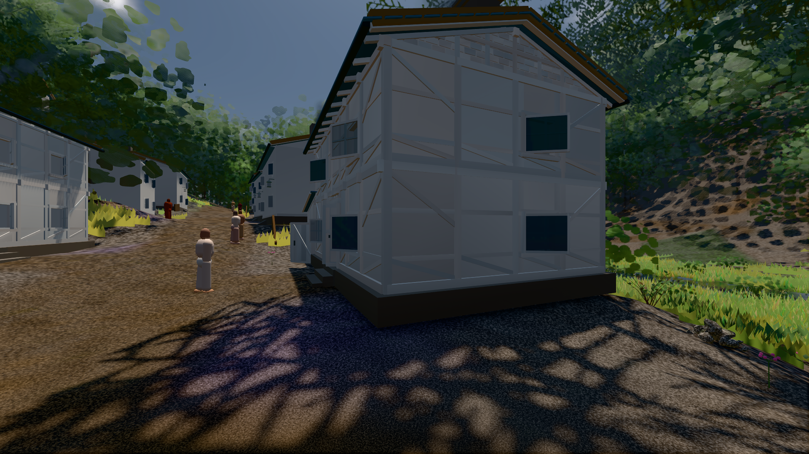

# GPU-PROBE 21e89623 — GRÜN

Zweig `w27-ort-pose` · Kopf 21e89623a014451b21eb46f7d6d65e77988094dc · Läufer omen-gtx1060 · 10.11. 09:23 · Wanduhr ab Push 331 s · Lauf https://github.com/MiguellD/AnazhRealm/actions/runs/42781512905

Ruf: `gate:naesse:echt bild:dorf@0.5 gate:welt-boot`

## Läufer omen-gtx1060 — GRÜN

GPU NVIDIA GeForce GTX 1060 · node_modules bleiben (package-lock a8738d68)
Schloss /c/Users/micha/AppData/Local/Temp/claude/gpu-schloss hält „ci-runner 42781512905/1 probe“
- Hook 2026-11-10 09:18:05 start ci-runner 42781512905/1 probe: wartet auf Schloss von 'omen-punkte-gtx-sitzung'
- Hook 2026-11-10 09:18:20 start ci-runner 42781512905/1 probe: Schloss genommen (refs/heads/w27-ort-pose 21e89623a014451b21eb46f7d6d65e77988094dc ws=C:\actions-runner\_work\AnazhRealm\AnazhRealm)

### gate:naesse:echt — GRÜN · 127 s · Läufer omen-gtx1060

Adapter: ungenannt (die Probe nannte keinen Browser-Adapter)

```text
NÄSSE GRUEN
```

### bild:dorf@0.5 — GRÜN · 93 s · Läufer omen-gtx1060

Adapter: [linse-gpu] nvidia/pascal

```text
Kamera des Spiels → Blick (5.2 m): -704.22 39.69 -880.02 -703.03 39.69 -874.96
 "abnahme": "ABNAHME GRÜN · beweis · Sicht 0.0 % · Ziel Blickziel im Bild frei 5.2 m · Luma 58 σ 32.6 schwarz 0.7 % weiß 0.0 % · Stand 18.546.244 · Bühne summer sunny 0.50 · Gerät WebGPU nvidia pascal",
```



### gate:welt-boot — GRÜN · 50 s · Läufer omen-gtx1060

Adapter: ungenannt (die Probe nannte keinen Browser-Adapter)

```text
  ✅ Schleife: JS-SCHLEIFE — der Haupt-Thread rechnet in __stallSchleife schleife.html:1 · Stapel __stallSchleife schleife.html:1 · Pausen der Seite 0 (Soll 0)
  ✅ Versprechen: AWAIT — der Haupt-Thread lebt (Puls vor 1.0 s), ein Versprechen der Seite kehrt nie zurück; zuletzt kein Stempel
  ✅ Bau LANGSAM (3,2 s, eine Karte offen): steht nach 158 Takten, 3201 ms
  ✅ Bau TOT (nichts offen): DER BAU STEHT NICHT: tot#2 nach 5 Takten — die Welt hat nichts mehr offen · dem Weltbild fehlt: das Licht des Orts wird gemessen
  ✅ Bau HÄNGT: DIE WELT HÄNGT: haenger nach 3601 Takten — offen {"foundry":0,"chunks":0,"wald":0,"karten":1} ohne Bau-Ereignis · 
  ✅ Regler atmet (echter Renderer): steht nach 30 Takten, danach frei
  ✅ Weiche: welt-boot.cjs startet „echt" und zeichnet nie (keine seiner 1 Seiten arbeitet auf der GPU): das Rezept ist „null" · nach einem Draw trägt
  ✅ Start auf belegtem Port: save-server.js endete vor seiner Bereitschaft (Code 1): Error: listen EADDRINUSE: address already in use 127.0.0.1:64921
 (139 ms)
  ✅ eigene Ports 64921, 64922
GRÜN — die Akte nennt Schleife und Versprechen beim Namen, ein kurzer Block bleibt still; das Warten auf den Bau und der Start eines Servers urteilen am Ereignis
```
