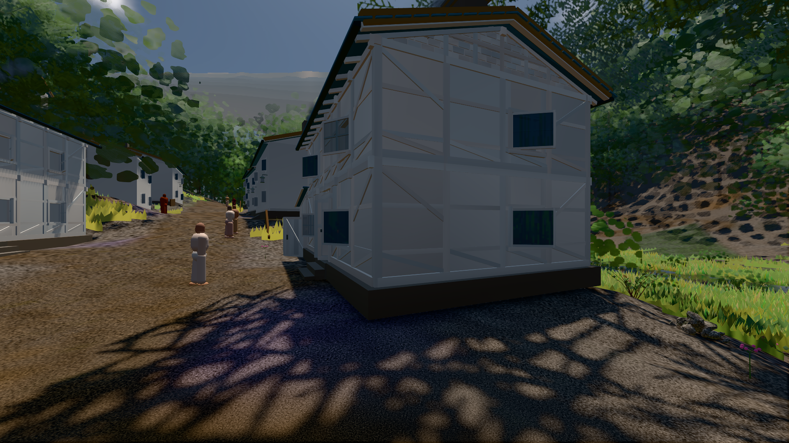
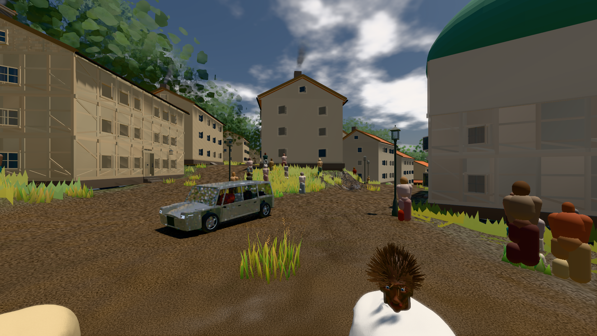

# GPU-PROBE 9374df33 — GRÜN

Zweig `w27-ort-pose` · Kopf 9374df33942b3170d6adf5378460ca5b2cebb8cc · Läufer gtx1050-desktop · 10.11. 03:27 · Wanduhr ab Push 839 s · Lauf https://github.com/MiguellD/AnazhRealm/actions/runs/42741304416

Ruf: `bild:dorf@0.5 bild:stadt@0.5 gate:welt-boot`

## Läufer gtx1050-desktop — GRÜN

GPU NVIDIA GeForce GTX 1050 · node_modules bleiben (package-lock 818c194e)
Schloss /c/Users/User/AppData/Local/Temp/claude/gpu-schloss hält „ci-runner 42741304416/1 probe“
- Hook 2026-11-10 03:15:58 start ci-runner 42741304416/1 probe: wartet auf Schloss von 'hand w27-ort-pose-voll messung pose8 (Claude)'
- Hook 2026-11-10 03:16:13 start ci-runner 42741304416/1 probe: Schloss genommen (refs/heads/w27-ort-pose 9374df33942b3170d6adf5378460ca5b2cebb8cc ws=C:\actions-runner\_work\AnazhRealm\AnazhRealm)

### bild:dorf@0.5 — GRÜN · 204 s · Läufer gtx1050-desktop

Adapter: [linse-gpu] nvidia/pascal

```text
Kamera des Spiels → Blick (5.2 m): -704.22 39.69 -880.02 -703.03 39.69 -874.96
 "abnahme": "ABNAHME GRÜN · beweis · Sicht 0.0 % · Ziel Blickziel im Bild frei 5.2 m · Luma 57.9 σ 32.4 schwarz 0.7 % weiß 0.0 % · Stand 18.546.241 · Bühne summer sunny 0.50 · Gerät WebGPU nvidia pascal",
```



### bild:stadt@0.5 — GRÜN · 317 s · Läufer gtx1050-desktop

Adapter: [linse-gpu] nvidia/pascal

```text
Kamera des Spiels → Blick (23.9 m): 662.72 63.28 429.48 686.59 63.28 428.39
 "abnahme": "ABNAHME GRÜN · beweis · Sicht 0.0 % · Ziel Blickziel im Bild frei 23.89 m · Luma 86.6 σ 42.5 schwarz 0.3 % weiß 0.0 % · Stand 18.546.241 · Bühne summer sunny 0.50 · Gerät WebGPU nvidia pascal",
```



### gate:welt-boot — GRÜN · 60 s · Läufer gtx1050-desktop

Adapter: ungenannt (die Probe nannte keinen Browser-Adapter)

```text
  ✅ Schleife: JS-SCHLEIFE — der Haupt-Thread rechnet in __stallSchleife schleife.html:1 · Stapel __stallSchleife schleife.html:1 · Pausen der Seite 0 (Soll 0)
  ✅ Versprechen: AWAIT — der Haupt-Thread lebt (Puls vor 0.0 s), ein Versprechen der Seite kehrt nie zurück; zuletzt kein Stempel
  ✅ Bau LANGSAM (3,2 s, eine Karte offen): steht nach 159 Takten, 3209 ms
  ✅ Bau TOT (nichts offen): DER BAU STEHT NICHT: tot#2 nach 5 Takten — die Welt hat nichts mehr offen · dem Weltbild fehlt: das Licht des Orts wird gemessen
  ✅ Bau HÄNGT: DIE WELT HÄNGT: haenger nach 3601 Takten — offen {"foundry":0,"chunks":0,"wald":0,"karten":1} ohne Bau-Ereignis · 
  ✅ Regler atmet (echter Renderer): steht nach 30 Takten, danach frei
  ✅ Weiche: welt-boot.cjs startet „echt" und zeichnet nie (keine seiner 1 Seiten arbeitet auf der GPU): das Rezept ist „null" · nach einem Draw trägt
  ✅ Start auf belegtem Port: save-server.js endete vor seiner Bereitschaft (Code 1): Error: listen EADDRINUSE: address already in use 127.0.0.1:56305 (249 ms)
  ✅ eigene Ports 56305, 56306
GRÜN — die Akte nennt Schleife und Versprechen beim Namen, ein kurzer Block bleibt still; das Warten auf den Bau und der Start eines Servers urteilen am Ereignis
```
