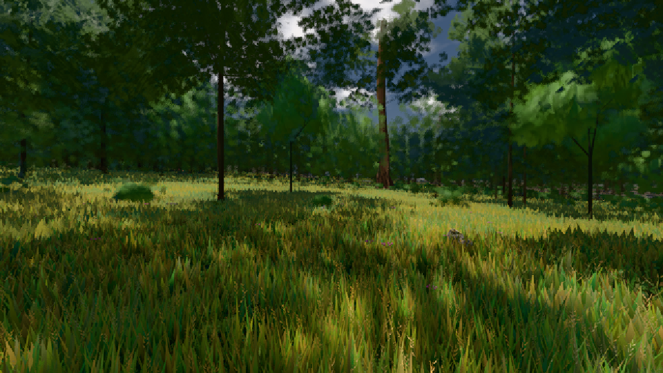

# GPU-PROBE 972a2bcf — ROT

Zweig `w27-studio-mesh` · Kopf 972a2bcff69d5ecfa9bb242aeb573005cd1bbfdd · Läufer radeon-890m · 10.11. 08:54 · Wanduhr ab Push 367 s · Lauf https://github.com/MiguellD/AnazhRealm/actions/runs/42777835325

Ruf: `gate:garage-labor gate:studio-uebergabe bild:wiese@0.5`

## Läufer radeon-890m — ROT

GPU AMD Radeon(TM) 890M Graphics · npm ci 58 s (package-lock a8738d68)
Schloss /c/Users/micha/AppData/Local/Temp/claude/gpu-schloss hält „ci-runner 42777835325/1 probe“
- Hook 2026-11-10 08:48:39 start ci-runner 42777835325/1 probe: Schloss genommen (refs/heads/w27-studio-mesh 972a2bcff69d5ecfa9bb242aeb573005cd1bbfdd ws=C:\actions-runner\_work\AnazhRealm\AnazhRealm)

### gate:garage-labor — ROT · 105 s · Läufer radeon-890m

Adapter: [linse-gpu] google/swiftshader · kein Hardware-Adapter: [linse-gpu] google/swiftshader

```text
  ✅ G11 die Prüfstrecke (die fliegende Runde) — {"t0":62.449999999997736,"kurven":[{"R":70,"bank":10,"aQ":1.11,"vScheitel":28.1},{"R":30,"bank":0,"aQ":0.89,"vScheitel":15.6},{"R":70,"bank":0,"aQ":0.91,"vScheitel":23.7},{"R":45,"bank":8,"aQ":1.05,"vScheitel":21.8}],"fluege":[{"weite":0.8,"stoss":-0.16},{"weite":18.7,"stoss":-0.16},{"weite":0.4,"stoss":-0.16}],"hubMin":-0.08,"anschlag":2,"nick":0.03303964232217319,"wank":0.056111256802818636,"boden":3524,"schritte":3576,"ablage":2.31,"zeit":59.6,"kontakt":0.985} 
  ✅ G2 der Fahr-HUD ist ein Flex-Band — flex · 46.25 px
  ✅ G3 der Tacho zeigt km/h — 12 bei 3.411954843437435 m/s
  ✅ G4 P == DEFAULT_P + Preset + Kultur, Regler == Modell
  ✅ G5 die Kultur lässt sich abwählen
  ✅ G6 keine Lehren in der Probefahrt, zurück in der Werkstatt — 0 · 5
  ✅ G8 die Ansicht zeigt den Wagen je Modus (≥ 1,5 % des Bildes) in ≤ 120 Befehlen — {"iso":[38,0.041157407407407406],"seite":[28,0.044189814814814814],"explosion":[58,0.05740740740740741],"animation":[57,0.041087962962962965]}
  ✅ G10 der Schirm gehört dem Wagen: ≤ 15 % Leiste, Lehren auf Knopf, Leicht nimmt ≥ 40 % der Bildzeit — {"anteil":11.2,"schilder":0,"lehrenSchilder":5,"lehrenTafel":true} {"voll":249,"leicht":69,"pr":0.5,"schatten":false,"leinwand":true}
  ✅ G7 die Probefahrt atmet das Tempo wie der Ritt — {"n":71,"zeigt":0,"quelle":true,"orbit":25,"rueck":1.08} 
✅ GRÜN — die Garage: Maus, HUD, Tacho, Preset, Kultur, Lehren, Tempo, die Ansicht in jedem Modus und die Zeit-Achse.
```

### gate:studio-uebergabe — GRÜN · 49 s · Läufer radeon-890m

Adapter: ungenannt (die Probe nannte keinen Browser-Adapter)

```text
  ✅ SELBST-TEST: der Empfänger leitet die Blume in einen eigenen Speicher → die Blume ist ROT
  ✅ SELBST-TEST: der Wirt prägt die Rand-Same → der Baum ist ROT
  ✅ SELBST-TEST: ein Studio, das selbst postet, ist ROT bei Datei:Zeile — worlds/probe/probe.js:1
  ✅ ohne Prägung liefern die Leser die Buch-Referenz (vor und nach der Linse)
  ✅ die Welt nimmt das Werk des Körper-Studios an
  ✅ der LEBENDE Avatar gießt neu und trägt die Gestalt (rot nur mit Prägung · Haut ebenholz · Größen-Faktor ≠ 1) — {"refVorher":true,"koerperAn":true,"rot":true,"haut":true,"groesse":true,"kreaturAn":true,"spawnFaktor":1.4644050835581337,"snap":true,"restore":true,"refNachher":true}
  ✅ ein Kreatur-Spawn trägt das Werk der Gattung (size 3.5 ⇒ Welt-Gestalt ×3.5/2.4, wurf-normalisiert) — Faktor 1.4644050835581337
  ✅ der Snapshot trägt den Prägungs-Speicher
  ✅ der Restore läuft durch DENSELBEN Prüfer: height 99 → max, erfundene Farbe und fremdes Rezept fallen
✅ GRÜN — DER EINE ÜBERGABE-KANAL TRÄGT: jede Art reist von der Hülle in den EINEN Prägungs-Speicher, der Leser baut byte-gleich.
```

### bild:wiese@0.5 — GRÜN · 53 s · Läufer radeon-890m

Adapter: [linse-gpu] amd/rdna-3

```text
Kamera des Spiels → Blick (10.0 m): -280.40 29.71 -1045.60 -289.61 29.71 -1049.50
 "abnahme": "ABNAHME GRÜN · beweis · Sicht 0.0 % · Ziel Blickziel im Bild frei 10 m · Luma 57 σ 32.9 schwarz 0.0 % weiß 0.0 % · Stand 18.546.244 · Bühne summer sunny 0.50 · Gerät WebGPU amd rdna-3",
```


