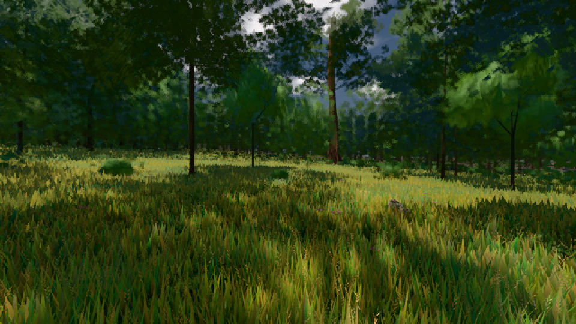

# GPU-PROBE d77c2744 — GRÜN

Zweig `w27-studio-mesh` · Kopf d77c2744fe410b5d7c0627d941c5161a93cc9106 · Läufer gtx1050-desktop · 10.11. 08:59 · Wanduhr ab Push 260 s · Lauf https://github.com/MiguellD/AnazhRealm/actions/runs/42778693889

Ruf: `gate:studio-uebergabe gate:wasser-leben:bild bild:wiese@0.5`

## Läufer gtx1050-desktop — GRÜN

GPU NVIDIA GeForce GTX 1050 · node_modules bleiben (package-lock a8738d68)
Schloss /c/Users/User/AppData/Local/Temp/claude/gpu-schloss hält „ci-runner 42778693889/1 probe“
- Hook 2026-11-10 08:55:41 start ci-runner 42778693889/1 probe: Schloss genommen (refs/heads/w27-studio-mesh d77c2744fe410b5d7c0627d941c5161a93cc9106 ws=C:\actions-runner\_work\AnazhRealm\AnazhRealm)

### gate:studio-uebergabe — GRÜN · 85 s · Läufer gtx1050-desktop

Adapter: ungenannt (die Probe nannte keinen Browser-Adapter)

```text
  ✅ SELBST-TEST: der Empfänger leitet die Blume in einen eigenen Speicher → die Blume ist ROT
  ✅ SELBST-TEST: der Wirt prägt die Rand-Same → der Baum ist ROT
  ✅ SELBST-TEST: ein Studio, das selbst postet, ist ROT bei Datei:Zeile — worlds/probe/probe.js:1
  ✅ ohne Prägung liefern die Leser die Buch-Referenz (vor und nach der Linse)
  ✅ die Welt nimmt das Werk des Körper-Studios an
  ✅ der LEBENDE Avatar gießt neu und trägt die Gestalt (rot nur mit Prägung · Haut ebenholz · Größen-Faktor ≠ 1) — {"refVorher":true,"koerperAn":true,"rot":true,"haut":true,"groesse":true,"kreaturAn":true,"spawnFaktor":1.4644050835581337,"snap":true,"restore":true,"refNachher":true}
  ✅ ein Kreatur-Spawn trägt das Werk der Gattung (size 3.5 ⇒ Welt-Gestalt ×3.5/2.4, wurf-normalisiert) — Faktor 1.4644050835581337
  ✅ der Snapshot trägt den Prägungs-Speicher
  ✅ der Restore läuft durch DENSELBEN Prüfer: height 99 → max, erfundene Farbe und fremdes Rezept fallen
✅ GRÜN — DER EINE ÜBERGABE-KANAL TRÄGT: jede Art reist von der Hülle in den EINEN Prägungs-Speicher, der Leser baut byte-gleich.
```

### gate:wasser-leben:bild — GRÜN · 37 s · Läufer gtx1050-desktop

Adapter: [linse-gpu] nvidia/pascal

```text
WASSER-LEBEN GRÜN
```

### bild:wiese@0.5 — GRÜN · 93 s · Läufer gtx1050-desktop

Adapter: [linse-gpu] nvidia/pascal

```text
Kamera des Spiels → Blick (10.0 m): -280.40 29.71 -1045.60 -289.61 29.71 -1049.50
 "abnahme": "ABNAHME GRÜN · beweis · Sicht 0.0 % · Ziel Blickziel im Bild frei 10 m · Luma 56.5 σ 32.9 schwarz 0.0 % weiß 0.0 % · Stand 18.546.244 · Bühne summer sunny 0.50 · Gerät WebGPU nvidia pascal",
```


