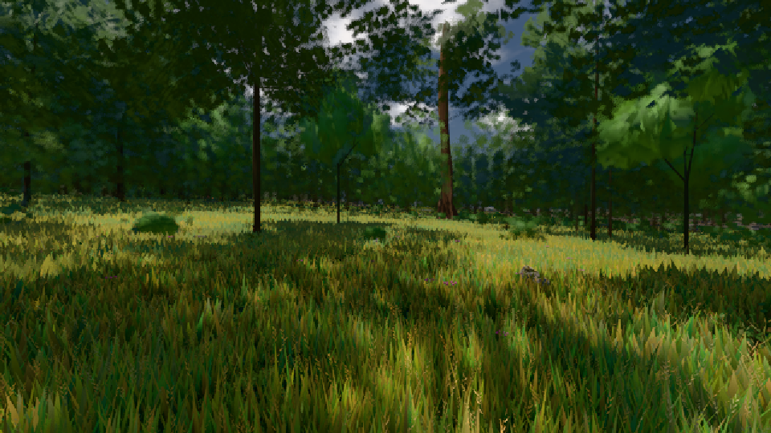

# GPU-PROBE da9919e3 — ROT

Zweig `w27-studio-mesh` · Kopf da9919e3537290b023c9b2ba2bd9c9095da96793 · Läufer radeon-890m · 10.11. 01:59 · Wanduhr ab Push 480 s · Lauf https://github.com/MiguellD/AnazhRealm/actions/runs/42731532288

Ruf: `gate:studio-huelle gate:wasser-leben:bild bild:wiese@0.5`

## Läufer radeon-890m — ROT

GPU AMD Radeon(TM) 890M Graphics · node_modules bleiben (package-lock a7ce949e)
Schloss /c/Users/micha/AppData/Local/Temp/claude/gpu-schloss hält „ci-runner 42731532288/1 probe“
- Hook 2026-11-10 01:52:54 start ci-runner 42731532288/1 probe: Schloss genommen (refs/heads/w27-studio-mesh da9919e3537290b023c9b2ba2bd9c9095da96793 ws=C:\actions-runner\_work\AnazhRealm\AnazhRealm)

### gate:studio-huelle — ROT · 152 s · Läufer radeon-890m

Adapter: [linse-gpu] amd/rdna-3

```text
❌ H8 koerperstudio: L1 GPU-ms 0.0232 ↔ 0.4417
❌ H8 koerperstudio: L2 GPU-ms 0.0122 ↔ 0.2167
❌ H8 koerperstudio: L3 GPU-ms 0.011 ↔ 0.1
❌ H7 koerperstudio: p95 Neubau 1521 ms > 1000 ms
❌ H8 tetrapoda: L0 GPU-ms 0.152 ↔ 0.4833
❌ H8 tetrapoda: L1 GPU-ms 0.0182 ↔ 0.1333
❌ H8 terrain: L0 GPU-ms 0.019 ↔ 0.125
❌ H8 terrain: L1 GPU-ms 0.013 ↔ 0.1583
❌ H8 terrain: L2 GPU-ms 0.011 ↔ 0.0833
❌ DER GANG: 4 von 11 Seiten ohne fremde Engine · 8 Sitzungen
```

### gate:wasser-leben:bild — GRÜN · 32 s · Läufer radeon-890m

Adapter: [linse-gpu] amd/rdna-3

```text
WASSER-LEBEN GRÜN
```

### bild:wiese@0.5 — GRÜN · 52 s · Läufer radeon-890m

Adapter: [linse-gpu] amd/rdna-3

```text
Kamera des Spiels → Blick (10.0 m): -280.40 29.71 -1045.60 -289.61 29.71 -1049.50
 "abnahme": "ABNAHME GRÜN · beweis · Sicht 0.0 % · Ziel Blickziel im Bild frei 10 m · Luma 57.2 σ 33.2 schwarz 0.0 % weiß 0.0 % · Stand 18.546.240 · Bühne summer sunny 0.50 · Gerät WebGPU amd rdna-3",
```


