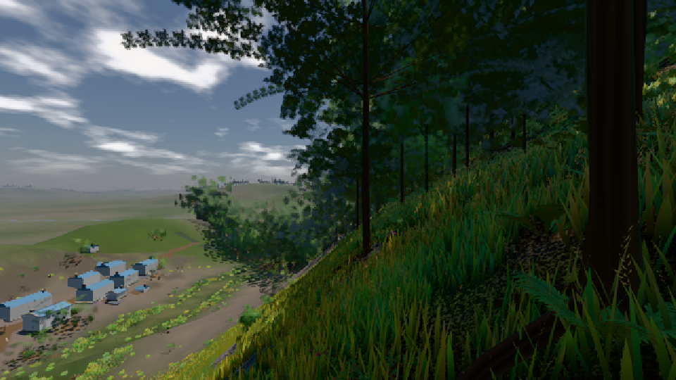
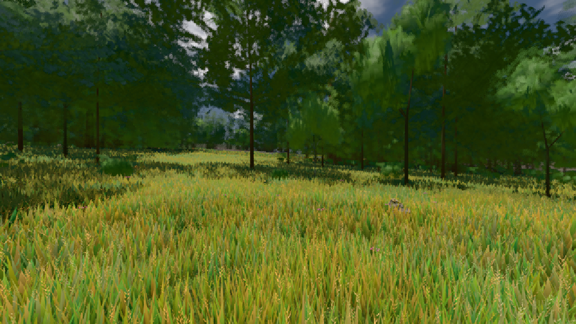

# GPU-PROBE e8aa2307 — GRÜN

Zweig `w27-takt-gc-2` · Kopf e8aa2307e342d22288c89bd09df2aefedfa66657 · Läufer omen-gtx1060 · 10.11. 20:50 · Wanduhr ab Push 162 s · Lauf https://github.com/MiguellD/AnazhRealm/actions/runs/42888821022

Ruf: `bild:dorf@0.5 bild:wiese@0.5`

## Läufer omen-gtx1060 — GRÜN

GPU NVIDIA GeForce GTX 1060 · node_modules bleiben (package-lock ac6c0885)
Schloss /c/Users/micha/AppData/Local/Temp/claude/gpu-schloss hält „ci-runner 42888821022/1 probe“
- Hook 2026-11-10 20:47:58 start ci-runner 42888821022/1 probe: wartet auf Schloss von 'omen-punkte-gtx-sitzung'
- Hook 2026-11-10 20:48:13 start ci-runner 42888821022/1 probe: Schloss genommen (refs/heads/w27-takt-gc-2 e8aa2307e342d22288c89bd09df2aefedfa66657 ws=C:\actions-runner\_work\AnazhRealm\AnazhRealm)

### bild:dorf@0.5 — GRÜN · 59 s · Läufer omen-gtx1060

Adapter: [linse-gpu] nvidia/pascal

```text
Kamera des Spiels → Blick (10.0 m): -841.00 86.89 -861.00 -834.08 86.89 -853.78
 "abnahme": "ABNAHME GRÜN · beweis · Sicht 0.0 % · Ziel Blickziel im Bild frei 10 m · Luma 64.7 σ 53.1 schwarz 1.1 % weiß 0.0 % · Stand 18.546.246 · Bühne summer sunny 0.50 · Gerät WebGPU nvidia pascal",
```



### bild:wiese@0.5 — GRÜN · 45 s · Läufer omen-gtx1060

Adapter: [linse-gpu] nvidia/pascal

```text
Kamera des Spiels → Blick (10.0 m): -280.40 29.71 -1045.60 -289.61 29.71 -1049.50
 "abnahme": "ABNAHME GRÜN · beweis · Sicht 0.0 % · Ziel Blickziel im Bild frei 10 m · Luma 83.7 σ 40.3 schwarz 0.0 % weiß 0.0 % · Stand 18.546.246 · Bühne summer sunny 0.50 · Gerät WebGPU nvidia pascal",
```


