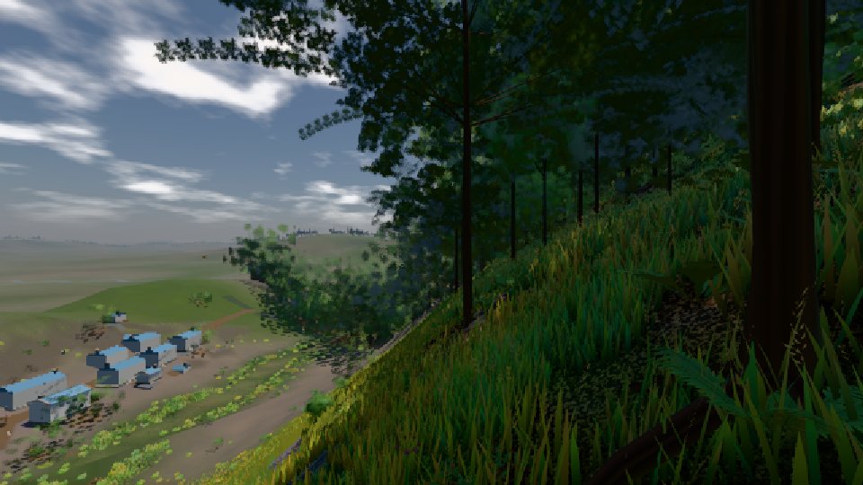
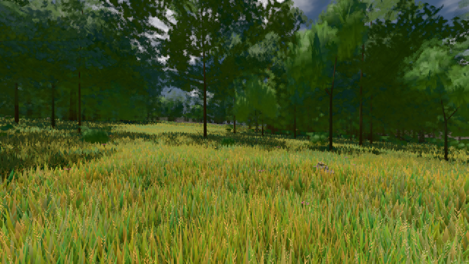

# GPU-PROBE 575fcc91 — GRÜN

Zweig `w27-takt-gc` · Kopf 575fcc913151b7ee70fa446138502c7978693722 · Läufer gtx1050-desktop · 10.11. 19:58 · Wanduhr ab Push 341 s · Lauf https://github.com/MiguellD/AnazhRealm/actions/runs/42879578578

Ruf: `bild:dorf@0.5 bild:wiese@0.5`

## Läufer gtx1050-desktop — GRÜN

GPU NVIDIA GeForce GTX 1050 · node_modules bleiben (package-lock ac6c0885)
Schloss /c/Users/User/AppData/Local/Temp/claude/gpu-schloss hält „ci-runner 42879578578/1 probe“
- Hook 2026-11-10 19:52:46 start ci-runner 42879578578/1 probe: Schloss genommen (refs/heads/w27-takt-gc 575fcc913151b7ee70fa446138502c7978693722 ws=C:\actions-runner\_work\AnazhRealm\AnazhRealm)

### bild:dorf@0.5 — GRÜN · 130 s · Läufer gtx1050-desktop

Adapter: [linse-gpu] nvidia/pascal

```text
Kamera des Spiels → Blick (10.0 m): -841.00 86.89 -861.00 -834.08 86.89 -853.78
 "abnahme": "ABNAHME GRÜN · beweis · Sicht 0.0 % · Ziel Blickziel im Bild frei 10 m · Luma 64.8 σ 53.1 schwarz 1.1 % weiß 0.0 % · Stand 18.546.246 · Bühne summer sunny 0.50 · Gerät WebGPU nvidia pascal",
```



### bild:wiese@0.5 — GRÜN · 131 s · Läufer gtx1050-desktop

Adapter: [linse-gpu] nvidia/pascal

```text
Kamera des Spiels → Blick (10.0 m): -280.40 29.71 -1045.60 -289.61 29.71 -1049.50
 "abnahme": "ABNAHME GRÜN · beweis · Sicht 0.0 % · Ziel Blickziel im Bild frei 10 m · Luma 84.1 σ 40.2 schwarz 0.0 % weiß 0.0 % · Stand 18.546.246 · Bühne summer sunny 0.50 · Gerät WebGPU nvidia pascal",
```


