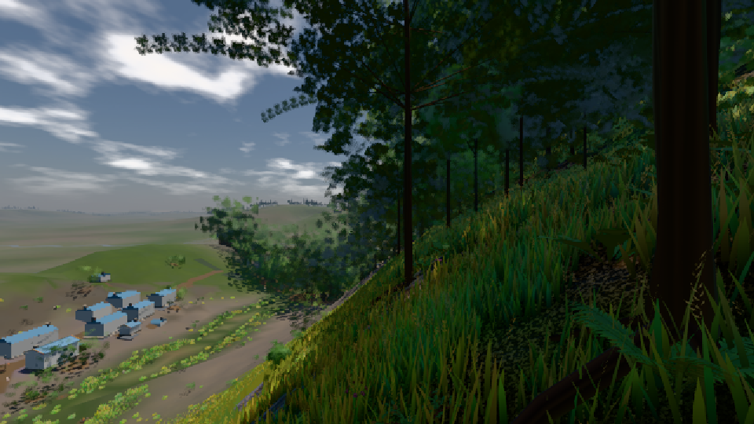
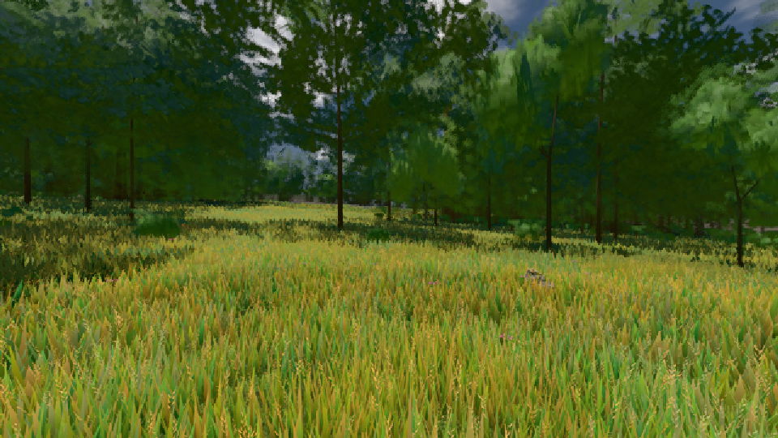

# GPU-PROBE eab8e8b3 — GRÜN

Zweig `w27-takt-gc` · Kopf eab8e8b3ba1e9f2f1de7d9a25b993a0101620654 · Läufer radeon-890m · 10.11. 18:32 · Wanduhr ab Push 378 s · Lauf https://github.com/MiguellD/AnazhRealm/actions/runs/42864951676

Ruf: `bild:dorf@0.5 bild:wiese@0.5`

## Läufer radeon-890m — GRÜN

GPU AMD Radeon(TM) 890M Graphics · node_modules bleiben (package-lock ac6c0885)
Schloss /c/Users/micha/AppData/Local/Temp/claude/gpu-schloss hält „ci-runner 42864951676/1 probe“
- Hook 2026-11-10 18:26:55 start ci-runner 42864951676/1 probe: wartet auf Schloss von 'punkte-radeon-sitzungpid=10564'
- Hook 2026-11-10 18:29:25 start ci-runner 42864951676/1 probe: verwaistes Schloss 'punkte-radeon-sitzungpid=10564' geloest - Halter pid=10564 lebt nicht
- Hook 2026-11-10 18:29:28 start ci-runner 42864951676/1 probe: Schloss genommen (refs/heads/w27-takt-gc eab8e8b3ba1e9f2f1de7d9a25b993a0101620654 ws=C:\actions-runner\_work\AnazhRealm\AnazhRealm)

### bild:dorf@0.5 — GRÜN · 69 s · Läufer radeon-890m

Adapter: [linse-gpu] amd/rdna-3

```text
Kamera des Spiels → Blick (10.0 m): -841.00 86.89 -861.00 -834.08 86.89 -853.78
 "abnahme": "ABNAHME GRÜN · beweis · Sicht 0.0 % · Ziel Blickziel im Bild frei 10 m · Luma 64.7 σ 53.1 schwarz 1.1 % weiß 0.0 % · Stand 18.546.246 · Bühne summer sunny 0.50 · Gerät WebGPU amd rdna-3",
```



### bild:wiese@0.5 — GRÜN · 58 s · Läufer radeon-890m

Adapter: [linse-gpu] amd/rdna-3

```text
Kamera des Spiels → Blick (10.0 m): -280.40 29.71 -1045.60 -289.61 29.71 -1049.50
 "abnahme": "ABNAHME GRÜN · beweis · Sicht 0.0 % · Ziel Blickziel im Bild frei 10 m · Luma 83.8 σ 40.2 schwarz 0.0 % weiß 0.0 % · Stand 18.546.246 · Bühne summer sunny 0.50 · Gerät WebGPU amd rdna-3",
```


