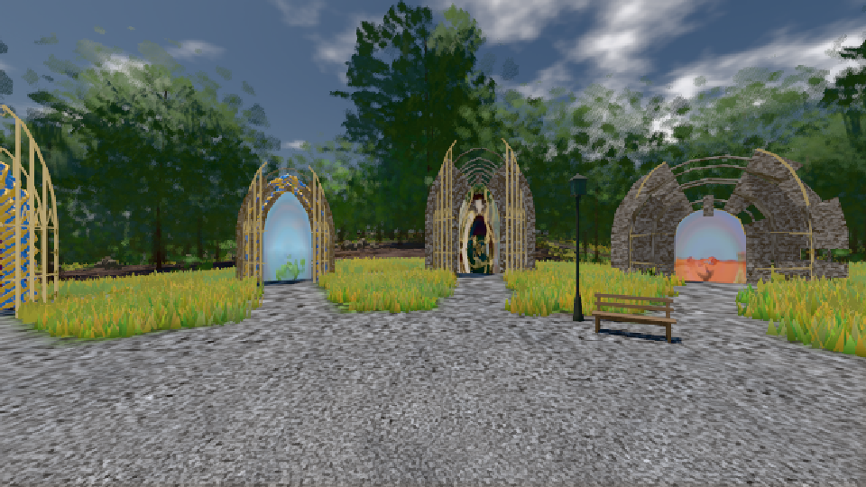
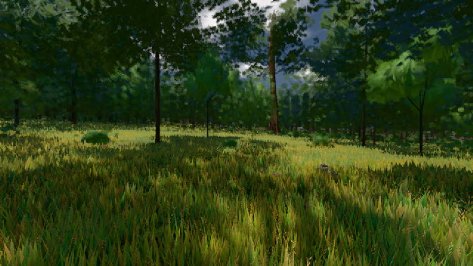

# GPU-PROBE b7b141c0 — GRÜN

Zweig `w27-takt-streu` · Kopf b7b141c0037f3890cc0fc62f3cef33d07be634af · Läufer gtx1050-desktop · 10.11. 00:12 · Wanduhr ab Push 1471 s · Lauf https://github.com/MiguellD/AnazhRealm/actions/runs/42715021454

Ruf: `gate:pop bild:genesis@0.5 bild:wiese@0.5`

## Läufer gtx1050-desktop — GRÜN

GPU NVIDIA GeForce GTX 1050 · node_modules bleiben (package-lock affde574)
Schloss /c/Users/User/AppData/Local/Temp/claude/gpu-schloss hält „ci-runner 42715021454/1 probe“
- Hook 2026-11-09 23:48:02 start ci-runner 42715021454/1 probe: wartet auf Schloss von 'hand w27-ort-pose mutant dorf (Claude)'
- Hook 2026-11-10 00:04:13 start ci-runner 42715021454/1 probe: Schloss genommen (refs/heads/w27-takt-streu b7b141c0037f3890cc0fc62f3cef33d07be634af ws=C:\actions-runner\_work\AnazhRealm\AnazhRealm)

### gate:pop — GRÜN · 149 s · Läufer gtx1050-desktop

Adapter: ungenannt (die Probe nannte keinen Browser-Adapter)

```text
lod.K2#1 GRÜN 0.0454 % Pop-Pixel/s (942 px) · 43*+1@189/75*/73*+2@154/408/122*/30*+3@192/114*+1@155/77*+2@189 · Laub 216 · dc, Dreiecke 93,430615 · GPU 53.66 ms, CPU 5.21 ms je Bild
BLOCK-TREUE GRÜN 215 Blöcke treu · Selbsttest nennt MeshStandardNodeMaterial · nahWiese:L1:0:0 · instanzFarbe: 1/888 Instanzen fremd
```

### bild:genesis@0.5 — GRÜN · 99 s · Läufer gtx1050-desktop

Adapter: [linse-gpu] nvidia/pascal

```text
Kamera des Spiels → Blick (10.0 m): 0.00 92.40 0.00 -10.00 92.40 0.00
 "abnahme": "ABNAHME GRÜN · beweis · Sicht 0.0 % · Ziel Blickziel im Bild frei 10 m · Luma 105.1 σ 37.7 schwarz 0.0 % weiß 0.0 % · Stand 18.546.238 · Bühne summer sunny 0.50 · Gerät WebGPU nvidia pascal",
```



### bild:wiese@0.5 — GRÜN · 102 s · Läufer gtx1050-desktop

Adapter: [linse-gpu] nvidia/pascal

```text
Kamera des Spiels → Blick (10.0 m): -280.40 29.71 -1045.60 -289.61 29.71 -1049.50
 "abnahme": "ABNAHME GRÜN · beweis · Sicht 0.0 % · Ziel Blickziel im Bild frei 10 m · Luma 56.7 σ 33.2 schwarz 0.0 % weiß 0.0 % · Stand 18.546.238 · Bühne summer sunny 0.50 · Gerät WebGPU nvidia pascal",
```


