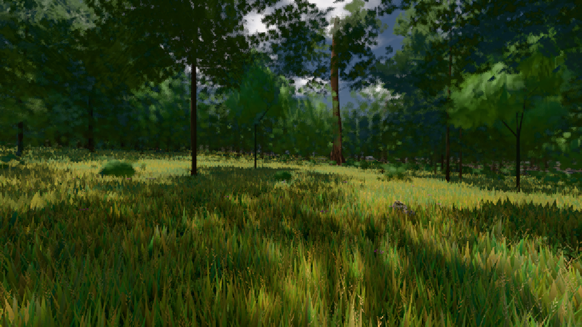
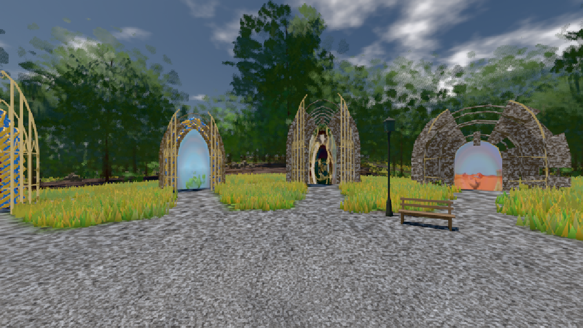

# GPU-PROBE 98b97f09 — GRÜN

Zweig `w27-tiere-sicht` · Kopf 98b97f09c5438f4dd02ac12a7204b3a9d083c368 · Läufer radeon-890m · 10.11. 08:38 · Wanduhr ab Push 328 s · Lauf https://github.com/MiguellD/AnazhRealm/actions/runs/42776095698

Ruf: `bild:wiese@0.5 bild:genesis@0.5`

## Läufer radeon-890m — GRÜN

GPU AMD Radeon(TM) 890M Graphics · npm ci 74 s (package-lock a8738d68)
Schloss /c/Users/micha/AppData/Local/Temp/claude/gpu-schloss hält „ci-runner 42776095698/1 probe“
- Hook 2026-11-10 08:33:57 start ci-runner 42776095698/1 probe: Schloss genommen (refs/heads/w27-tiere-sicht 98b97f09c5438f4dd02ac12a7204b3a9d083c368 ws=C:\actions-runner\_work\AnazhRealm\AnazhRealm)

### bild:wiese@0.5 — GRÜN · 66 s · Läufer radeon-890m

Adapter: [linse-gpu] amd/rdna-3

```text
Kamera des Spiels → Blick (10.0 m): -280.40 29.71 -1045.60 -289.61 29.71 -1049.50
 "abnahme": "ABNAHME GRÜN · beweis · Sicht 0.0 % · Ziel Blickziel im Bild frei 10 m · Luma 57 σ 32.9 schwarz 0.0 % weiß 0.0 % · Stand 18.546.244 · Bühne summer sunny 0.50 · Gerät WebGPU amd rdna-3",
```



### bild:genesis@0.5 — GRÜN · 56 s · Läufer radeon-890m

Adapter: [linse-gpu] amd/rdna-3

```text
Kamera des Spiels → Blick (10.0 m): 0.00 92.40 0.00 -10.00 92.40 0.00
 "abnahme": "ABNAHME GRÜN · beweis · Sicht 0.0 % · Ziel Blickziel im Bild frei 10 m · Luma 105.4 σ 37.8 schwarz 0.0 % weiß 0.0 % · Stand 18.546.244 · Bühne summer sunny 0.50 · Gerät WebGPU amd rdna-3",
```


