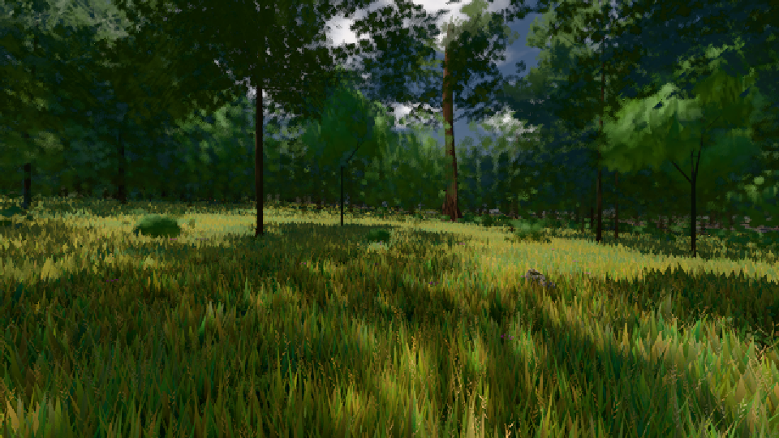
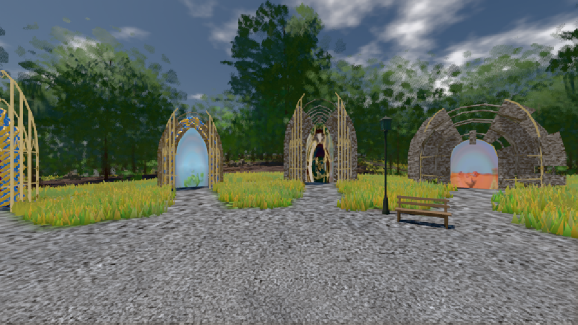

# GPU-PROBE cfce7eb0 — GRÜN

Zweig `w27-tiere-sicht` · Kopf cfce7eb00e15df9b7a93e458efc48dad088a024e · Läufer gtx1050-desktop · 10.11. 03:34 · Wanduhr ab Push 588 s · Lauf https://github.com/MiguellD/AnazhRealm/actions/runs/42742595714

Ruf: `gate:tier-gang bild:wiese@0.5 bild:genesis@0.5`

## Läufer gtx1050-desktop — GRÜN

GPU NVIDIA GeForce GTX 1050 · node_modules bleiben (package-lock 818c194e)
Schloss /c/Users/User/AppData/Local/Temp/claude/gpu-schloss hält „ci-runner 42742595714/1 probe“
- Hook 2026-11-10 03:26:44 start ci-runner 42742595714/1 probe: Schloss genommen (refs/heads/w27-tiere-sicht cfce7eb00e15df9b7a93e458efc48dad088a024e ws=C:\actions-runner\_work\AnazhRealm\AnazhRealm)

### gate:tier-gang — GRÜN · 144 s · Läufer gtx1050-desktop

Adapter: [linse-gpu] nvidia/pascal

```text
  ✅ Gangart Labor fox v̂ 3.5 · galopp [0 0.15 0.6 0.45] · Tastgrad 0.29 · Welt − Labor 0.01 Zyklus · Satz − Labor 0.02 Zyklus
  ✅ Gangart Labor bear v̂ 0.3 · schritt-lateral [0 0.5 0.25 0.75] · Tastgrad 0.64 · Welt − Labor 0.00 Zyklus · Satz − Labor 0.00 Zyklus
  ✅ Gangart Labor bear v̂ 0.74 · schritt-lateral [0 0.5 0.25 0.75] · Tastgrad 0.65 · Welt − Labor 0.01 Zyklus · Satz − Labor 0.00 Zyklus
  ✅ Gangart Labor bear v̂ 1.2 · trab [0 0.5 0.5 0] · Tastgrad 0.49 · Welt − Labor 0.00 Zyklus · Satz − Labor 0.01 Zyklus
  ✅ Gangart Labor bear v̂ 3.5 · galopp [0 0.15 0.59 0.44] · Tastgrad 0.27 · Welt − Labor 0.05 Zyklus · Satz − Labor 0.02 Zyklus
  ✅ Gangart Labor deer v̂ 0.3 · schritt-lateral [0 0.5 0.25 0.75] · Tastgrad 0.64 · Welt − Labor 0.01 Zyklus · Satz − Labor 0.00 Zyklus
  ✅ Gangart Labor deer v̂ 0.74 · schritt-lateral [0 0.5 0.25 0.75] · Tastgrad 0.66 · Welt − Labor 0.00 Zyklus · Satz − Labor 0.00 Zyklus
  ✅ Gangart Labor deer v̂ 1.2 · trab [0 0.49 0.49 0.99] · Tastgrad 0.49 · Welt − Labor 0.01 Zyklus · Satz − Labor 0.02 Zyklus
  ✅ Gangart Labor deer v̂ 3.5 · galopp [0 0.15 0.6 0.45] · Tastgrad 0.28 · Welt − Labor 0.00 Zyklus · Satz − Labor 0.01 Zyklus
✅ GRÜN — jede Gattung setzt ihre Pfoten (Schlupf ≤ 0.05) in Schritt, Trab und Galopp; der Mensch geht und läuft nach demselben Gesetz (Kadenz ≥ 1.5, Töne ± 15 %), in der Welt und im Körper-Studio.
```

### bild:wiese@0.5 — GRÜN · 114 s · Läufer gtx1050-desktop

Adapter: [linse-gpu] nvidia/pascal

```text
Kamera des Spiels → Blick (10.0 m): -280.40 29.71 -1045.60 -289.61 29.71 -1049.50
 "abnahme": "ABNAHME GRÜN · beweis · Sicht 0.0 % · Ziel Blickziel im Bild frei 10 m · Luma 56.5 σ 32.9 schwarz 0.0 % weiß 0.0 % · Stand 18.546.241 · Bühne summer sunny 0.50 · Gerät WebGPU nvidia pascal",
```



### bild:genesis@0.5 — GRÜN · 109 s · Läufer gtx1050-desktop

Adapter: [linse-gpu] nvidia/pascal

```text
Kamera des Spiels → Blick (10.0 m): 0.00 92.40 0.00 -10.00 92.40 0.00
 "abnahme": "ABNAHME GRÜN · beweis · Sicht 0.0 % · Ziel Blickziel im Bild frei 10 m · Luma 105.1 σ 37.7 schwarz 0.0 % weiß 0.0 % · Stand 18.546.241 · Bühne summer sunny 0.50 · Gerät WebGPU nvidia pascal",
```


