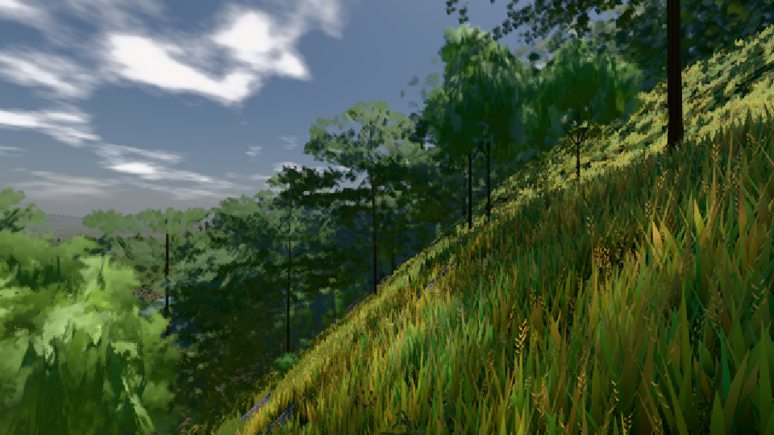

# GPU-PROBE 0710a518 — ROT

Zweig `w27-traa-fenster` · Kopf 0710a5184fc250f136ef97e333242d56ae48b65d · Läufer gtx1050-desktop · 10.11. 14:29 · Wanduhr ab Push 596 s · Lauf https://github.com/MiguellD/AnazhRealm/actions/runs/42823498092

Ruf: `bild:stadt-voll bild:dorf@0.5 gate:kamera-laub`

## Läufer gtx1050-desktop — ROT

GPU NVIDIA GeForce GTX 1050 · npm ci 74 s (package-lock a8738d68)
Schloss /c/Users/User/AppData/Local/Temp/claude/gpu-schloss hält „ci-runner 42823498092/1 probe“
- Hook 2026-11-10 14:19:59 start ci-runner 42823498092/1 probe: Schloss genommen (refs/heads/w27-traa-fenster 0710a5184fc250f136ef97e333242d56ae48b65d ws=C:\actions-runner\_work\AnazhRealm\AnazhRealm)

### bild:stadt-voll — ROT · 48 s · Läufer gtx1050-desktop

Adapter: [linse-gpu] nvidia/pascal

```text
Kamera des Spiels → Blick (60.0 m): 400.00 45.54 400.00 459.91 45.54 403.20
```

### bild:dorf@0.5 — GRÜN · 160 s · Läufer gtx1050-desktop

Adapter: [linse-gpu] nvidia/pascal

```text
Kamera des Spiels → Blick (10.0 m): -841.00 86.89 -861.00 -834.08 86.89 -853.78
 "abnahme": "ABNAHME GRÜN · beweis · Sicht 0.0 % · Ziel Blickziel im Bild frei 10 m · Luma 85.2 σ 48 schwarz 0.0 % weiß 0.0 % · Stand 18.546.244 · Bühne summer sunny 0.50 · Gerät WebGPU nvidia pascal",
```



### gate:kamera-laub — GRÜN · 271 s · Läufer gtx1050-desktop

Adapter: ungenannt (die Probe nannte keinen Browser-Adapter)

```text
     11. ROT  mensch-kopf: gesicht 1 Soll [1, 1] (gelesen KOPF_SOLL.{augeFrei, lippeL, lippeA, hoehleL, hoehleA, haarDeckung}) — gesicht 1 — veraltet seit cbc222cc+geändert: koerper-core.js geändert (c:876df0482c417a50 → c:c69a8110a4ddbf20) · augeFrei 1 [0.9, 1] · lippeL -5.61 [-14, -4] · lippeA 4.64 [4, 14] · hoehleL -0.98 [-12, 0] · hoehleA 0.34 [-2, 6] · haarDeckung 1 [0.9, 1] · Budget L0 15000/25 · L1 5250/9 · L2 1500/3 · 1.3 MB · gemessen 2026-10-17 cbc222cc amd rdna-3
     12. ROT  boden-nah-farbe: farbtonStreuung 11.1 Soll [10.7, ∞] (eigen) — farbtonStreuung 11.1 — veraltet seit b127dcf7: gelaende-core.js geändert (c:671ad7ea812567a8 → c:f629d39e83b8c02f) · Täter die Kachel -140, -522 (11022 Proben): σh 9.51° um h 114.7° · 8 Kacheln 2 m in 2–5 m · Belichtung 0.9935 · Budget L0 80000/4 · L1 28000/2 · L2 8000/1 · 6.8 MB · gemessen 2026-10-17 b127dcf7 amd rdna-3
     13. ROT  fell: strich — Soll [0.4358, 0.6538] (gerechnet) — strich ungemessen · Budget L0 60000/30 · L1 21000/11 · L2 6000/3 · 5.1 MB
     14. ROT  haar: strich — Soll [0.3554, 0.533] (gerechnet) — strich ungemessen · Budget L0 15000/25 · L1 5250/9 · L2 1500/3 · 1.3 MB
✅ SELBSTTEST GRÜN — die Kamera-Laub-Linse nennt ihre Täter beim Namen.
[stall-akte] Stderr [12764:11212:1110/142713.556:ERROR:google_apis\gcm\engine\mcs_client.cc:702]   Error code: 401  Error message: Authentication Failed: wrong_secret
[stall-akte] Stderr [12764:11212:1110/142713.556:ERROR:google_apis\gcm\engine\mcs_client.cc:702]   Error code: 401  Error message: Authentication Failed: wrong_secret
[stall-akte] Stderr [12764:3356:1110/142917.317:ERROR:services\on_device_model\public\cpp\service_client.cc:37] Unexpected on_device_model service disconnect; reason: 1, description: Error loading backend.
  ✅ K1 kein Laub, Strauch oder Fels vor der Linse (Deckung ≤ 2 %), der Schmuggel fällt
✅ GRÜN — die Kamera steckt nie in Laub, Strauch, Fels oder Boden.
```
