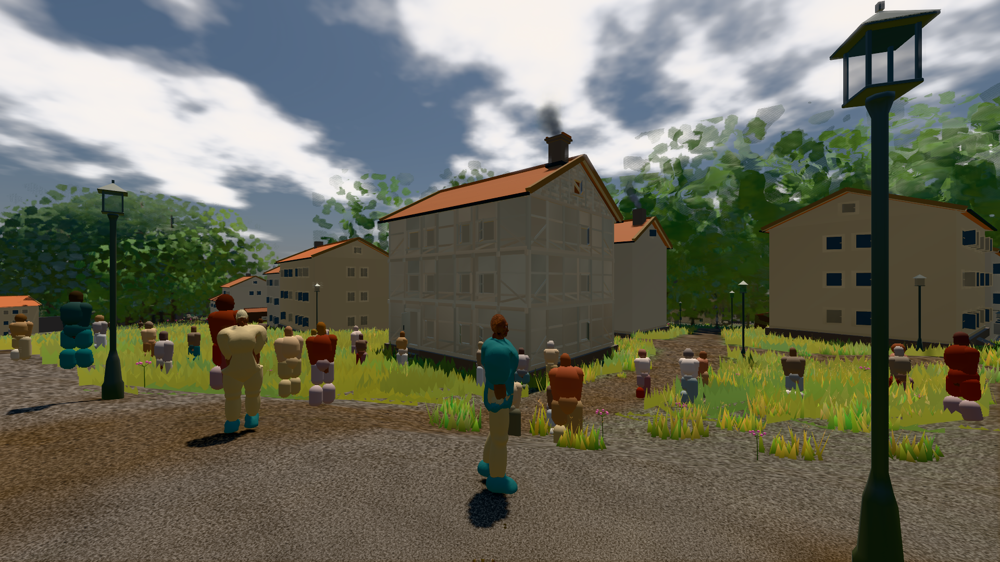

# GPU-PROBE ab6eeaf4 — NACHGEGEBEN

Zweig `w27-traa-fenster` · Kopf ab6eeaf4f22f6fd0dc90af95b60478f087512cc3 · Läufer omen-gtx1060 · 11.11. 15:57 · Wanduhr ab Push 427 s · Lauf https://github.com/MiguellD/AnazhRealm/actions/runs/43042429895

Ruf: `bild:stadt-voll bild:dorf@0.5 gate:kamera-laub`

## Läufer omen-gtx1060 — NACHGEGEBEN

GPU NVIDIA GeForce GTX 1060 · npm ci 43 s (package-lock 9e40b075)
Schloss /c/Users/micha/AppData/Local/Temp/claude/gpu-schloss hält „ci-runner 43042429895/1 probe“
- Hook 2026-11-11 15:51:04 start ci-runner 43042429895/1 probe: wartet auf Schloss von 'omen-heil-regler-wirkt-1'
- Hook 2026-11-11 15:51:19 start ci-runner 43042429895/1 probe: Schloss genommen (refs/heads/w27-traa-fenster ab6eeaf4f22f6fd0dc90af95b60478f087512cc3 ws=C:\actions-runner\_work\AnazhRealm\AnazhRealm)

### bild:stadt-voll — GRÜN · 171 s · Läufer omen-gtx1060

Adapter: [linse-gpu] nvidia/pascal

```text
Kamera des Spiels → Blick (14.6 m): 837.84 58.51 445.42 842.31 58.51 459.32
 "abnahme": "ABNAHME GRÜN · beweis · Sicht 0.0 % · Ziel Blickziel im Bild frei 14.6 m, verdeckt nur von Leibern: 1 Punkt, nächster 3.73 m (Leib bewohner) · Luma 105.2 σ 59 schwarz 0.1 % weiß 0.0 % · Stand 18.546.252 · Bühne summer sunny 0.50 · Gerät WebGPU nvidia pascal",
```



### bild:dorf@0.5 — NACHGEGEBEN · 12 s · Läufer omen-gtx1060

Adapter: ungenannt (die Probe nannte keinen Browser-Adapter) · NACHGEGEBEN: Vorfahrt-Blick gescheitert: 502 https://api.github.com/repos/MiguellD/AnazhRealm/actions/runs/43039235565/jobs?per_page=100

```text
NACHGEGEBEN: Vorfahrt-Blick gescheitert: 502 https://api.github.com/repos/MiguellD/AnazhRealm/actions/runs/43039235565/jobs?per_page=100
```

### gate:kamera-laub — GRÜN · 140 s · Läufer omen-gtx1060

Adapter: ungenannt (die Probe nannte keinen Browser-Adapter)

```text
     8. ROT  tor-bunt: oeffnungBunt 24.59 Soll [20, ∞] (eigen) — oeffnungBunt 24.59 — veraltet seit cbc222cc+geändert: porta-core.js geändert (c:43576786f20c3d32 → c:63bbdc8985e045f1) · Täter portal-membran in L2 (C*ab 21.78 über 16962 Pixel) · L1 portal-membran C*ab 25.85 (39810 px) · L2 portal-membran C*ab 21.78 (16962 px) · L3 portal-membran C*ab 22.05 (954 px) · Budget L0 60000/40 · L1 21000/14 · L2 6000/4 · 5.1 MB · gemessen 2026-10-17 cbc222cc amd rdna-3
     9. ROT  tor-ziel: zielTreue 0.642 Soll [0.5, ∞] (eigen) — zielTreue 0.642 — veraltet seit cbc222cc+geändert: porta-core.js geändert (c:43576786f20c3d32 → c:63bbdc8985e045f1) · Täter portal-membran in L3 (r 0.562 über 907 Pixel) · L1 portal-membran r 0.572 (39541 px) · L2 portal-membran r 0.81 (16883 px) · L3 portal-membran r 0.562 (907 px) · Budget L0 60000/40 · L1 21000/14 · L2 6000/4 · 5.1 MB · gemessen 2026-10-17 cbc222cc amd rdna-3
     10. ROT  fels: albedo 0.2388 Soll [0.1, 0.3] (eigen) — albedo 0.2388 — veraltet seit 1dcb844f: gelaende-core.js geändert (c:1da07e646fe2b0ad → c:f629d39e83b8c02f) · Täter Welt-Albedo 0.2388 (fels) · Budget L0 30000/20 · L1 10500/7 · L2 3000/2 · 2.6 MB · gemessen 2026-10-23 amd rdna-3
     11. ROT  mensch-kopf: gesicht 1 Soll [1, 1] (gelesen KOPF_SOLL.{augeFrei, lippeL, lippeA, hoehleL, hoehleA, haarDeckung}) — gesicht 1 — veraltet seit cbc222cc+geändert: koerper-core.js geändert (c:876df0482c417a50 → c:c69a8110a4ddbf20) · augeFrei 1 [0.9, 1] · lippeL -5.61 [-14, -4] · lippeA 4.64 [4, 14] · hoehleL -0.98 [-12, 0] · hoehleA 0.34 [-2, 6] · haarDeckung 1 [0.9, 1] · Budget L0 15000/25 · L1 5250/9 · L2 1500/3 · 1.3 MB · gemessen 2026-10-17 cbc222cc amd rdna-3
     12. ROT  boden-nah-farbe: farbtonStreuung 11.1 Soll [10.7, ∞] (eigen) — farbtonStreuung 11.1 — veraltet seit b127dcf7: gelaende-core.js geändert (c:671ad7ea812567a8 → c:f629d39e83b8c02f) · Täter die Kachel -140, -522 (11022 Proben): σh 9.51° um h 114.7° · 8 Kacheln 2 m in 2–5 m · Belichtung 0.9935 · Budget L0 80000/4 · L1 28000/2 · L2 8000/1 · 6.8 MB · gemessen 2026-10-17 b127dcf7 amd rdna-3
     13. ROT  fell: strich — Soll [0.4358, 0.6538] (gerechnet) — strich ungemessen · Budget L0 60000/30 · L1 21000/11 · L2 6000/3 · 5.1 MB
     14. ROT  haar: strich — Soll [0.3554, 0.533] (gerechnet) — strich ungemessen · Budget L0 15000/25 · L1 5250/9 · L2 1500/3 · 1.3 MB
✅ SELBSTTEST GRÜN — die Kamera-Laub-Linse nennt ihre Täter beim Namen.
  ✅ K1 kein Laub, Strauch oder Fels vor der Linse (Deckung ≤ 2 %), der Schmuggel fällt
✅ GRÜN — die Kamera steckt nie in Laub, Strauch, Fels oder Boden.
```
