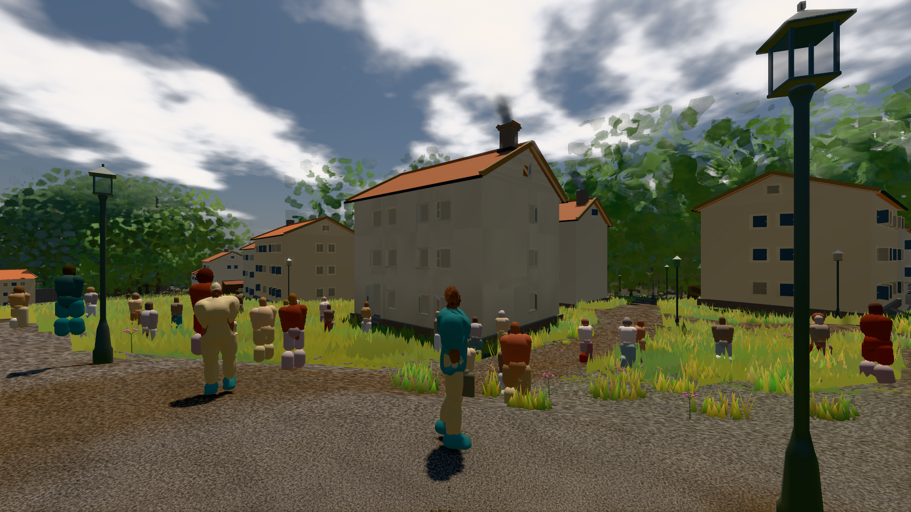

# GPU-PROBE 314ff351 — GRÜN

Zweig `w27-verkehr-leib` · Kopf 314ff351db501fd78ca530f2c3e17ac643e68a9f · Läufer omen-gtx1060 · 11.11. 23:02 · Wanduhr ab Push 2998 s · Lauf https://github.com/MiguellD/AnazhRealm/actions/runs/43101031085

Ruf: `bild:stadt-voll`

## Läufer omen-gtx1060 — GRÜN

GPU NVIDIA GeForce GTX 1060 · npm ci 47 s (package-lock bfde0fd0)
Schloss /c/Users/micha/AppData/Local/Temp/claude/gpu-schloss hält „ci-runner 43101031085/2 probe“
- Hook 2026-11-11 22:58:14 start ci-runner 43101031085/2 probe: Schloss genommen (refs/heads/w27-verkehr-leib 314ff351db501fd78ca530f2c3e17ac643e68a9f ws=C:\actions-runner\_work\AnazhRealm\AnazhRealm)

### bild:stadt-voll — GRÜN · 164 s · Läufer omen-gtx1060

Adapter: [linse-gpu] nvidia/pascal

```text
Kamera des Spiels → Blick (14.6 m): 837.84 58.51 445.42 842.31 58.51 459.32
 "abnahme": "ABNAHME GRÜN · beweis · Sicht 0.0 % · Ziel Blickziel im Bild frei 14.6 m, verdeckt nur von Leibern: 1 Punkt, nächster 3.75 m (Leib bewohner) · Luma 105.4 σ 58.8 schwarz 0.1 % weiß 0.0 % · Stand 18.546.257 · Bühne summer sunny 0.50 · Gerät WebGPU nvidia pascal",
```


