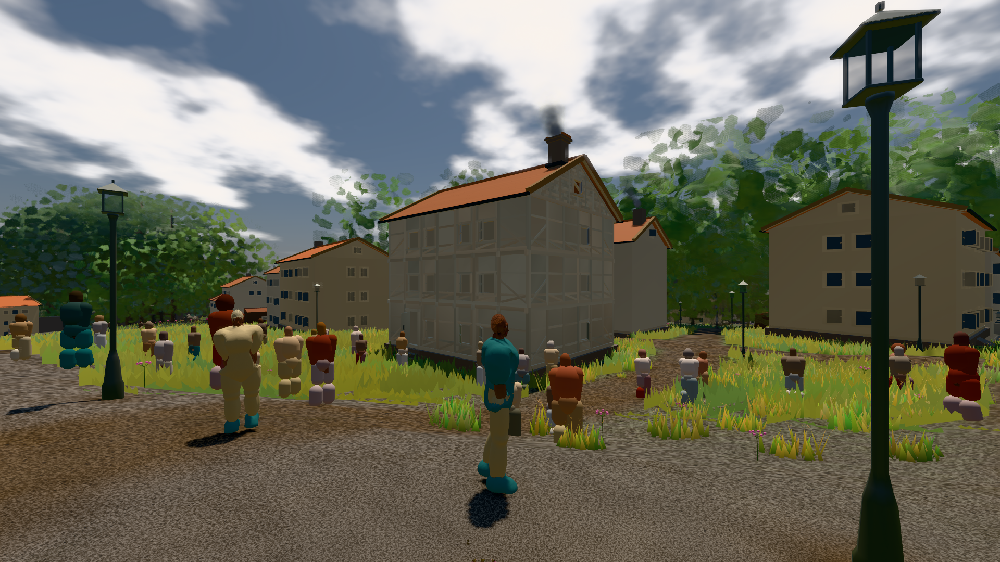
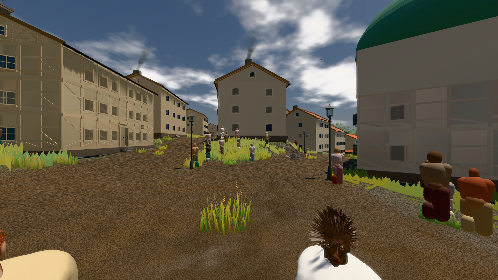

# GPU-PROBE f1a726fa — GRÜN

Zweig `w27-verkehr-leib` · Kopf f1a726facec99756a46431a3b502499b90113dec · Läufer radeon-890m · 11.11. 15:48 · Wanduhr ab Push 313 s · Lauf https://github.com/MiguellD/AnazhRealm/actions/runs/43041202769

Ruf: `bild:stadt-voll bild:stadt@0.5`

## Läufer radeon-890m — GRÜN

GPU AMD Radeon(TM) 890M Graphics · npm ci 31 s (package-lock 9e40b075)
Schloss /c/Users/micha/AppData/Local/Temp/claude/gpu-schloss hält „ci-runner 43041202769/1 probe“
- Hook 2026-11-11 15:43:30 start ci-runner 43041202769/1 probe: Schloss genommen (refs/heads/w27-verkehr-leib f1a726facec99756a46431a3b502499b90113dec ws=C:\actions-runner\_work\AnazhRealm\AnazhRealm)

### bild:stadt-voll — GRÜN · 144 s · Läufer radeon-890m

Adapter: [linse-gpu] amd/rdna-3

```text
Kamera des Spiels → Blick (14.6 m): 837.84 58.51 445.42 842.31 58.51 459.32
 "abnahme": "ABNAHME GRÜN · beweis · Sicht 0.0 % · Ziel Blickziel im Bild frei 14.6 m, verdeckt nur von Leibern: 1 Punkt, nächster 3.73 m (Leib bewohner) · Luma 105.2 σ 58.9 schwarz 0.1 % weiß 0.0 % · Stand 18.546.252 · Bühne summer sunny 0.50 · Gerät WebGPU amd rdna-3",
```



### bild:stadt@0.5 — GRÜN · 102 s · Läufer radeon-890m

Adapter: [linse-gpu] amd/rdna-3

```text
Kamera des Spiels → Blick (23.9 m): 662.72 63.28 429.48 686.59 63.28 428.39
 "abnahme": "ABNAHME GRÜN · beweis · Sicht 0.0 % · Ziel Blickziel im Bild frei 23.89 m · Luma 89.6 σ 42.7 schwarz 0.0 % weiß 0.0 % · Stand 18.546.252 · Bühne summer sunny 0.50 · Gerät WebGPU amd rdna-3",
```


