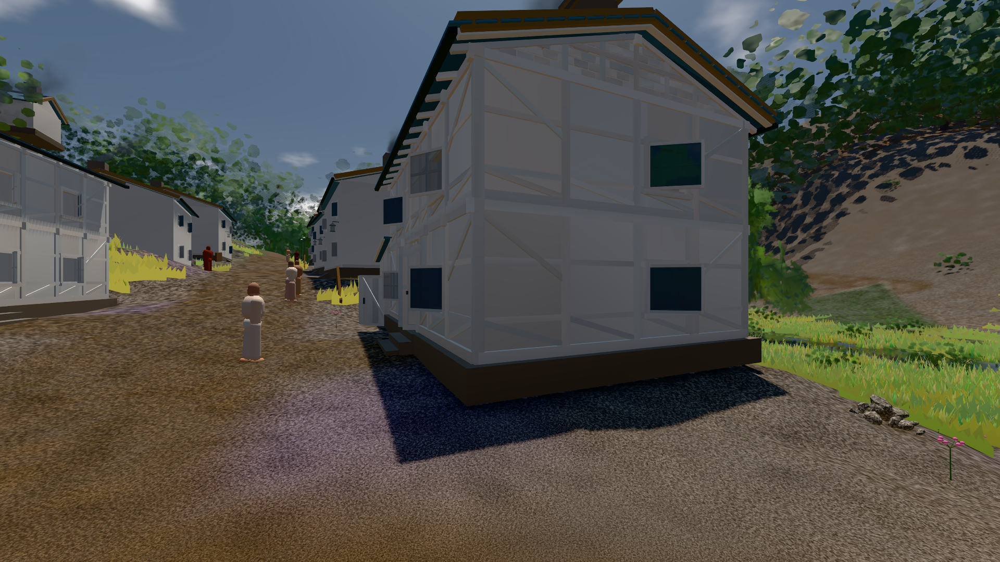

# GPU-PROBE baaf1721 — GRÜN

Zweig `w27-wagen-spalt` · Kopf baaf172179829cc3f2c5fdf278be47d2e776cacb · Läufer radeon-890m · 11.11. 03:14 · Wanduhr ab Push 461 s · Lauf https://github.com/MiguellD/AnazhRealm/actions/runs/42943748676

Ruf: `gate:naesse:echt gate:kollision-bild bild:dorf@0.5`

## Läufer radeon-890m — GRÜN

GPU AMD Radeon(TM) 890M Graphics · node_modules bleiben (package-lock df29564e)
Schloss /c/Users/micha/AppData/Local/Temp/claude/gpu-schloss hält „ci-runner 42943748676/1 probe“
- Hook 2026-11-11 03:07:36 start ci-runner 42943748676/1 probe: wartet auf Schloss von 'punkte-radeon-sitzungpid=2264'
- Hook 2026-11-11 03:07:53 start ci-runner 42943748676/1 probe: Schloss genommen (refs/heads/w27-wagen-spalt baaf172179829cc3f2c5fdf278be47d2e776cacb ws=C:\actions-runner\_work\AnazhRealm\AnazhRealm)

### gate:naesse:echt — GRÜN · 135 s · Läufer radeon-890m

Adapter: ungenannt (die Probe nannte keinen Browser-Adapter)

```text
NÄSSE GRUEN
```

### gate:kollision-bild — GRÜN · 125 s · Läufer radeon-890m

Adapter: [linse-gpu] kein Adapter

```text
  ✅ Selbsttest „BILD ≠ KOLLISION: gestossen .*@60" → rot: (V) BILD ≠ KOLLISION: gestossen 5.86 m/s @60 → mauer#7 — im Bild Spalt 0 m, Eindringen 0.12 m
  ✅ Selbsttest „BILD ≠ KOLLISION: wagen .*@30 .*Spalt 0.218" → rot: (V) BILD ≠ KOLLISION: wagen 5.86 m/s @30 → mauer#7 — im Bild Spalt 0.218 m, Eindringen 0 m
  ✅ Selbsttest „NICHT IM BILD: wagen — 0 px" → rot: (V) NICHT IM BILD: wagen — 0 px 
  ✅ Selbsttest „KEINE KARTE: .*kein Adapter" → rot: (V) KEINE KARTE: [linse-gpu] kein Adapter
  ✅ Selbsttest „KEIN BILD: wagen.mauer" → rot: (V) KEIN BILD: wagen|mauer
  ✅ Selbsttest „ZEILE FEHLT: riese.mauer.144" → rot: (V) ZEILE FEHLT: riese|mauer|144 · (V) ZEILE FEHLT: riese|mauer|60 · (V) ZEILE FEHLT: riese|mauer|30 · (V) ZEILE FEHLT: riese|mauer|deckel · (V) ZEILE FEHLT: riese|fels|144 · (V) ZEILE FEHLT: riese|fels|60 · (V) ZEILE FEHLT: riese|fels|30 · (V) ZEILE FEHLT: riese|fels|deckel · (V) ZEILE FEHLT: riese|haus|144 · (V) ZEILE FEHLT: riese|haus|60 · (V) ZEILE FEHLT: riese|haus|30 · (V) ZEILE FEHLT: riese|haus|deckel · (V) ZEILE FEHLT: riese|baum|144 · (V) ZEILE FEHLT: riese|baum|60 · (V) ZEILE FEHLT: riese|baum|30 · (V) ZEILE F
  ✅ Selbsttest „LINSE STUMPF: \(V\)" → rot: LINSE STUMPF: (V) der Fuchs ohne Teil-Schritt blieb vor der Mauer
  ✅ Selbsttest „LEER: \(V\)" → rot: LEER: (V) keine Tempo-Probe (undefined)
✅ SELBSTTEST GRÜN — jeder injizierte Täter fällt rot und wird beim Namen genannt.
✅ KOLLISION = BILD GRÜN (OFFEN oben: 3)
```

### bild:dorf@0.5 — GRÜN · 92 s · Läufer radeon-890m

Adapter: [linse-gpu] amd/rdna-3

```text
Kamera des Spiels → Blick (5.2 m): -704.22 39.69 -880.02 -703.03 39.69 -874.96
 "abnahme": "ABNAHME GRÜN · beweis · Sicht 0.0 % · Ziel Blickziel im Bild frei 5.2 m · Luma 79 σ 30.6 schwarz 0.2 % weiß 0.0 % · Stand 18.546.249 · Bühne summer sunny 0.50 · Gerät WebGPU amd rdna-3",
```


