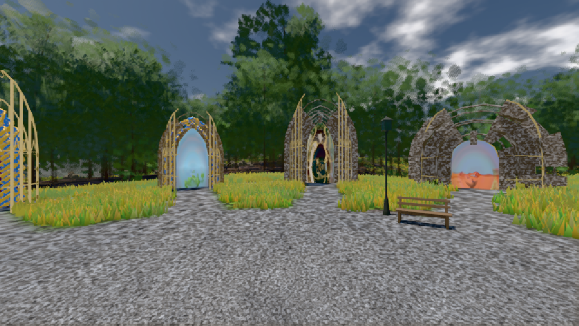
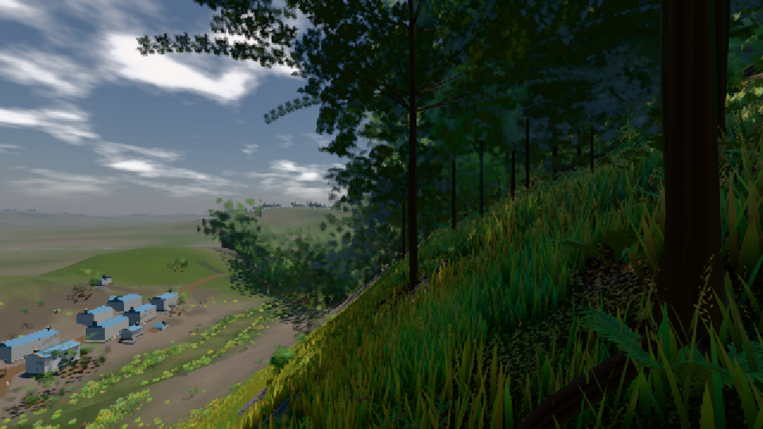

# GPU-PROBE 98aac81d — GRÜN

Zweig `w27-wald-kosten-heim` · Kopf 98aac81d9b786a7311be15e7004f1e97964b3031 · Läufer gtx1050-desktop · 10.11. 10:11 · Wanduhr ab Push 419 s · Lauf https://github.com/MiguellD/AnazhRealm/actions/runs/42787594118

Ruf: `gate:pop bild:genesis@0.5 bild:dorf@0.5`

## Läufer gtx1050-desktop — GRÜN

GPU NVIDIA GeForce GTX 1050 · node_modules bleiben (package-lock a8738d68)
Schloss /c/Users/User/AppData/Local/Temp/claude/gpu-schloss hält „ci-runner 42787594118/1 probe“
- Hook 2026-11-10 10:04:32 start ci-runner 42787594118/1 probe: Schloss genommen (refs/heads/w27-wald-kosten-heim 98aac81d9b786a7311be15e7004f1e97964b3031 ws=C:\actions-runner\_work\AnazhRealm\AnazhRealm)

### gate:pop — GRÜN · 151 s · Läufer gtx1050-desktop

Adapter: ungenannt (die Probe nannte keinen Browser-Adapter)

```text
lod.K2#1 GRÜN 0.0435 % Pop-Pixel/s (902 px) · 86*+1@189/46*/444*+1@207/22*+1@154/38*/63*+2@192/75*+1@155/128*+1@189 · Laub 216 · dc, Dreiecke 99,426095 · GPU 57.27 ms, CPU 4.82 ms je Bild
BLOCK-TREUE GRÜN 233 Blöcke treu · Selbsttest nennt MeshStandardNodeMaterial · nahWiese:L1:0:0 · instanzFarbe: 1/882 Instanzen fremd
```

### bild:genesis@0.5 — GRÜN · 94 s · Läufer gtx1050-desktop

Adapter: [linse-gpu] nvidia/pascal

```text
Kamera des Spiels → Blick (10.0 m): 0.00 92.40 0.00 -10.00 92.40 0.00
 "abnahme": "ABNAHME GRÜN · beweis · Sicht 0.0 % · Ziel Blickziel im Bild frei 10 m · Luma 105.2 σ 39.8 schwarz 0.0 % weiß 0.0 % · Stand 18.546.244 · Bühne summer sunny 0.50 · Gerät WebGPU nvidia pascal",
```



### bild:dorf@0.5 — GRÜN · 125 s · Läufer gtx1050-desktop

Adapter: [linse-gpu] nvidia/pascal

```text
Kamera des Spiels → Blick (10.0 m): -841.00 86.89 -861.00 -834.08 86.89 -853.78
 "abnahme": "ABNAHME GRÜN · beweis · Sicht 0.0 % · Ziel Blickziel im Bild frei 10 m · Luma 64.7 σ 53.1 schwarz 1.1 % weiß 0.0 % · Stand 18.546.244 · Bühne summer sunny 0.50 · Gerät WebGPU nvidia pascal",
```


