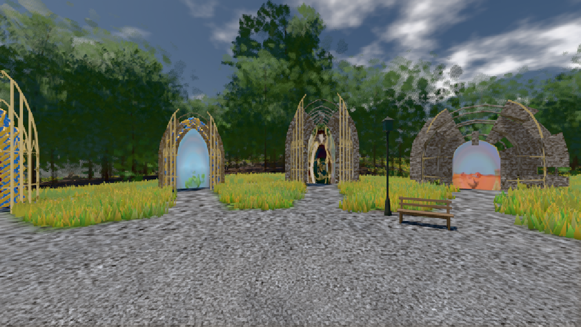
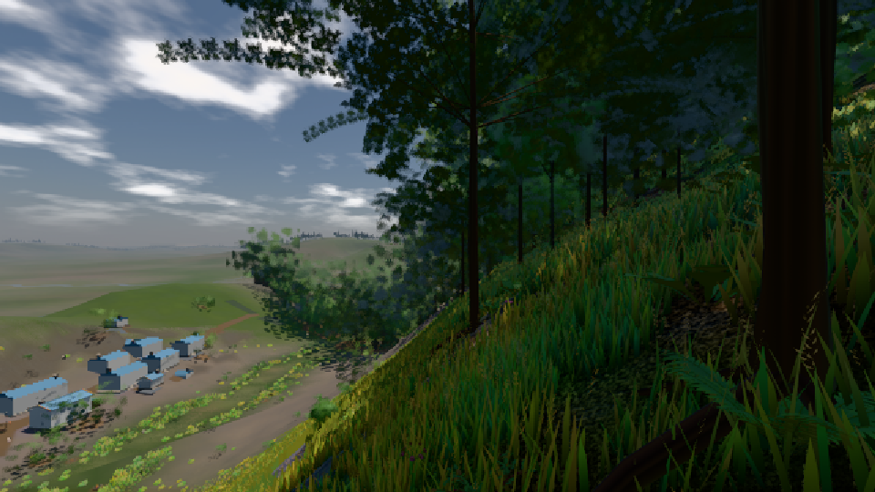

# GPU-PROBE a98f0db6 — GRÜN

Zweig `w27-wald-kosten-heim` · Kopf a98f0db6d8144aed84924d9452e93c2af8107fa2 · Läufer gtx1050-desktop · 10.11. 07:35 · Wanduhr ab Push 842 s · Lauf https://github.com/MiguellD/AnazhRealm/actions/runs/42767995728

Ruf: `gate:pop bild:genesis@0.5 bild:dorf@0.5`

## Läufer gtx1050-desktop — GRÜN

GPU NVIDIA GeForce GTX 1050 · node_modules bleiben (package-lock 818c194e)
Schloss /c/Users/User/AppData/Local/Temp/claude/gpu-schloss hält „ci-runner 42767995728/1 probe“
- Hook 2026-11-10 07:22:06 start ci-runner 42767995728/1 probe: Schloss genommen (refs/heads/w27-wald-kosten-heim a98f0db6d8144aed84924d9452e93c2af8107fa2 ws=C:\actions-runner\_work\AnazhRealm\AnazhRealm)

### gate:pop — GRÜN · 152 s · Läufer gtx1050-desktop

Adapter: ungenannt (die Probe nannte keinen Browser-Adapter)

```text
lod.K2#1 ROT 0.055 % Pop-Pixel/s (1141 px) · 53*+1@189/74*/75*+1@207/526*+1@154/211*/52*+2@192/75+1@155/75*+1@189 · Laub 216 · dc, Dreiecke 99,428020 · GPU 58.14 ms, CPU 6.09 ms je Bild
BLOCK-TREUE GRÜN 233 Blöcke treu · Selbsttest nennt MeshStandardNodeMaterial · nahWiese:L1:1:0 · instanzFarbe: 1/898 Instanzen fremd
```

### bild:genesis@0.5 — GRÜN · 112 s · Läufer gtx1050-desktop

Adapter: [linse-gpu] nvidia/pascal

```text
Kamera des Spiels → Blick (10.0 m): 0.00 92.40 0.00 -10.00 92.40 0.00
 "abnahme": "ABNAHME GRÜN · beweis · Sicht 0.0 % · Ziel Blickziel im Bild frei 10 m · Luma 105.1 σ 39.6 schwarz 0.0 % weiß 0.0 % · Stand 18.546.241 · Bühne summer sunny 0.50 · Gerät WebGPU nvidia pascal",
```



### bild:dorf@0.5 — GRÜN · 138 s · Läufer gtx1050-desktop

Adapter: [linse-gpu] nvidia/pascal

```text
Kamera des Spiels → Blick (10.0 m): -841.00 86.89 -861.00 -834.08 86.89 -853.78
 "abnahme": "ABNAHME GRÜN · beweis · Sicht 0.0 % · Ziel Blickziel im Bild frei 10 m · Luma 64.7 σ 53.1 schwarz 1.0 % weiß 0.0 % · Stand 18.546.241 · Bühne summer sunny 0.50 · Gerät WebGPU nvidia pascal",
```


