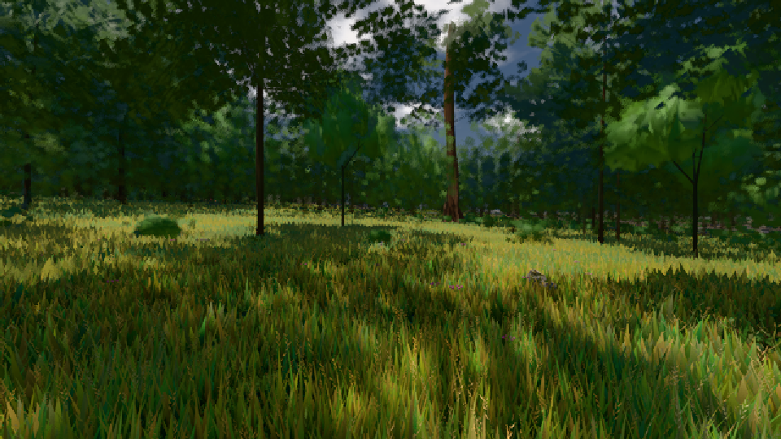

# GPU-PROBE b8e11f05 — GRÜN

Zweig `w27-werkbank-teil` · Kopf b8e11f050c820d2364cd3dc7668d71f795d311a3 · Läufer radeon-890m · 09.11. 23:57 · Wanduhr ab Push 523 s · Lauf https://github.com/MiguellD/AnazhRealm/actions/runs/42715107822

Ruf: `gate:pruefbuehne-licht bild:wiese@0.5`

## Läufer radeon-890m — GRÜN

GPU AMD Radeon(TM) 890M Graphics · node_modules bleiben (package-lock affde574)
Schloss /c/Users/micha/AppData/Local/Temp/claude/gpu-schloss hält „ci-runner 42715107822/1 probe“
- Hook 2026-11-09 23:53:09 start ci-runner 42715107822/1 probe: Schloss genommen (refs/heads/w27-werkbank-teil b8e11f050c820d2364cd3dc7668d71f795d311a3 ws=C:\actions-runner\_work\AnazhRealm\AnazhRealm)

### gate:pruefbuehne-licht — GRÜN · 69 s · Läufer radeon-890m

Adapter: [linse-gpu] amd/rdna-3

```text
  S0 BODEN-PROGRAMM 1/1: 99966 Zeichen WGSL · Pipeline asynchron · kalt 847 · 737 · 690 · 734 · 848 · 731 · 705 · 659 · 686 ms → GRÜN
  S0 K17-FALL (Selbsttest): 192391 Zeichen WGSL · Pipeline synchron · kalt 1001 · 839 · 827 · 1172 · 848 · 834 · 819 · 806 · 779 ms → ROT
✅ S0 BILD GRÜN: die Feuerstelle trägt den Feuerkreis aus 2 m in der Ausgabe (38 s, amd/rdna-3 · Holz kienspan)
```

### bild:wiese@0.5 — GRÜN · 65 s · Läufer radeon-890m

Adapter: [linse-gpu] amd/rdna-3

```text
Kamera des Spiels → Blick (10.0 m): -280.40 29.71 -1045.60 -289.61 29.71 -1049.50
 "abnahme": "ABNAHME GRÜN · beweis · Sicht 0.0 % · Ziel Blickziel im Bild frei 10 m · Luma 57.2 σ 33.2 schwarz 0.0 % weiß 0.0 % · Stand 18.546.238 · Bühne summer sunny 0.50 · Gerät WebGPU amd rdna-3",
```


