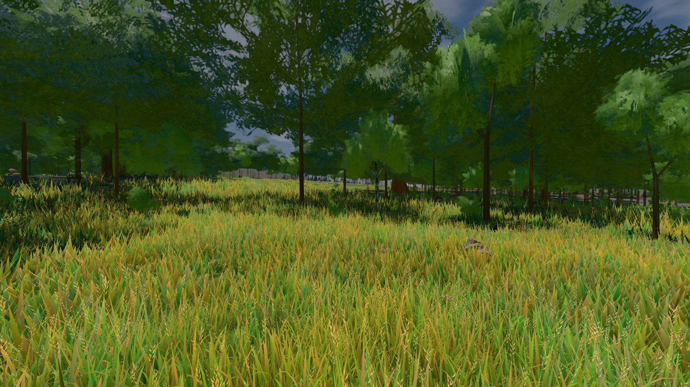

# GPU-PROBE 2c406f26 — GRÜN

Zweig `w28-alte-tests-fallen` · Kopf 2c406f26b5b9bc39432487e3add1ee5b02408353 · Läufer radeon-890m · 19.11. 18:23 · Wanduhr ab Push 181 s · Lauf https://github.com/MiguellD/AnazhRealm/actions/runs/44576191634

Ruf: `bild:wiese@0.5`

## Läufer radeon-890m — GRÜN

GPU AMD Radeon(TM) 890M Graphics · node_modules bleiben (package-lock b38d03a8)
Schloss /c/Users/micha/AppData/Local/Temp/claude/gpu-schloss hält „ci-runner 44576191634/1 probe“
- Hook 2026-11-19 18:21:32 start ci-runner 44576191634/1 probe: Schloss genommen (refs/heads/w28-alte-tests-fallen 2c406f26b5b9bc39432487e3add1ee5b02408353 ws=C:\actions-runner\_work\AnazhRealm\AnazhRealm)

### bild:wiese@0.5 — GRÜN · 73 s · Läufer radeon-890m

Adapter: [linse-gpu] amd/rdna-3

```text
Kamera des Spiels → Blick (10.0 m): -280.40 29.71 -1045.60 -289.61 29.71 -1049.50
 "abnahme": "ABNAHME GRÜN · beweis · Sicht 0.0 % · Ziel Blickziel im Bild frei 10 m · Luma 81.5 σ 39.3 schwarz 0.0 % weiß 0.0 % · Stand 18.546.343 · Bühne summer sunny 0.50 Tiere gehalten · Gerät WebGPU amd rdna-3 · Inhalt nahWiese 48.2 % (≥ 15.0 %) h 107° Luma 117",
```


