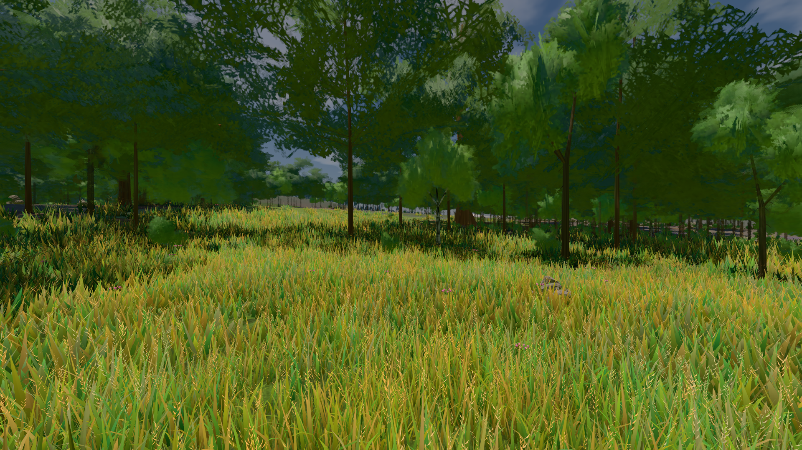

# GPU-PROBE 1de6bff3 — GRÜN

Zweig `w28-altlast-in-die-karte-2` · Kopf 1de6bff3f41579c9e1c8b0f0f16ce31343dcb189 · Läufer gtx1050-desktop · 19.11. 23:05 · Wanduhr ab Push 185 s · Lauf https://github.com/MiguellD/AnazhRealm/actions/runs/44624717201

Ruf: `bild:wiese@0.5`

## Läufer gtx1050-desktop — GRÜN

GPU NVIDIA GeForce GTX 1050 · node_modules bleiben (package-lock bd5d6c75)
Schloss /c/Users/User/AppData/Local/Temp/claude/gpu-schloss hält „ci-runner 44624717201/1 probe“
- Hook 2026-11-19 23:02:53 start ci-runner 44624717201/1 probe: Schloss genommen (refs/heads/w28-altlast-in-die-karte-2 1de6bff3f41579c9e1c8b0f0f16ce31343dcb189 ws=C:\actions-runner\_work\AnazhRealm\AnazhRealm)

### bild:wiese@0.5 — GRÜN · 126 s · Läufer gtx1050-desktop

Adapter: [linse-gpu] nvidia/pascal

```text
Kamera des Spiels → Blick (10.0 m): -280.40 29.71 -1045.60 -289.61 29.71 -1049.50
 "abnahme": "ABNAHME GRÜN · beweis · Sicht 0.0 % · Ziel Blickziel im Bild frei 10 m · Luma 81.9 σ 38.9 schwarz 0.0 % weiß 0.0 % · Stand 18.546.345 · Bühne summer sunny 0.50 Tiere gehalten · Gerät WebGPU nvidia pascal · Inhalt nahWiese 48.2 % (≥ 15.0 %) h 107° Luma 117",
```


