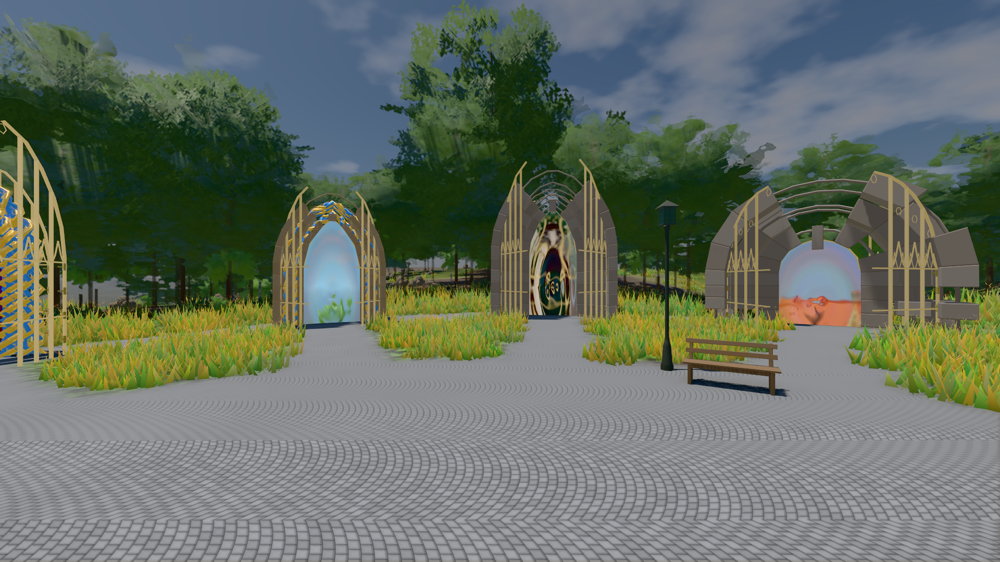

# GPU-PROBE 41ccd7dd — GRÜN

Zweig `w28-ankunft-stapel` · Kopf 41ccd7dd237d7194641e8908d156bd16f7ace60c · Läufer gtx1050-desktop + radeon-890m (Band-Gerät) · 16.11. 05:00 · Wanduhr ab Push 688 s · Lauf https://github.com/MiguellD/AnazhRealm/actions/runs/43800388099

Ruf: `gate:fern-ring bild:genesis@0.5 zeit:gate:ankunft`

## Läufer gtx1050-desktop — GRÜN

GPU NVIDIA GeForce GTX 1050 · node_modules bleiben (package-lock 76b18c39)
Schloss /c/Users/User/AppData/Local/Temp/claude/gpu-schloss hält „ci-runner 43800388099/1 probe“
- Hook 2026-11-16 04:49:21 start ci-runner 43800388099/1 probe: wartet auf Schloss von 'hand steh-linse (Claude)'
- Hook 2026-11-16 04:56:08 start ci-runner 43800388099/1 probe: Schloss genommen (refs/heads/w28-ankunft-stapel 41ccd7dd237d7194641e8908d156bd16f7ace60c ws=C:\actions-runner\_work\AnazhRealm\AnazhRealm)

### gate:fern-ring — GRÜN · 150 s · Läufer gtx1050-desktop

Adapter: [linse-gpu] nvidia/pascal

```text
  ✅ 9: DIE NAHT — kein Durchstich: wo der Ring zeichnet, liegt er nicht über dem Deck (im Saum um die Weiche gesenkt — er weicht dem Chunk in die Tiefe); Selbsttest: ohne die Karte sticht seine Sehne durch (> 2 %) — proben=22428 anteil=0.0000 seiten={} weiche=6 stufen={"0":6,"1":30,"2":13} zeit=10112+62561ms maskNode=true karte=49/49 selbsttest-ohne-karte=0.3495
  ✅ 9: DIE NAHT — kein Einschnitt: wo das Deck mehr als 2 m unter der 2D-Höhe liegt (Höhlen-Mündung, Kanal, Edit) und der Ring zeichnet, steht er nicht über ihm — die Naht trägt die Fläche des Feldes, das der Chunk zeichnet, und die Weiche des Saums den Fehler der Masche (`_fernRingWeiche`: Steigung × Durchmesser); Selbsttest: der Ring auf der 2D-Höhe (die alte Naht) schneidet ein — einschnitt=0/0 orte=[] luecke=274 (davon unter der Weiche 224 ["(518.3|-5.4) Deck 116.3 Ring 117.6 Weiche 13.9","(518.5|-5.4) Deck 116.3 Ring 117.7 Weiche 14.0","(517.8|-5.4) Deck 116.3 Ring 117.6 W
  ✅ 10: DIE FERN-FARBE OHNE STREIFEN — Streifen-Index (RMS Nachbar-Sprung / RMS 4er-Sprung) im Median ≤ 0,5 — reihen=24 median=0.436 p90=0.790 selbsttest zufall=0.99 glatt=0.25
  ✅ 11: DAS DACH IST DER BESTAND — die Deckung des Kronendachs trifft die Kronen-Deckung des gepflanzten Waldes (192 × 192 m, je 32-m-Land-Kachel) im Verhältnis 0,8–1,25; Selbsttest: das alte Dach (die Geburt als Deckung) fällt rot — kacheln=36 gepflanzt=0.203 dach=0.196 verhaeltnis=1.039 selbsttest-alt=0.886 (0.229)
  ✅ 12: DIE WEICHE KOSTET NUR AN DER NAHT — kein gezeichnetes Dreieck mit depthNode ohne Rand-Zelle des Gebauten in Reichweite (1½ s_max); Selbsttest: die Weiche über den ganzen Ring findet Dreiecke ohne Naht — weiche=2654 ohne-naht=0 {} ring=18614 rand-zellen=49 selbsttest-weiche-überall=15960
  ✅ 13: DIE TEILUNG IST TREU — ein freies Dreieck trägt nur Regel 0, ein getragenes nur Regel 2 (die Punkte der Loch-Probe und Ecken, Kanten-Mitten, Schwerpunkte); Selbsttest: die Naht als frei zeigt Stiche, verworfen Löcher — proben=94083 stich=0 loch=0 klassen(frei/naht/getragen)=[5976,2654,6346] orte=[] selbsttest stich=12259 loch=8187
  ✅ 14: DAS WASSER DES RINGS IST DAS WASSER DES BODENS — ein See liegt über dem Ring; ein Fluss trägt seinen Anteil der Masche als Wasser-Anteil aNass (≤ 0,05, gezeichnet mit dem Blick des Wassers), seine Boden-Farbe ohne Fern-Blau (≤ 0,01) und seine Höhe als Mittel aus Boden und Spiegel (≤ 0,05 m); Selbsttest: die alte Regel (kein Anteil, keine Senkung) verfehlt den Fluss — see=0 verdeckt=0 fluss=552 deutlich(>=0,25)=18 abweichung=0 zwilling=0 hoehe=0/508 offen=0 orte=[] selbsttest-alt=552 alt-hoehe=84 hub-max=0.241 m karte(mitte/fehl/daneben)=95/0/0
  ✅ 15: DER HORIZONT STEHT NACH DEM SCHNEE — ein Edit-Auftrag fliegt, die Schneegrenze bestellt neu (`_fernRingNeuBestellen`) — [im Flug, Generation vorher, nachher, editFlug] 1,0,1,0
  ✅ 16: DIE REGIONEN GEHEN VOR — der neue Faden antwortet vor dem letzten Chunk — 236.46000000834465,3534.1800000071526 ms — TÄTER sonst: hydro-an hinter den Chunks (voxel-worker.js REGIONEN_STAND)
✅ GRÜN — DER FERN-RING STEHT UND DAS FELD ZEICHNET: 3 Schalen aus dem EINEN Höhen-Gesetz (Fern-Wahrheit includeDetail=false, XZ welt-gesnappt), der Fern-Faden rechnet Ring, Feld und Krone in Scheiben aus dem Gelände-Gesetzbuch, der Haupt-Faden hängt nur ein, quantisiertes Re-Zentrieren, headless-default ruhig.
```

### bild:genesis@0.5 — GRÜN · 80 s · Läufer gtx1050-desktop

Adapter: [linse-gpu] nvidia/pascal

```text
Kamera des Spiels → Blick (10.0 m): 0.00 92.40 0.00 -10.00 92.40 0.00
 "abnahme": "ABNAHME GRÜN · beweis · Sicht 0.0 % · Ziel Blickziel im Bild frei 10 m · Luma 108.5 σ 38.5 schwarz 0.0 % weiß 0.0 % · Stand 18.546.299 · Bühne summer sunny 0.50 Tiere gehalten · Gerät WebGPU nvidia pascal · Inhalt bodenSatz 36.4 % (≥ 15.0 %) Luma 140, portal-membran 2.7 % (≥ 0.3 %) Luma 140",
```



## Läufer radeon-890m (Band-Gerät) — GRÜN

GPU AMD Radeon(TM) 890M Graphics · node_modules bleiben (package-lock 76b18c39)
Schloss /c/Users/micha/AppData/Local/Temp/claude/gpu-schloss hält „ci-runner 43800388099/1 probe“
- Hook 2026-11-16 04:49:28 start ci-runner 43800388099/1 probe: wartet auf Schloss von 'punkte-radeon-sitzungpid=27348'
- Hook 2026-11-16 04:49:44 start ci-runner 43800388099/1 probe: Schloss genommen (refs/heads/w28-ankunft-stapel 41ccd7dd237d7194641e8908d156bd16f7ace60c ws=C:\actions-runner\_work\AnazhRealm\AnazhRealm)

### zeit:gate:ankunft — GRÜN · 97 s · Läufer radeon-890m (Band-Gerät)

Adapter: ungenannt (die Probe nannte keinen Browser-Adapter)

```text
  ✅ LH was das Bild nicht liest, hält es nicht: die Hülle am Leib, der Ring außer Bild im Leerlauf — Hülle 0,0,0,1,0 · Ring [hinten ohne Leerlauf, vorn, Ruf, hinten mit] false,true,true,true · Kacheln {"_tickNahWiese":[0,1],"_nahWieseFernTakt":[0,6],"_tickNahStreu":[0,3]} · Krone vor der Kachel [gebaut, stehend, unter der kommenden, unter der gelandeten] {"_tickNahWiese":[24,24,0,10],"_nahWieseFernTakt":[852,852,0,4],"_tickNahStreu":[148,148,0,36]} · Mutante {"_tickNahWiese":[34,24,10,10],"_nahWieseFernTakt":[856,852,4,4],"_tickNahStreu":[184,148,36,36]} · Chunk [offen, gepflanzt]
  ✅ L1 das Fadenkreuz steht in der Bildmitte und weicht der Schublade — da true · Mitte 0/0 px · mit Werkstatt false · danach true
  ✅ L2b „hilfe" nennt die EINEN Tafeln und die Tasten — „hilfe": 0 fehlen · „help": 0 fehlen · „?": 0 fehlen
  ✅ L3 Enter öffnet das Gespräch, Enter sendet und gibt die Welt zurück, Enter auf einem Knopf gehört dem Knopf — Enter → chat-input · gesendet true · danach BODY · W true · Esc → BODY · Enter auf dem Knopf → knopf
  ✅ L7 der Start-Gurt liest den Katalog (je Studio-Art ein Werk) — baum_eiche · fahrzeug_gt · tor_drachentor · haus_alemannisch · bank_sitzbank · leiter_podestleiter · bruecke_jochfeld · schaukel_doppelschaukel (Arten im Katalog: tree, vehicle, ort:tor, haus, ort:platz, ort:wand, ort:weg, ort:spielplatz)
  ✅ LK die 3rd-Kamera rückt nur vor Boden und Bau ein, gleitet hinaus, jeder Pflanzen-Stoff trägt die Durchsicht — baum_kiefer · Stamm × 3.977 (Welt × 3.977) · fuss: 496 Proben, Pflanze hält 0, Arm 6.11/6.11 m (Ist/Soll), < 3 m 0, Sprünge 0 (Soll 0, hinaus 0) · ritt: 496 Proben, Pflanze hält 0, Arm 9.38/9.38 m (Ist/Soll), < 3 m 0, Sprünge 0 (Soll 0, hinaus 0) · Pflanzen-Stoffe 20, ohne Durchsicht 0, Ziel 0.6 m neben der Brust, Fadenkreuz 0.6 m neben der Brust · Fadenkreuz-Strahl: 96 Stellungen, hinter dem Spieler {}, Ziel neben dem Blick 0 m · Durchsicht: 1st 0/8 Anläufe mit
  ✅ D8 der Spieler-Chat trägt Worte, das Log die Zahlen — 6 Zeilen · Log true
  ✅ D6 die KI nennt die Ursache (Dienst · Schlüssel · Proxy) — Status „Fehler (Ollama (lokal oder gehostet)): Keine Antwort von 127" · ohne Schlüssel „(Grok schweigt: für Claude (Anthropic, kostet) fehlt der Sch" · Proxy http://127.0.0.1:4601/api/proxy/llm
  ✅ D9 das Dorf steht vor dir, ein gesperrter Slot fällt an seinem Ort — 17 Häuser (Log: 17 platziert, 0 übersprungen) · hinten 0 · außer Bild 0 · gesperrter Slot steht false, laut true · „„Villaalto" steht vor dir: 17 Häuser." · baue dorf hier: 47–128.6 m, beim Mitspieler 0 m daneben (Häuser 14 / 14)
✅ GRÜN — die Ankunft trägt ihre benannten Schnitte.
```
