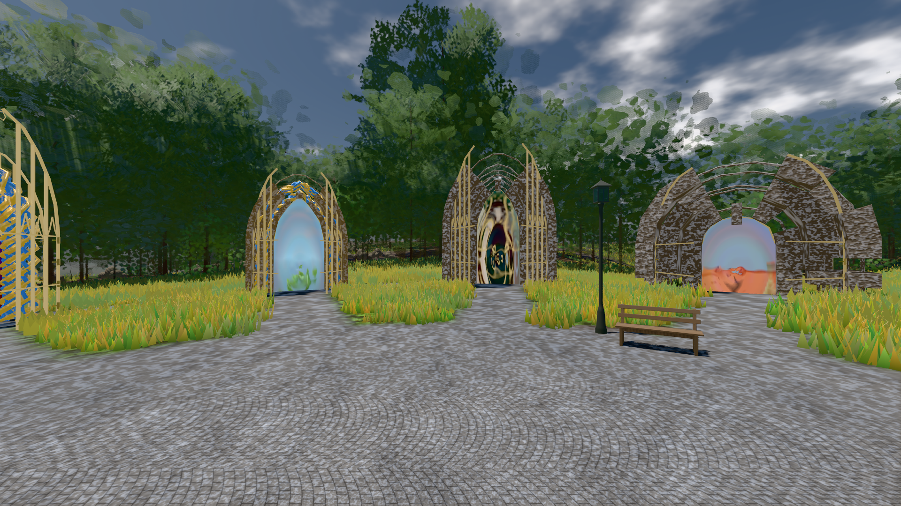

# GPU-PROBE 453babf6 — GRÜN

Zweig `w28-ankunft-stapel` · Kopf 453babf6d6235f49fecef1d9017d9d926d71a670 · Läufer gtx1050-desktop · 12.11. 13:13 · Wanduhr ab Push 473 s · Lauf https://github.com/MiguellD/AnazhRealm/actions/runs/43214763277

Ruf: `gate:kamera-treue gate:weltbild-frost:echt bild:genesis@0.5`

## Läufer gtx1050-desktop — GRÜN

GPU NVIDIA GeForce GTX 1050 · npm ci 54 s (package-lock b254a196)
Schloss /c/Users/User/AppData/Local/Temp/claude/gpu-schloss hält „ci-runner 43214763277/1 probe“
- Hook 2026-11-12 13:06:16 start ci-runner 43214763277/1 probe: Schloss genommen (refs/heads/w28-ankunft-stapel 453babf6d6235f49fecef1d9017d9d926d71a670 ws=C:\actions-runner\_work\AnazhRealm\AnazhRealm)

### gate:kamera-treue — GRÜN · 50 s · Läufer gtx1050-desktop

Adapter: [linse-gpu] nvidia/pascal

```text
  ✅ Selbsttest „alphaTest-0,5-Werfer verliert discard" → rot: WURF: wurf:schnitt — Hauptpass verwirft true, Wurf verwirft false
  ✅ Selbsttest „Farb-Graph im Wurf" → rot: WURF: wurf:voll — ohne Ausschnitt trägt der Wurf den Farb-Graphen
  ✅ Selbsttest „Stand blind" → rot: STAND direkt: DIÄT: keine Diät-Prüfung gezählt — die Linse ist blind
  ✅ Selbsttest „Stempel überlebt den verschachtelten Render" → rot: VERSCHACHTELT replay: nach einem verschachtelten Render über die Vendor-Bahn (Werfer ohne Diät) zeichnet die Diät 0.1099 gleich mit dem vollen Refresh (Soll ≥ 0.999) — ein Stempel überlebte den verschachtelten Render, die nächste geteilte Gruppe trug dessen Kamera
  ✅ Selbsttest „Verschachtelt blind (Täter)" → rot: VERSCHACHTELT direkt: ein Stempel nur aus der Render-Id zeichnet 1 gleich (Soll < 0.98) — die Probe ist blind (oder der Gang liest seinen Render-Abschnitt nicht aus `rend.info.calls`)
  ✅ Selbsttest „kein verschachtelter Render" → rot: VERSCHACHTELT replay: kein verschachtelter Render im Bild der Diät — die Probe ist blind
  ✅ Selbsttest „Spiel-Frame in der Bühne" → rot: LAUF: 2 Spiel-Bilder während der Bühne, der GPU-Kehraus nahm 51 Geometrie-Puffer — der Spiel-Loop lief hinein, der Lauf ist ungültig
  ✅ Selbsttest „Kehraus ohne Spiel-Bild" → rot: LAUF: 0 Spiel-Bilder während der Bühne, der GPU-Kehraus nahm 3 Geometrie-Puffer — der Spiel-Loop lief hinein, der Lauf ist ungültig
✅ SELBSTTEST GRÜN — jeder injizierte Täter fällt rot und wird beim Namen genannt.
✅ GRÜN — LAUF: 0 Spiel-Bilder, 0 Kehraus-Puffer in der Bühne; die Aufnahme verfolgt 14 von 14 Draws trotz Schatten-Render, kein Bundle unter dem Override-Stoff; der Replay zeichnet Blick Y wie der direkte Pfad (1, mit fremdem Schatten-Stoff 1); ohne den Chokepoint 0.7898, ein Schatten-Bundle 0.7898. SCHLÜSSEL · WURF halten. SENKE: zwei Senken EINER Gestalt zeichnen aus EINEM Knoten-Zustand (zwei r184-InstancedMesh: zwei), bild-gleich mit r184s InstancedMesh (1; ohne die Senke 0.9563). STAND: 8 Karten-Programme tragen 1 geteilte Gruppe(n); je Render 27 Prüfungen, 0 Voll-Refreshs (auch 
```

### gate:weltbild-frost:echt — GRÜN · 214 s · Läufer gtx1050-desktop

Adapter: [linse-gpu] nvidia/pascal

```text
  ✅ S6 der JS-Speicher fällt mit dem Abschied zurück — 392.8 → 396.7 MB nach 10 Erscheinungen und Abschied (Soll ≤ +20 MB)
  ✅ Nachlauf: kein verspätetes Wort einer Validierung
  ✅ P2 kein writeBuffer schief: der Pfad und ein Index ungerader Länge der Ich-Bühne — 268107 writeBuffer, keiner schief
  ✅ T1 die Index-Wache nennt den Index über der Vertex-Zahl beim Namen — ["Scene/frost-taeter-bereich: Index 3 ≥ 3 Vertices im gezeichneten Bereich"]
  ✅ T3 die Puffer-Wache nennt den schiefen writeBuffer beim Namen, WebGPU wirft — frost-taeter-puffer · Uint16Array · Versatz 0 · 6 B · q.writeBuffer (stamm/dirigent-ankunft.js:250:36) < pptr:;page.%3Ccomputed%3E%20%5Bas%20evaluate%5D%20(C%3A%5Cactions-runner%5C_work%5CAnazhRealm%5Cgpu-probe%5Cscripts%5Clib%5Cwelt-boot.cjs%3A954%3A22):6:23 · geworfen: Failed to execute 'writeBuffer' on 'GPUQueue': Number of bytes to write must be a multiple of 4
  ✅ T2 die Index-Wache nennt den geweiteten Index beim Pfad — Group/BundleGroup/Group/mensch/torso/head/Mesh: 7962 × Uint32Array = 31848 B gebunden, der Puffer trägt 15924 B
  ✅ T2 die GPU-Wache des Spiels zählt die Validierung — {"n":189}
  ✅ T2 der eigene Hörer hört die Validierung (Device oder r184-Fehler-Bereich) — 378 Meldungen: device 0: Index range (first: 0, count: 7962, format: IndexFormat::Uint32) does not fit in index buffer size (15924). | device 0: [Invalid RenderBundle from RenderBundleEncoder "renderBundleEncoder"] is invalid due to a previous error.
  ✅ T2 die Bild-Probe erkennt das stehende Bild — 0.19 % der Blöcke bewegt
✅ GRÜN — DIE FROST-WAND steht — durch Werkstatt, Ich- und Hof-Bühne trägt jeder Index-Puffer der Welt-GPU sein Format, kein Device meldet, das Bild folgt der Kamera; die Täter (Index über der Vertex-Zahl, ein fremd geweiteter Mensch-Index) nennen die Wachen beim Namen, und das stehende Bild wird erkannt.
```

### bild:genesis@0.5 — GRÜN · 79 s · Läufer gtx1050-desktop

Adapter: [linse-gpu] nvidia/pascal

```text
Kamera des Spiels → Blick (10.0 m): 0.00 92.40 0.00 -10.00 92.40 0.00
 "abnahme": "ABNAHME GRÜN · beweis · Sicht 0.0 % · Ziel Blickziel im Bild frei 10 m · Luma 105.7 σ 40.3 schwarz 0.0 % weiß 0.0 % · Stand 18.546.263 · Bühne summer sunny 0.50 Tiere gehalten · Gerät WebGPU nvidia pascal · Inhalt bodenSatz 35.3 % (≥ 15.0 %) Luma 130, portal-membran 2.8 % (≥ 0.3 %) Luma 139",
```


