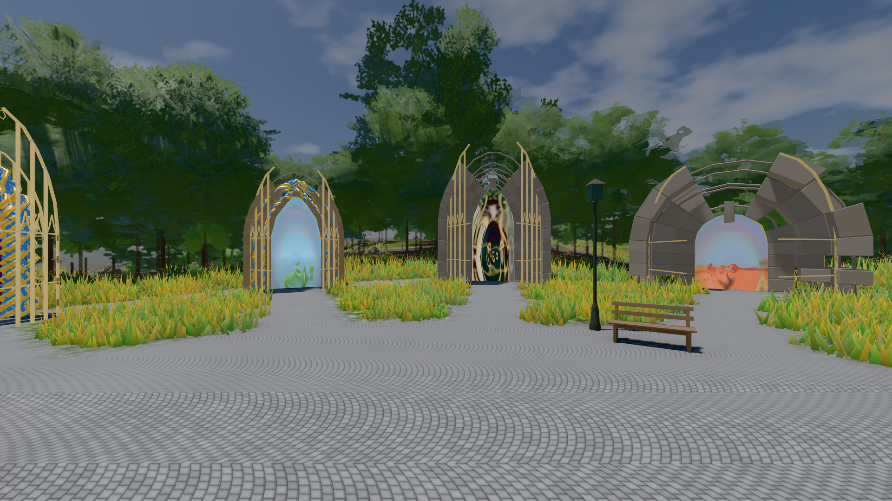
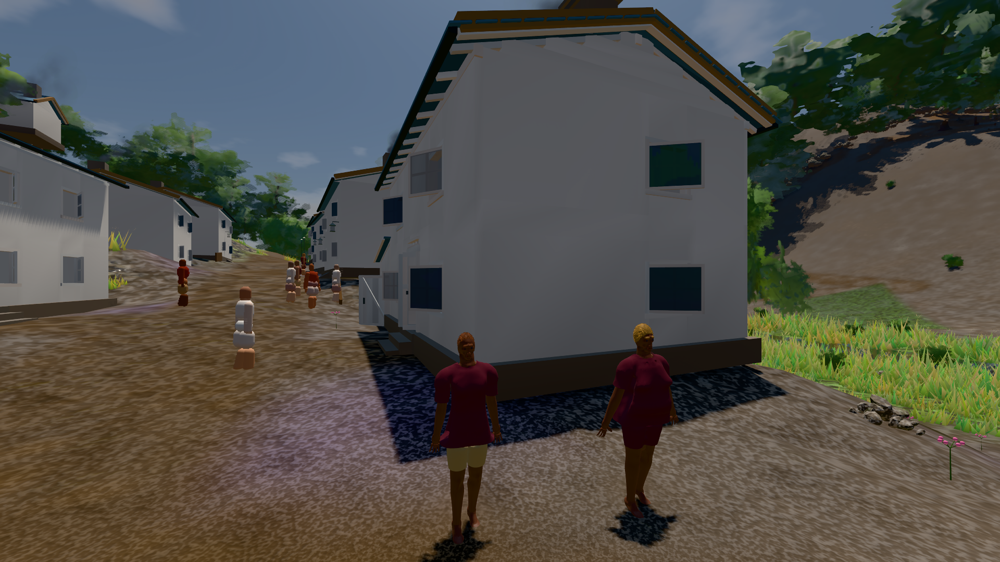

# GPU-PROBE b6d828a0 — GRÜN

Zweig `w28-auge` · Kopf b6d828a0cefa7bcf73a41999f03961a6b2aac356 · Läufer radeon-890m · 14.11. 22:12 · Wanduhr ab Push 893 s · Lauf https://github.com/MiguellD/AnazhRealm/actions/runs/43640181587

Ruf: `bild:genesis@0.5 bild:dorf@0.5 gate:kamera-leib:echt`

## Läufer radeon-890m — GRÜN

GPU AMD Radeon(TM) 890M Graphics · npm ci 71 s (package-lock 82123e6f)
Schloss /c/Users/micha/AppData/Local/Temp/claude/gpu-schloss hält „ci-runner 43640181587/1 probe“
- Hook 2026-11-14 21:57:31 start ci-runner 43640181587/1 probe: wartet auf Schloss von 'befund-gpu-genesispid=25828'
- Hook 2026-11-14 22:07:15 start ci-runner 43640181587/1 probe: Schloss genommen (refs/heads/w28-auge b6d828a0cefa7bcf73a41999f03961a6b2aac356 ws=C:\actions-runner\_work\AnazhRealm\AnazhRealm)

### bild:genesis@0.5 — GRÜN · 46 s · Läufer radeon-890m

Adapter: [linse-gpu] amd/rdna-3

```text
Kamera des Spiels → Blick (10.0 m): 0.00 92.40 0.00 -10.00 92.40 0.00
 "abnahme": "ABNAHME GRÜN · beweis · Sicht 0.0 % · Ziel Blickziel im Bild frei 10 m · Luma 107.6 σ 39 schwarz 0.0 % weiß 0.0 % · Stand 18.546.289 · Bühne summer sunny 0.50 Tiere gehalten · Gerät WebGPU amd rdna-3 · Inhalt bodenSatz 36.4 % (≥ 15.0 %) Luma 140, portal-membran 2.7 % (≥ 0.3 %) Luma 140",
```



### bild:dorf@0.5 — GRÜN · 71 s · Läufer radeon-890m

Adapter: [linse-gpu] amd/rdna-3

```text
Kamera des Spiels → Blick (5.2 m): -704.22 39.69 -880.02 -703.03 39.69 -874.96
 "abnahme": "ABNAHME GRÜN · beweis · Sicht 0.0 % · Ziel Blickziel im Bild frei 5.2 m · Luma 77.9 σ 30.9 schwarz 0.3 % weiß 0.0 % · Stand 18.546.289 · Bühne summer sunny 0.50 Tiere gehalten · Gerät WebGPU amd rdna-3 · Inhalt bauSatz 28.7 % (≥ 2.0 %) Luma 80",
```



### gate:kamera-leib:echt — GRÜN · 65 s · Läufer radeon-890m

Adapter: [linse-gpu] amd/rdna-3

```text
  ✅ K6 Strafe am Prüfplatz — A0 Kopf 0.8 % Leib 1.4 % (2460 px),A1 Kopf 0.0 % Leib 1.3 % (2465 px),A2 Kopf 0.0 % Leib 1.6 % (2503 px),A3 Kopf 0.0 % Leib 1.1 % (2522 px),D0 Kopf 0.0 % Leib 2.7 % (2517 px),D1 Kopf 0.7 % Leib 1.1 % (2412 px),D2 Kopf 0.8 % Leib 2.0 % (2502 px),D3 Kopf 0.0 % Leib 1.1 % (2556 px) · Rückstrahl 0.1 %
✅ GRÜN — die Kamera steckt nie in Laub, Strauch, Fels oder Boden.
```
