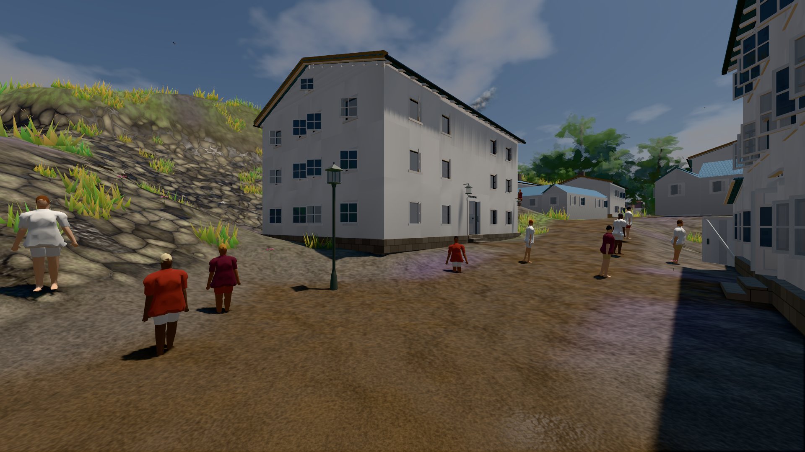

# GPU-PROBE f885be79 — GRÜN

Zweig `w28-bau-rezept-tuer` · Kopf f885be79ee538525eec5de81a14aeb19abea4128 · Läufer omen-gtx1060 · 20.11. 11:45 · Wanduhr ab Push 523 s · Lauf https://github.com/MiguellD/AnazhRealm/actions/runs/44720658769

Ruf: `gate:pruefbuehne-licht gate:weltbild-frost:echt bild:dorf@0.5`

## Läufer omen-gtx1060 — GRÜN

GPU NVIDIA GeForce GTX 1060 · node_modules bleiben (package-lock 6407f3da)
Schloss /c/Users/micha/AppData/Local/Temp/claude/gpu-schloss hält „ci-runner 44720658769/1 probe“
- Hook 2026-11-20 11:36:47 start ci-runner 44720658769/1 probe: Schloss genommen (refs/heads/w28-bau-rezept-tuer f885be79ee538525eec5de81a14aeb19abea4128 ws=C:\actions-runner\_work\AnazhRealm\AnazhRealm)

### gate:pruefbuehne-licht — GRÜN · 56 s · Läufer omen-gtx1060

Adapter: [linse-gpu] nvidia/pascal

```text
  S0 BODEN-PROGRAMM 1/1: 101568 Zeichen WGSL (Ratsche ≤ 104162) · Pipeline asynchron → GRÜN · kalt 1219 · 1284 · 1332 · 1152 · 1070 · 1164 · 1057 · 1045 · 1050 ms, Median 1152 ms · ÷ K17 derselben Sitzung 0,77 (Auskunft, kein Zeit-Urteil)
✅ S0 BILD GRÜN: die Feuerstelle trägt den Feuerkreis aus 2 m in der Ausgabe · Nacht {"luma":22.3,"schwarz":0} (47 s, nvidia/pascal · Holz kienspan)
```

### gate:weltbild-frost:echt — GRÜN · 317 s · Läufer omen-gtx1060

Adapter: [linse-gpu] nvidia/pascal

```text
  ✅ S6 der JS-Speicher fällt mit dem Abschied zurück — 253.6 → 257.6 MB nach 10 Erscheinungen und Abschied (Soll ≤ +20 MB)
  ✅ Nachlauf: kein verspätetes Wort einer Validierung
  ✅ P2 kein writeBuffer schief: der Pfad und ein Index ungerader Länge der Ich-Bühne — 1150905 writeBuffer, keiner schief
  ✅ T1 die Index-Wache nennt den Index über der Vertex-Zahl beim Namen — ["Scene/frost-taeter-bereich: Index 3 ≥ 3 Vertices im gezeichneten Bereich"]
  ✅ T3 die Puffer-Wache nennt den schiefen writeBuffer beim Namen, WebGPU wirft — frost-taeter-puffer · Uint16Array · Versatz 0 · 6 B · q.writeBuffer (stamm/dirigent-ankunft.js:253:36) < pptr:;page.%3Ccomputed%3E%20(C%3A%5Cactions-runner%5C_work%5CAnazhRealm%5Cgpu-probe%5Cscripts%5Clib%5Cwelt-boot.cjs%3A1027%3A22):6:23 · geworfen: Failed to execute 'writeBuffer' on 'GPUQueue': Number of bytes to write must be a multiple of 4
  ✅ T2 die Index-Wache nennt den geweiteten Index beim Pfad — Group/BundleGroup/Group/mensch/torso/head/Mesh: 7962 × Uint32Array = 31848 B gebunden, der Puffer trägt 15924 B
  ✅ T2 die GPU-Wache des Spiels zählt die Validierung — {"n":195}
  ✅ T2 der eigene Hörer hört die Validierung (Device oder r184-Fehler-Bereich) — 390 Meldungen: device 0: Index range (first: 0, count: 7962, format: IndexFormat::Uint32) does not fit in index buffer size (15924). | device 0: [Invalid RenderBundle from RenderBundleEncoder "renderBundleEncoder"] is invalid due to a previous error.
  ✅ T2 die Bild-Probe erkennt das stehende Bild — 2.46 % der Blöcke bewegt
✅ GRÜN — DIE FROST-WAND steht — durch Werkstatt, Ich- und Hof-Bühne trägt jeder Index-Puffer der Welt-GPU sein Format, kein Device meldet, das Bild folgt der Kamera; die Täter (Index über der Vertex-Zahl, ein fremd geweiteter Mensch-Index) nennen die Wachen beim Namen, und das stehende Bild wird erkannt.
```

### bild:dorf@0.5 — GRÜN · 84 s · Läufer omen-gtx1060

Adapter: [linse-gpu] nvidia/pascal

```text
Kamera des Spiels → Blick (11.6 m): -688.22 46.09 -880.02 -676.75 46.09 -878.28
 "abnahme": "ABNAHME GRÜN · beweis · Sicht 0.0 % · Ziel Blickziel im Bild frei 11.6 m · Luma 81.3 σ 31.1 schwarz 0.2 % weiß 0.0 % · Stand 18.546.350 · Bühne summer sunny 0.50 Tiere gehalten · Gerät WebGPU nvidia pascal · Inhalt bauSatz 20.5 % (≥ 2.0 %) Luma 87",
```


