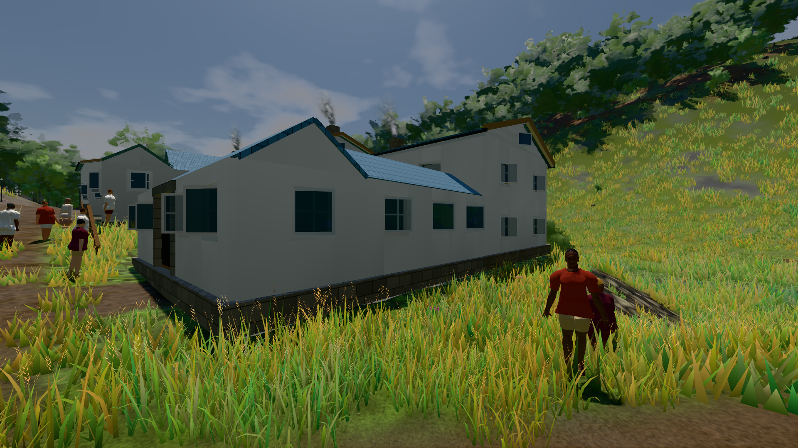
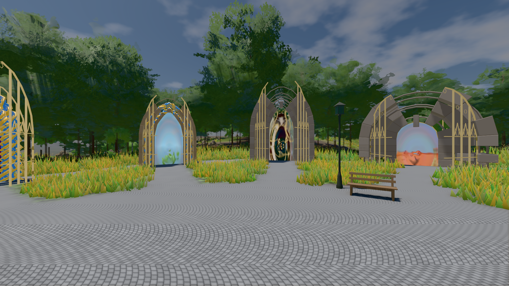

# GPU-PROBE ff2b8341 — GRÜN

Zweig `w28-bau-rezept` · Kopf ff2b8341a46771e22deaf775435308f919c75331 · Läufer gtx1050-desktop · 18.11. 12:47 · Wanduhr ab Push 818 s · Lauf https://github.com/MiguellD/AnazhRealm/actions/runs/44295889842

Ruf: `bild:dorf@0.5 bild:genesis@0.5`

## Läufer gtx1050-desktop — GRÜN

GPU NVIDIA GeForce GTX 1050 · node_modules bleiben (package-lock b6f9c154)
Schloss /c/Users/User/AppData/Local/Temp/claude/gpu-schloss hält „ci-runner 44295889842/1 probe“
- Hook 2026-11-18 12:43:55 start ci-runner 44295889842/1 probe: Schloss genommen (refs/heads/w28-bau-rezept ff2b8341a46771e22deaf775435308f919c75331 ws=C:\actions-runner\_work\AnazhRealm\AnazhRealm)

### bild:dorf@0.5 — GRÜN · 131 s · Läufer gtx1050-desktop

Adapter: [linse-gpu] nvidia/pascal

```text
Kamera des Spiels → Blick (7.0 m): -731.86 41.87 -932.69 -733.16 41.87 -925.81
 "abnahme": "ABNAHME GRÜN · beweis · Sicht 0.0 % · Ziel Blickziel im Bild frei 7 m · Luma 90.3 σ 33.8 schwarz 0.1 % weiß 0.0 % · Stand 18.546.333 · Bühne summer sunny 0.50 Tiere gehalten · Gerät WebGPU nvidia pascal · Inhalt bauSatz 19.5 % (≥ 2.0 %) Luma 70",
```



### bild:genesis@0.5 — GRÜN · 68 s · Läufer gtx1050-desktop

Adapter: [linse-gpu] nvidia/pascal

```text
Kamera des Spiels → Blick (10.0 m): 0.00 92.40 0.00 -10.00 92.40 0.00
 "abnahme": "ABNAHME GRÜN · beweis · Sicht 0.0 % · Ziel Blickziel im Bild frei 10 m · Luma 108.5 σ 38.5 schwarz 0.0 % weiß 0.0 % · Stand 18.546.333 · Bühne summer sunny 0.50 Tiere gehalten · Gerät WebGPU nvidia pascal · Inhalt bodenSatz 36.4 % (≥ 15.0 %) Luma 140, portal-membran 2.7 % (≥ 0.3 %) Luma 140",
```


