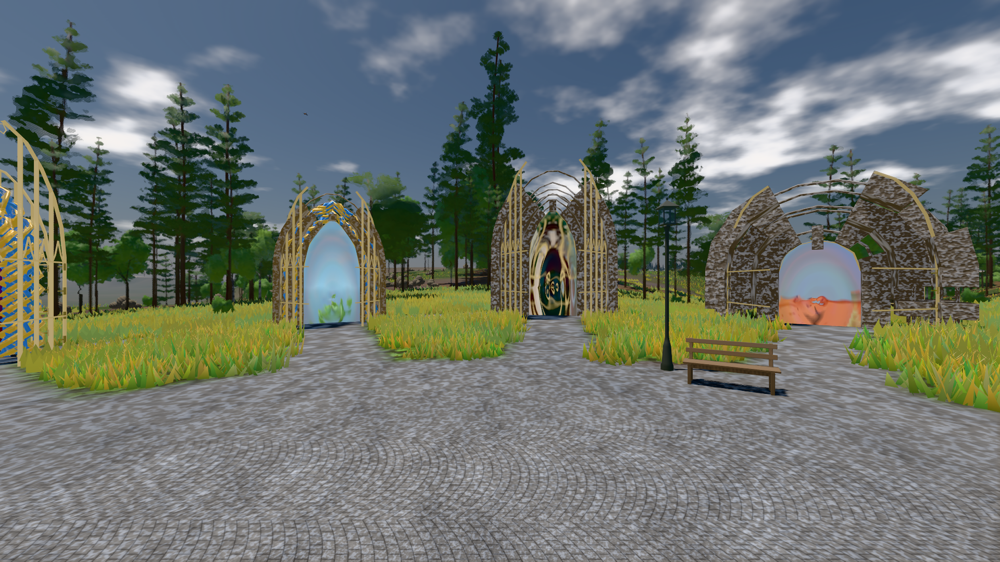
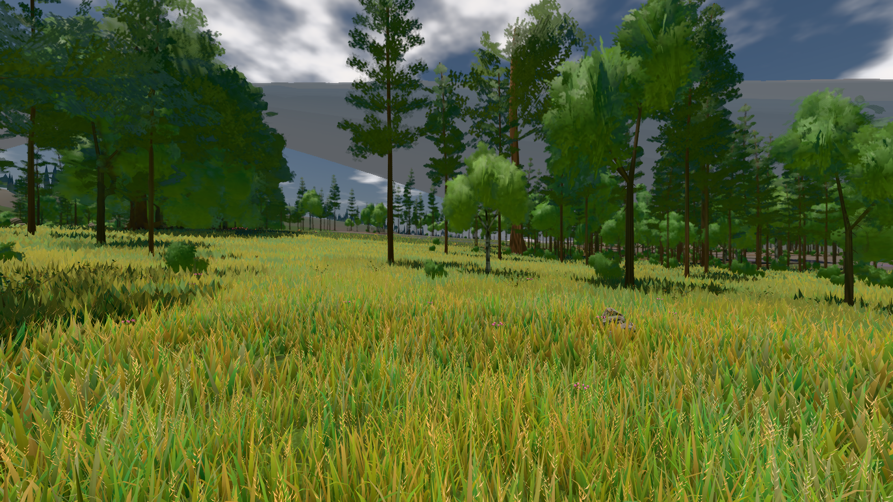

# GPU-PROBE b365300f — GRÜN

Zweig `w28-baum-ganz` · Kopf b365300f131f2a04c87bce5445e6ea3fa215fbf8 · Läufer gtx1050-desktop · 14.11. 01:21 · Wanduhr ab Push 195 s · Lauf https://github.com/MiguellD/AnazhRealm/actions/runs/43533328681

Ruf: `bild:genesis@0.5 bild:wiese@0.5`

## Läufer gtx1050-desktop — GRÜN

GPU NVIDIA GeForce GTX 1050 · node_modules bleiben (package-lock 95130897)
Schloss /c/Users/User/AppData/Local/Temp/claude/gpu-schloss hält „ci-runner 43533328681/1 probe“
- Hook 2026-11-14 01:18:58 start ci-runner 43533328681/1 probe: Schloss genommen (refs/heads/w28-baum-ganz b365300f131f2a04c87bce5445e6ea3fa215fbf8 ws=C:\actions-runner\_work\AnazhRealm\AnazhRealm)

### bild:genesis@0.5 — GRÜN · 67 s · Läufer gtx1050-desktop

Adapter: [linse-gpu] nvidia/pascal

```text
Kamera des Spiels → Blick (10.0 m): 0.00 92.40 0.00 -10.00 92.40 0.00
 "abnahme": "ABNAHME GRÜN · beweis · Sicht 0.0 % · Ziel Blickziel im Bild frei 10 m · Luma 114 σ 38 schwarz 0.0 % weiß 0.0 % · Stand 18.546.276 · Bühne summer sunny 0.50 Tiere gehalten · Gerät WebGPU nvidia pascal · Inhalt bodenSatz 35.4 % (≥ 15.0 %) Luma 128, portal-membran 2.8 % (≥ 0.3 %) Luma 139",
```



### bild:wiese@0.5 — GRÜN · 78 s · Läufer gtx1050-desktop

Adapter: [linse-gpu] nvidia/pascal

```text
Kamera des Spiels → Blick (10.0 m): -280.40 29.71 -1045.60 -289.61 29.71 -1049.50
 "abnahme": "ABNAHME GRÜN · beweis · Sicht 0.0 % · Ziel Blickziel im Bild frei 10 m · Luma 94.9 σ 41.5 schwarz 0.0 % weiß 0.0 % · Stand 18.546.276 · Bühne summer sunny 0.50 Tiere gehalten · Gerät WebGPU nvidia pascal · Inhalt nahWiese 48.1 % (≥ 15.0 %) h 107° Luma 120",
```


