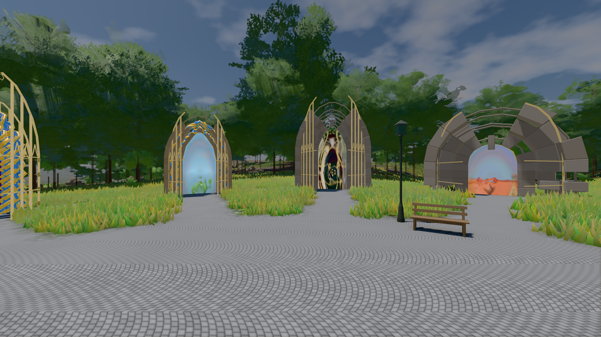
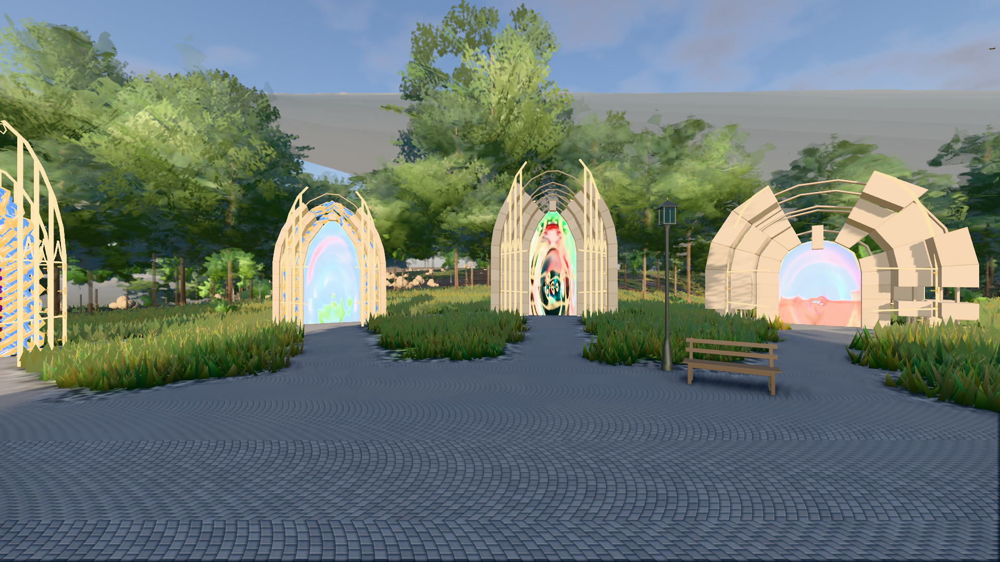

# GPU-PROBE 5e8a5d31 — GRÜN

Zweig `w28-beet-feuchte` · Kopf 5e8a5d31579f80ab364b39325b12e00e10cd07c2 · Läufer omen-gtx1060 · 14.11. 12:04 · Wanduhr ab Push 148 s · Lauf https://github.com/MiguellD/AnazhRealm/actions/runs/43588027411

Ruf: `bild:genesis@0.5 bild:genesis@0.3`

## Läufer omen-gtx1060 — GRÜN

GPU NVIDIA GeForce GTX 1060 · node_modules bleiben (package-lock 57539f97)
Schloss /c/Users/micha/AppData/Local/Temp/claude/gpu-schloss hält „ci-runner 43588027411/1 probe“
- Hook 2026-11-14 12:01:49 start ci-runner 43588027411/1 probe: Schloss genommen (refs/heads/w28-beet-feuchte 5e8a5d31579f80ab364b39325b12e00e10cd07c2 ws=C:\actions-runner\_work\AnazhRealm\AnazhRealm)

### bild:genesis@0.5 — GRÜN · 44 s · Läufer omen-gtx1060

Adapter: [linse-gpu] nvidia/pascal

```text
Kamera des Spiels → Blick (10.0 m): 0.00 92.40 0.00 -10.00 92.40 0.00
 "abnahme": "ABNAHME GRÜN · beweis · Sicht 0.0 % · Ziel Blickziel im Bild frei 10 m · Luma 106.6 σ 38.7 schwarz 0.0 % weiß 0.0 % · Stand 18.546.283 · Bühne summer sunny 0.50 Tiere gehalten · Gerät WebGPU nvidia pascal · Inhalt bodenSatz 36.1 % (≥ 15.0 %) Luma 139, portal-membran 2.7 % (≥ 0.3 %) Luma 140",
```



### bild:genesis@0.3 — GRÜN · 45 s · Läufer omen-gtx1060

Adapter: [linse-gpu] nvidia/pascal

```text
Kamera des Spiels → Blick (10.0 m): 0.00 92.40 0.00 -10.00 92.40 0.00
 "abnahme": "ABNAHME GRÜN · beweis · Sicht 0.0 % · Ziel Blickziel im Bild frei 10 m · Luma 118.1 σ 48.3 schwarz 0.0 % weiß 0.0 % · Stand 18.546.283 · Bühne summer sunny 0.30 Tiere gehalten · Gerät WebGPU nvidia pascal · Inhalt bodenSatz 36.1 % (≥ 15.0 %) Luma 90, portal-membran 2.7 % (≥ 0.3 %) Luma 218",
```


