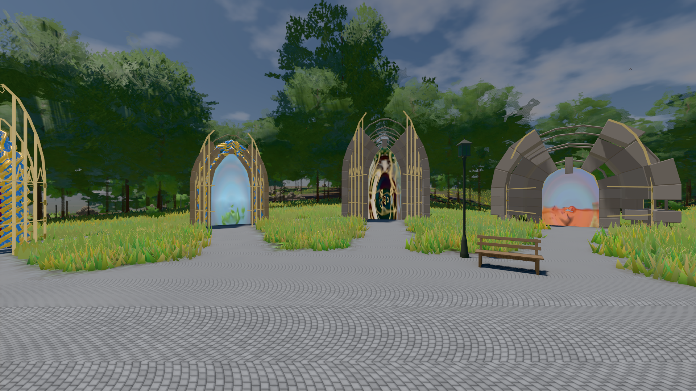
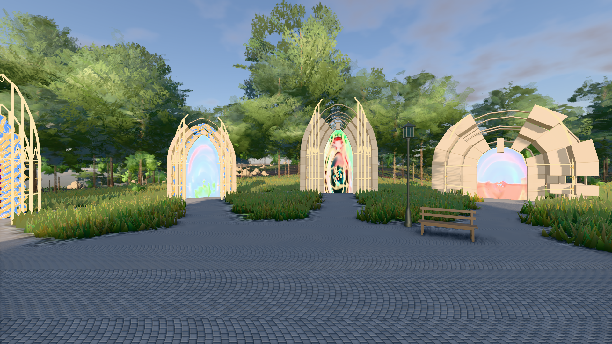

# GPU-PROBE fe64931c — GRÜN

Zweig `w28-beet-feuchte` · Kopf fe64931c5887812e2adca776d1ef00bb4607b5bf · Läufer radeon-890m · 14.11. 12:51 · Wanduhr ab Push 429 s · Lauf https://github.com/MiguellD/AnazhRealm/actions/runs/43591419422

Ruf: `bild:genesis@0.5 bild:genesis@0.3`

## Läufer radeon-890m — GRÜN

GPU AMD Radeon(TM) 890M Graphics · node_modules bleiben (package-lock 57539f97)
Schloss /c/Users/micha/AppData/Local/Temp/claude/gpu-schloss hält „ci-runner 43591419422/1 probe“
- Hook 2026-11-14 12:46:13 start ci-runner 43591419422/1 probe: verwaistes Schloss 'punkte-radeon-sitzungpid=99024' geloest - Halter pid=99024 lebt nicht
- Hook 2026-11-14 12:46:18 start ci-runner 43591419422/1 probe: Schloss genommen (refs/heads/w28-beet-feuchte fe64931c5887812e2adca776d1ef00bb4607b5bf ws=C:\actions-runner\_work\AnazhRealm\AnazhRealm)

### bild:genesis@0.5 — GRÜN · 64 s · Läufer radeon-890m

Adapter: [linse-gpu] amd/rdna-3

```text
Kamera des Spiels → Blick (10.0 m): 0.00 92.40 0.00 -10.00 92.40 0.00
 "abnahme": "ABNAHME GRÜN · beweis · Sicht 0.0 % · Ziel Blickziel im Bild frei 10 m · Luma 106.6 σ 38.7 schwarz 0.0 % weiß 0.0 % · Stand 18.546.283 · Bühne summer sunny 0.50 Tiere gehalten · Gerät WebGPU amd rdna-3 · Inhalt bodenSatz 36.1 % (≥ 15.0 %) Luma 139, portal-membran 2.7 % (≥ 0.3 %) Luma 140",
```



### bild:genesis@0.3 — GRÜN · 50 s · Läufer radeon-890m

Adapter: [linse-gpu] amd/rdna-3

```text
Kamera des Spiels → Blick (10.0 m): 0.00 92.40 0.00 -10.00 92.40 0.00
 "abnahme": "ABNAHME GRÜN · beweis · Sicht 0.0 % · Ziel Blickziel im Bild frei 10 m · Luma 119.8 σ 49.3 schwarz 0.0 % weiß 0.0 % · Stand 18.546.283 · Bühne summer sunny 0.30 Tiere gehalten · Gerät WebGPU amd rdna-3 · Inhalt bodenSatz 36.1 % (≥ 15.0 %) Luma 90, portal-membran 2.7 % (≥ 0.3 %) Luma 218",
```


