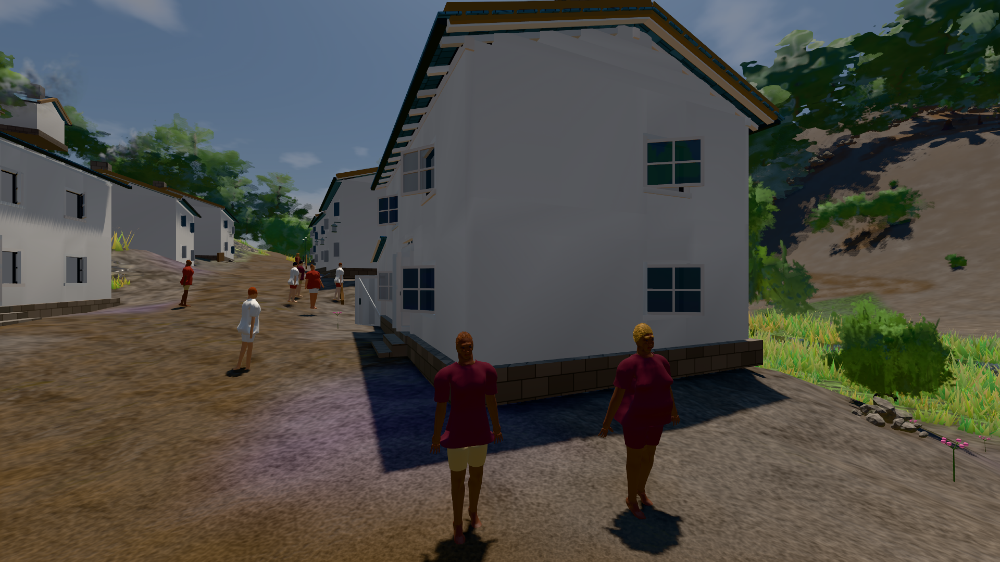

# GPU-PROBE 70be3eae — GRÜN

Zweig `w28-beobachter-ein-weg` · Kopf 70be3eae2d1bb9f5cf47b84aa79be7f12b71d087 · Läufer radeon-890m · 20.11. 05:11 · Wanduhr ab Push 704 s · Lauf https://github.com/MiguellD/AnazhRealm/actions/runs/44671447986

Ruf: `bild:dorf@0.5`

## Läufer radeon-890m — GRÜN

GPU AMD Radeon(TM) 890M Graphics · npm ci 119 s (package-lock 20e3f8f6)
Schloss /c/Users/micha/AppData/Local/Temp/claude/gpu-schloss hält „ci-runner 44671447986/1 probe“
- Hook 2026-11-20 05:03:37 start ci-runner 44671447986/1 probe: Schloss genommen (refs/heads/w28-beobachter-ein-weg 70be3eae2d1bb9f5cf47b84aa79be7f12b71d087 ws=C:\actions-runner\_work\AnazhRealm\AnazhRealm)

### bild:dorf@0.5 — GRÜN · 157 s · Läufer radeon-890m

Adapter: [linse-gpu] amd/rdna-3

```text
Kamera des Spiels → Blick (5.2 m): -704.22 39.69 -880.02 -703.01 39.69 -874.96
 "abnahme": "ABNAHME GRÜN · beweis · Sicht 0.0 % · Ziel Blickziel im Bild frei 5.2 m · Luma 76.1 σ 30.8 schwarz 0.2 % weiß 0.0 % · Stand 18.546.346 · Bühne summer sunny 0.50 Tiere gehalten · Gerät WebGPU amd rdna-3 · Inhalt bauSatz 29.7 % (≥ 2.0 %) Luma 80",
```


