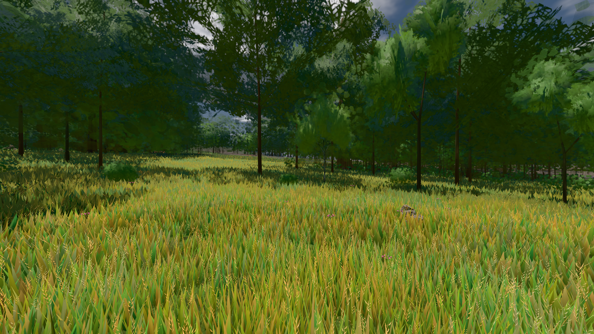
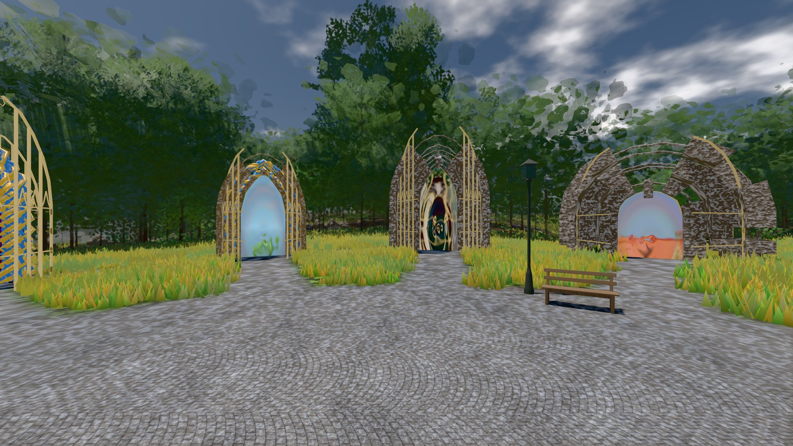

# GPU-PROBE 6c04fac8 — GRÜN

Zweig `w28-bestand-kennung` · Kopf 6c04fac8c7cc9c155b9c6e919311870cb72d458b · Läufer gtx1050-desktop · 12.11. 07:17 · Wanduhr ab Push 430 s · Lauf https://github.com/MiguellD/AnazhRealm/actions/runs/43166273757

Ruf: `bild:wiese@0.5 bild:genesis@0.5`

## Läufer gtx1050-desktop — GRÜN

GPU NVIDIA GeForce GTX 1050 · npm ci 93 s (package-lock db0dbb29)
Schloss /c/Users/User/AppData/Local/Temp/claude/gpu-schloss hält „ci-runner 43166273757/1 probe“
- Hook 2026-11-12 07:10:52 start ci-runner 43166273757/1 probe: Schloss genommen (refs/heads/w28-bestand-kennung 6c04fac8c7cc9c155b9c6e919311870cb72d458b ws=C:\actions-runner\_work\AnazhRealm\AnazhRealm)

### bild:wiese@0.5 — GRÜN · 131 s · Läufer gtx1050-desktop

Adapter: [linse-gpu] nvidia/pascal

```text
Kamera des Spiels → Blick (10.0 m): -280.40 29.71 -1045.60 -289.61 29.71 -1049.50
 "abnahme": "ABNAHME GRÜN · beweis · Sicht 0.0 % · Ziel Blickziel im Bild frei 10 m · Luma 81.9 σ 42.5 schwarz 0.0 % weiß 0.0 % · Stand 18.546.261 · Bühne summer sunny 0.50 Tiere gehalten · Gerät WebGPU nvidia pascal · Inhalt nahWiese 48.2 % (≥ 15.0 %) h 107° Luma 120",
```



### bild:genesis@0.5 — GRÜN · 132 s · Läufer gtx1050-desktop

Adapter: [linse-gpu] nvidia/pascal

```text
Kamera des Spiels → Blick (10.0 m): 0.00 92.40 0.00 -10.00 92.40 0.00
 "abnahme": "ABNAHME GRÜN · beweis · Sicht 0.0 % · Ziel Blickziel im Bild frei 10 m · Luma 105.7 σ 40.3 schwarz 0.0 % weiß 0.0 % · Stand 18.546.261 · Bühne summer sunny 0.50 Tiere gehalten · Gerät WebGPU nvidia pascal · Inhalt bodenSatz 35.3 % (≥ 15.0 %) Luma 130, portal-membran 2.8 % (≥ 0.3 %) Luma 139",
```


