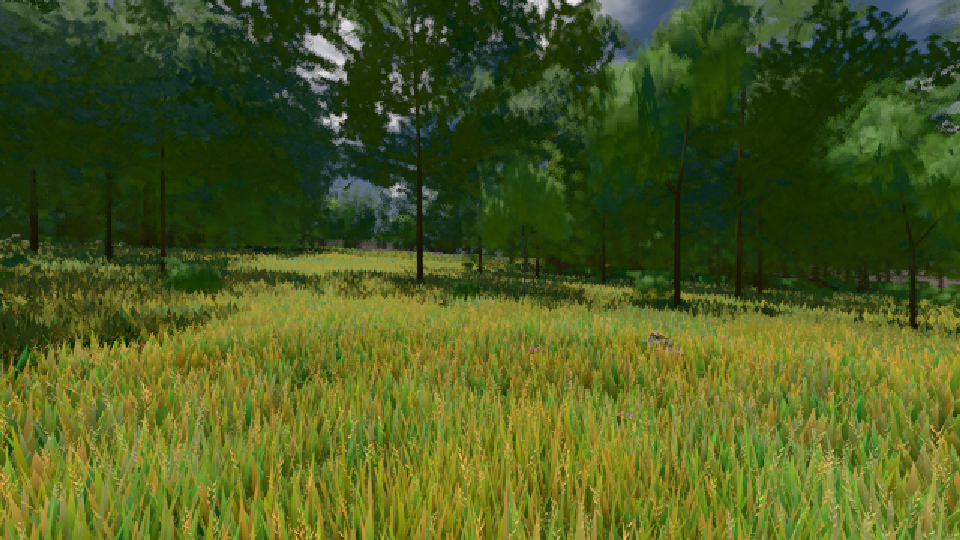

# GPU-PROBE 87880e32 — ROT

Zweig `w28-bestand-kennung` · Kopf 87880e328e888dbd58904b7db724d0d9a5f7b0a1 · Läufer gtx1050-desktop · 12.11. 05:12 · Wanduhr ab Push 1936 s · Lauf https://github.com/MiguellD/AnazhRealm/actions/runs/43149777247

Ruf: `gate:kreatur-takt bild:wiese@0.5`

## Läufer gtx1050-desktop — ROT

GPU NVIDIA GeForce GTX 1050 · node_modules bleiben (package-lock 657462dc)
Schloss /c/Users/User/AppData/Local/Temp/claude/gpu-schloss hält „ci-runner 43149777247/1 probe“
- Hook 2026-11-12 04:52:02 start ci-runner 43149777247/1 probe: Schloss genommen (refs/heads/w28-bestand-kennung 87880e328e888dbd58904b7db724d0d9a5f7b0a1 ws=C:\actions-runner\_work\AnazhRealm\AnazhRealm)

### gate:kreatur-takt — ROT · 1127 s · Läufer gtx1050-desktop

Adapter: ungenannt (die Probe nannte keinen Browser-Adapter) · DECKEL 960 s

```text
  ❌ bewohner  [Täter bewohner-wiederkehr] {"alsLeib":52,"schmiede10":2,"schmiede2":0,"tagTakt":12,"haeuser":18,"sollSumme":81,"leiber":80,"quote":0.988,"leer":["kirche gotisch #613181: 0 von 1"],"leerN":1,"imBlick":{"ego":16,"third":20},"nahLeiber":4,"planGleich":true,"trefferMin":0.188,"unter":["gasthaus/gasthaus #419347: 35 %","gasthaus/gasthaus #419347: 38 %","gasthaus/gasthaus #419347: 32 %","gasthaus/gasthaus #419347: 36 %","gasthaus/gasthaus #419347: 31 %"],"unterN":80,"stationen":2,"satzGang":{"schlupf":1,"wegLeib":3229.7},"blick":{"n":158,"quote":0.462,"sektorMax":1},"ohnePlatz":6,"
       ✅ der Täter macht die Probe ROT und wird beim Namen genannt — die Linse sieht ihn
  ❌ bewohner  [Täter bewohner-stadt-blind] {"alsLeib":52,"schmiede10":2,"schmiede2":0,"tagTakt":12,"haeuser":18,"sollSumme":81,"leiber":80,"quote":0.988,"leer":["kirche gotisch #613181: 0 von 1"],"leerN":1,"imBlick":{"ego":16,"third":20},"nahLeiber":4,"planGleich":true,"trefferMin":0.188,"unter":["gasthaus/gasthaus #419347: 35 %","gasthaus/gasthaus #419347: 38 %","gasthaus/gasthaus #419347: 32 %","gasthaus/gasthaus #419347: 36 %","gasthaus/gasthaus #419347: 31 %"],"unterN":80,"stationen":2,"satzGang":{"schlupf":1,"wegLeib":3229.7},"blick":{"n":158,"quote":0.462,"sektorMax":1},"ohnePlatz":6,
       ✅ der Täter macht die Probe ROT und wird beim Namen genannt — die Linse sieht ihn
  ❌ bewohner  [Täter bewohner-stadt-rempeln] {"alsLeib":52,"schmiede10":2,"schmiede2":0,"tagTakt":12,"haeuser":18,"sollSumme":81,"leiber":80,"quote":0.988,"leer":["kirche gotisch #613181: 0 von 1"],"leerN":1,"imBlick":{"ego":16,"third":20},"nahLeiber":4,"planGleich":true,"trefferMin":0.188,"unter":["gasthaus/gasthaus #419347: 35 %","gasthaus/gasthaus #419347: 38 %","gasthaus/gasthaus #419347: 32 %","gasthaus/gasthaus #419347: 36 %","gasthaus/gasthaus #419347: 31 %"],"unterN":80,"stationen":2,"satzGang":{"schlupf":1,"wegLeib":3229.7},"blick":{"n":158,"quote":0.462,"sektorMax":1},"ohnePlatz":
       ✅ der Täter macht die Probe ROT und wird beim Namen genannt — die Linse sieht ihn
✅ SELBST-TEST GRÜN — jeder Täter macht seine Probe rot und wird beim Namen genannt (12 Täter).
[stall-akte] Stderr [7876:10508:1112/050356.841:ERROR:services\on_device_model\public\cpp\service_client.cc:37] Unexpected on_device_model service disconnect; reason: 1, description: Error loading backend.
  ✅ bewohner  {"alsLeib":4,"schmiede10":2,"schmiede2":0,"tagTakt":0,"haeuser":18,"sollSumme":81,"leiber":81,"quote":1,"leer":[],"leerN":0,"imBlick":{"ego":16,"third":20},"nahLeiber":4,"planGleich":true,"trefferMin":0.983,"unter":[],"unterN":0,"stationen":2,"satzGang":{"schlupf":0.022,"wegLeib":1759.9},"blick":{"n":160,"quote":0.925,"sektorMax":0.119},"ohnePlatz":0,"ohnePlatzWer":[],"stapel":[],"huellen":18,"wege":{"wandN":0,"wand":[],"durch":266,"tuer":266,"falsch":[],"aufWeg":0.902,"sprungN":0,"wegeMin":5,"wegeMax":8,"streckeMin":192,"ausserN":0,"ausser":[],"kurzN":0,"kurz":[],"steckenN":0,
✅ GRÜN — bewohner
```

### bild:wiese@0.5 — GRÜN · 80 s · Läufer gtx1050-desktop

Adapter: [linse-gpu] nvidia/pascal

```text
Kamera des Spiels → Blick (10.0 m): -280.40 29.71 -1045.60 -289.61 29.71 -1049.50
 "abnahme": "ABNAHME GRÜN · beweis · Sicht 0.0 % · Ziel Blickziel im Bild frei 10 m · Luma 83.7 σ 40.3 schwarz 0.0 % weiß 0.0 % · Stand 18.546.259 · Bühne summer sunny 0.50 · Gerät WebGPU nvidia pascal",
```


