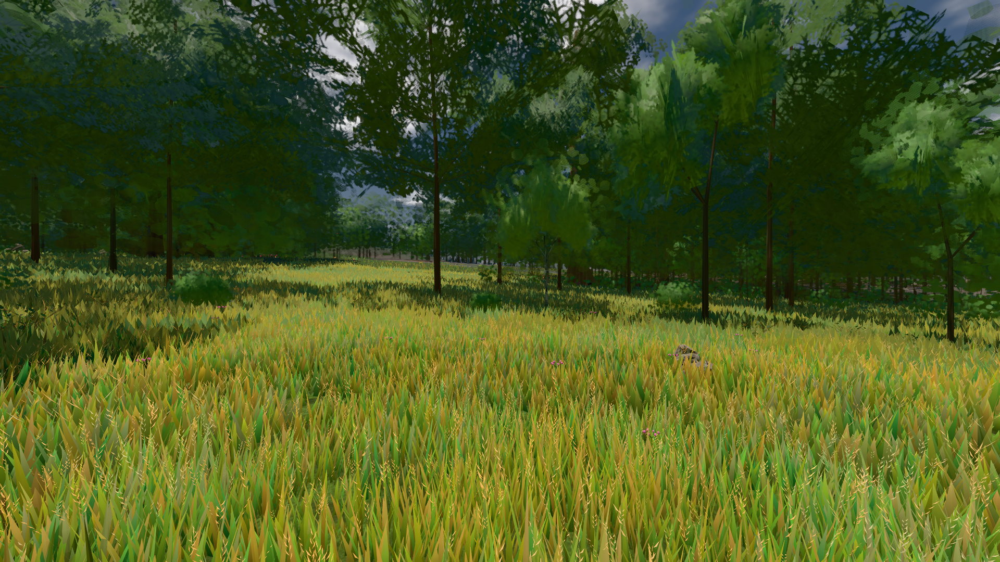

# GPU-PROBE 9375b6d2 — ROT

Zweig `w28-bestand-kennung` · Kopf 9375b6d2c5c266d79050a98c6fc41cae183ae693 · Läufer gtx1050-desktop + omen-gtx1060 (Band-Gerät) · 12.11. 06:20 · Wanduhr ab Push 610 s · Lauf https://github.com/MiguellD/AnazhRealm/actions/runs/43159614711

Ruf: `bild:wiese@0.5 zeit:gate:kreatur-takt`

## Läufer gtx1050-desktop — GRÜN

GPU NVIDIA GeForce GTX 1050 · npm ci 61 s (package-lock f5d79618)
Schloss /c/Users/User/AppData/Local/Temp/claude/gpu-schloss hält „ci-runner 43159614711/1 probe“
- Hook 2026-11-12 06:11:03 start ci-runner 43159614711/1 probe: Schloss genommen (refs/heads/w28-bestand-kennung 9375b6d2c5c266d79050a98c6fc41cae183ae693 ws=C:\actions-runner\_work\AnazhRealm\AnazhRealm)

### bild:wiese@0.5 — GRÜN · 88 s · Läufer gtx1050-desktop

Adapter: [linse-gpu] nvidia/pascal

```text
Kamera des Spiels → Blick (10.0 m): -280.40 29.71 -1045.60 -289.61 29.71 -1049.50
 "abnahme": "ABNAHME GRÜN · beweis · Sicht 0.0 % · Ziel Blickziel im Bild frei 10 m · Luma 82.2 σ 42.6 schwarz 0.0 % weiß 0.0 % · Stand 18.546.260 · Bühne summer sunny 0.50 Tiere gehalten · Gerät WebGPU nvidia pascal · Inhalt nahWiese 48.2 % (≥ 15.0 %) h 107° Luma 120",
```



## Läufer omen-gtx1060 (Band-Gerät) — ROT

GPU NVIDIA GeForce GTX 1060 · npm ci 50 s (package-lock f5d79618)
Schloss /c/Users/micha/AppData/Local/Temp/claude/gpu-schloss hält „ci-runner 43159614711/1 probe“
- Hook 2026-11-12 06:11:00 start ci-runner 43159614711/1 probe: wartet auf Schloss von 'omen-sg-check'
- Hook 2026-11-12 06:11:15 start ci-runner 43159614711/1 probe: Schloss genommen (refs/heads/w28-bestand-kennung 9375b6d2c5c266d79050a98c6fc41cae183ae693 ws=C:\actions-runner\_work\AnazhRealm\AnazhRealm)

### zeit:gate:kreatur-takt — ROT · 505 s · Läufer omen-gtx1060 (Band-Gerät)

Adapter: ungenannt (die Probe nannte keinen Browser-Adapter) · DECKEL 480 s

```text
       ✅ der Täter macht die Probe ROT und wird beim Namen genannt — die Linse sieht ihn
  ❌ bewohner  [Täter bewohner-wiederkehr] {"alsLeib":58,"schmiede10":2,"schmiede2":0,"tagTakt":12,"haeuser":18,"sollSumme":81,"leiber":80,"quote":0.988,"leer":["kirche gotisch #613181: 0 von 1"],"leerN":1,"imBlick":{"ego":16,"third":20},"nahLeiber":4,"planGleich":true,"trefferMin":0.188,"unter":["gasthaus/gasthaus #419347: 35 %","gasthaus/gasthaus #419347: 38 %","gasthaus/gasthaus #419347: 32 %","gasthaus/gasthaus #419347: 36 %","gasthaus/gasthaus #419347: 31 %"],"unterN":80,"stationen":2,"satzGang":{"schlupf":1,"wegLeib":3229.7},"blick":{"n":158,"quote":0.462,"sektorMax":1},"ohnePlatz":6,"
       ✅ der Täter macht die Probe ROT und wird beim Namen genannt — die Linse sieht ihn
  ❌ bewohner  [Täter bewohner-stadt-blind] {"alsLeib":58,"schmiede10":2,"schmiede2":0,"tagTakt":12,"haeuser":18,"sollSumme":81,"leiber":80,"quote":0.988,"leer":["kirche gotisch #613181: 0 von 1"],"leerN":1,"imBlick":{"ego":16,"third":20},"nahLeiber":4,"planGleich":true,"trefferMin":0.188,"unter":["gasthaus/gasthaus #419347: 35 %","gasthaus/gasthaus #419347: 38 %","gasthaus/gasthaus #419347: 32 %","gasthaus/gasthaus #419347: 36 %","gasthaus/gasthaus #419347: 31 %"],"unterN":80,"stationen":2,"satzGang":{"schlupf":1,"wegLeib":3229.7},"blick":{"n":158,"quote":0.462,"sektorMax":1},"ohnePlatz":6,
       ✅ der Täter macht die Probe ROT und wird beim Namen genannt — die Linse sieht ihn
  ❌ bewohner  [Täter bewohner-stadt-rempeln] {"alsLeib":58,"schmiede10":2,"schmiede2":0,"tagTakt":12,"haeuser":18,"sollSumme":81,"leiber":80,"quote":0.988,"leer":["kirche gotisch #613181: 0 von 1"],"leerN":1,"imBlick":{"ego":16,"third":20},"nahLeiber":4,"planGleich":true,"trefferMin":0.188,"unter":["gasthaus/gasthaus #419347: 35 %","gasthaus/gasthaus #419347: 38 %","gasthaus/gasthaus #419347: 32 %","gasthaus/gasthaus #419347: 36 %","gasthaus/gasthaus #419347: 31 %"],"unterN":80,"stationen":2,"satzGang":{"schlupf":1,"wegLeib":3229.7},"blick":{"n":158,"quote":0.462,"sektorMax":1},"ohnePlatz":
       ✅ der Täter macht die Probe ROT und wird beim Namen genannt — die Linse sieht ihn
✅ SELBST-TEST GRÜN — jeder Täter macht seine Probe rot und wird beim Namen genannt (12 Täter).
  ✅ bewohner  {"alsLeib":4,"schmiede10":2,"schmiede2":0,"tagTakt":0,"haeuser":18,"sollSumme":81,"leiber":81,"quote":1,"leer":[],"leerN":0,"imBlick":{"ego":16,"third":20},"nahLeiber":4,"planGleich":true,"trefferMin":0.983,"unter":[],"unterN":0,"stationen":2,"satzGang":{"schlupf":0.022,"wegLeib":1759},"blick":{"n":160,"quote":0.925,"sektorMax":0.119},"ohnePlatz":0,"ohnePlatzWer":[],"stapel":[],"huellen":18,"wege":{"wandN":0,"wand":[],"durch":266,"tuer":266,"falsch":[],"aufWeg":0.902,"sprungN":0,"wegeMin":5,"wegeMax":8,"streckeMin":192,"ausserN":0,"ausser":[],"kurzN":0,"kurz":[],"steckenN":0,"s
✅ GRÜN — bewohner
```
