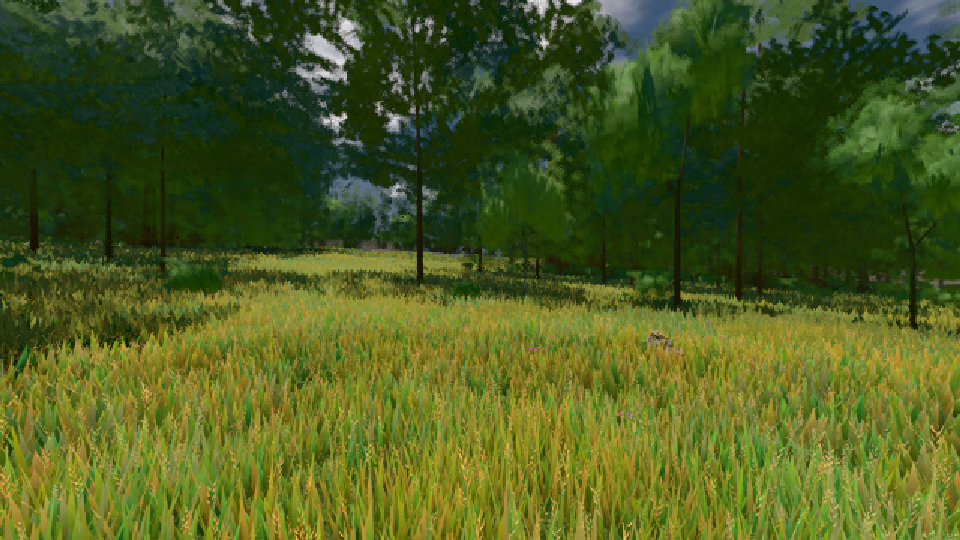
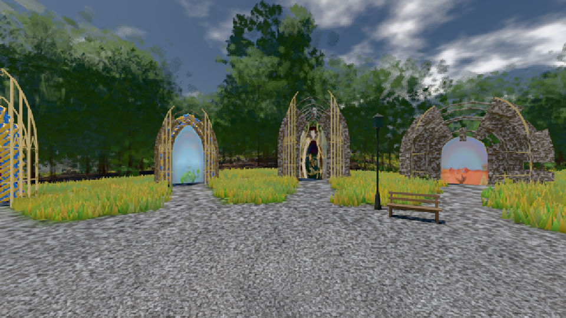

# GPU-PROBE 609fb453 — GRÜN

Zweig `w28-blatt-atlas-kalt` · Kopf 609fb453713b989000e374fe188f8a619c841e40 · Läufer radeon-890m · 11.11. 07:13 · Wanduhr ab Push 1062 s · Lauf https://github.com/MiguellD/AnazhRealm/actions/runs/42968896730

Ruf: `gate:boot-stage bild:wiese@0.5 bild:genesis@0.5`

## Läufer radeon-890m — GRÜN

GPU AMD Radeon(TM) 890M Graphics · npm ci 58 s (package-lock bf9cc5c4)
Schloss /c/Users/micha/AppData/Local/Temp/claude/gpu-schloss hält „ci-runner 42968896730/1 probe“
- Hook 2026-11-11 07:09:12 start ci-runner 42968896730/1 probe: Schloss genommen (refs/heads/w28-blatt-atlas-kalt 609fb453713b989000e374fe188f8a619c841e40 ws=C:\actions-runner\_work\AnazhRealm\AnazhRealm)

### gate:boot-stage — GRÜN · 24 s · Läufer radeon-890m

Adapter: ungenannt (die Probe nannte keinen Browser-Adapter)

```text
  ✅ BIBLIOTHEK warm (true) · IMPOSTOREN idle (true) · die Foundry stand in Takt 1, 0.1 s nach Pumpen-Beginn
  ✅ die BÜHNE wurde erreicht (das Prädikat schloss)
  ✅ DER INIT BAUT NICHTS VERBORGENES 
  ✅ SELBST-TEST: die Bühnen-Wahrheit der Welt (`_buehneSteht`) liest dieselbe Streu — ohne Regionen-Karte steht sie nicht, mit ihr steht sie
  ✅ SELBST-TEST: der Deckel der Bühne öffnet laut — ohne Regionen-Karte hinter BUEHNE_SETTLE_CAP_MS steht sie, das Log nennt die Lücke (WARN)
  ✅ SELBST-TEST: die verschluckte Lieferung ist ROT — LIEFERUNG kalt: 0 von 131 von der Platte (0.0 %) · Werk 115 · Haupt-Faden 6 · leer 10 · verschluckt 1
  ✅ SELBST-TEST: der Kern-Wechsel urteilt (fremder Neubau, alter Leser ROT)
  ✅ SELBST-TEST: synchron nach dem Bild ROT
  ✅ SELBST-TEST: der Deckel der Pumpe zählt Takte ab der Foundry, davor die Wanduhr
✅ „Volle Bühne" ist ein Prädikat — Kriterium 2 ist messbar.
```

### bild:wiese@0.5 — GRÜN · 54 s · Läufer radeon-890m

Adapter: [linse-gpu] amd/rdna-3

```text
Kamera des Spiels → Blick (10.0 m): -280.40 29.71 -1045.60 -289.61 29.71 -1049.50
 "abnahme": "ABNAHME GRÜN · beweis · Sicht 0.0 % · Ziel Blickziel im Bild frei 10 m · Luma 83.8 σ 40.2 schwarz 0.0 % weiß 0.0 % · Stand 18.546.250 · Bühne summer sunny 0.50 · Gerät WebGPU amd rdna-3",
```



### bild:genesis@0.5 — GRÜN · 45 s · Läufer radeon-890m

Adapter: [linse-gpu] amd/rdna-3

```text
Kamera des Spiels → Blick (10.0 m): 0.00 92.40 0.00 -10.00 92.40 0.00
 "abnahme": "ABNAHME GRÜN · beweis · Sicht 0.0 % · Ziel Blickziel im Bild frei 10 m · Luma 105.2 σ 39.9 schwarz 0.0 % weiß 0.0 % · Stand 18.546.250 · Bühne summer sunny 0.50 · Gerät WebGPU amd rdna-3",
```


