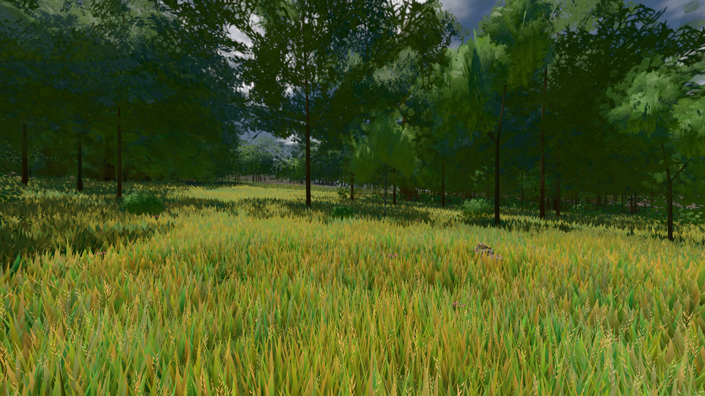

# GPU-PROBE 081eb7c2 — GRÜN

Zweig `w28-brand-flucht` · Kopf 081eb7c2c3c2fe899d880827f4adb3f464705f12 · Läufer gtx1050-desktop · 12.11. 07:54 · Wanduhr ab Push 150 s · Lauf https://github.com/MiguellD/AnazhRealm/actions/runs/43171110630

Ruf: `bild:wiese`

## Läufer gtx1050-desktop — GRÜN

GPU NVIDIA GeForce GTX 1050 · node_modules bleiben (package-lock db0dbb29)
Schloss /c/Users/User/AppData/Local/Temp/claude/gpu-schloss hält „ci-runner 43171110630/1 probe“
- Hook 2026-11-12 07:52:09 start ci-runner 43171110630/1 probe: Schloss genommen (refs/heads/w28-brand-flucht 081eb7c2c3c2fe899d880827f4adb3f464705f12 ws=C:\actions-runner\_work\AnazhRealm\AnazhRealm)

### bild:wiese — GRÜN · 99 s · Läufer gtx1050-desktop

Adapter: [linse-gpu] nvidia/pascal

```text
Kamera des Spiels → Blick (10.0 m): -280.40 29.71 -1045.60 -289.61 29.71 -1049.50
 "abnahme": "ABNAHME GRÜN · beweis · Sicht 0.0 % · Ziel Blickziel im Bild frei 10 m · Luma 82.2 σ 42.6 schwarz 0.0 % weiß 0.0 % · Stand 18.546.261 · Bühne summer sunny 0.50 Tiere gehalten · Gerät WebGPU nvidia pascal · Inhalt nahWiese 48.2 % (≥ 15.0 %) h 107° Luma 120",
```


