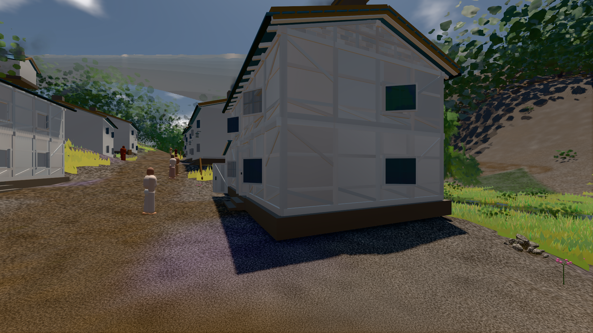

# GPU-PROBE d77047ba — GRÜN

Zweig `w28-buch-platte` · Kopf d77047ba523650f9ed057c9a496924536dbec8d1 · Läufer gtx1050-desktop · 11.11. 07:21 · Wanduhr ab Push 284 s · Lauf https://github.com/MiguellD/AnazhRealm/actions/runs/42971259458

Ruf: `gate:boot-stage bild:dorf@0.5`

## Läufer gtx1050-desktop — GRÜN

GPU NVIDIA GeForce GTX 1050 · npm ci 39 s (package-lock bf9cc5c4)
Schloss /c/Users/User/AppData/Local/Temp/claude/gpu-schloss hält „ci-runner 42971259458/1 probe“
- Hook 2026-11-11 07:16:40 start ci-runner 42971259458/1 probe: Schloss genommen (refs/heads/w28-buch-platte d77047ba523650f9ed057c9a496924536dbec8d1 ws=C:\actions-runner\_work\AnazhRealm\AnazhRealm)

### gate:boot-stage — GRÜN · 31 s · Läufer gtx1050-desktop

Adapter: ungenannt (die Probe nannte keinen Browser-Adapter)

```text
  ✅ BIBLIOTHEK warm (true) · IMPOSTOREN idle (true) · die Foundry stand in Takt 1, 0.2 s nach Pumpen-Beginn
  ✅ die BÜHNE wurde erreicht (das Prädikat schloss)
  ✅ DER INIT BAUT NICHTS VERBORGENES 
  ✅ SELBST-TEST: die Bühnen-Wahrheit der Welt (`_buehneSteht`) liest dieselbe Streu — ohne Regionen-Karte steht sie nicht, mit ihr steht sie
  ✅ SELBST-TEST: der Deckel der Bühne öffnet laut — ohne Regionen-Karte hinter BUEHNE_SETTLE_CAP_MS steht sie, das Log nennt die Lücke (WARN)
  ✅ SELBST-TEST: die verschluckte Lieferung ist ROT — LIEFERUNG kalt: 0 von 131 von der Platte (0.0 %) · Werk 115 · Haupt-Faden 6 · leer 10 · verschluckt 1
  ✅ SELBST-TEST: der Kern-Wechsel urteilt (fremder Neubau, alter Leser ROT)
  ✅ SELBST-TEST: synchron nach dem Bild ROT
  ✅ SELBST-TEST: der Deckel der Pumpe zählt Takte ab der Foundry, davor die Wanduhr
✅ „Volle Bühne" ist ein Prädikat — Kriterium 2 ist messbar.
```

### bild:dorf@0.5 — GRÜN · 161 s · Läufer gtx1050-desktop

Adapter: [linse-gpu] nvidia/pascal

```text
Kamera des Spiels → Blick (5.2 m): -704.22 39.69 -880.02 -703.03 39.69 -874.96
 "abnahme": "ABNAHME GRÜN · beweis · Sicht 0.0 % · Ziel Blickziel im Bild frei 5.2 m · Luma 78.7 σ 30.5 schwarz 0.2 % weiß 0.0 % · Stand 18.546.250 · Bühne summer sunny 0.50 · Gerät WebGPU nvidia pascal",
```


