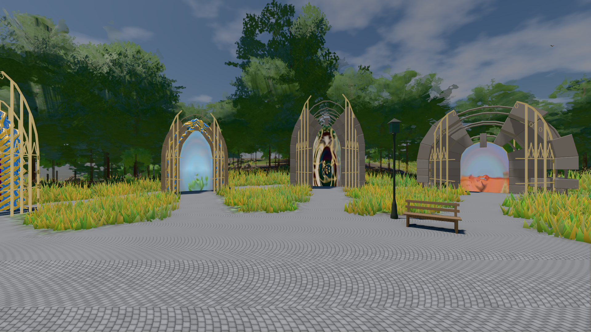

# GPU-PROBE 19ac21b3 — GRÜN

Zweig `w28-cull-weckruf` · Kopf 19ac21b3a80bb1ea351a656ad3b748b8345ab0e9 · Läufer omen-gtx1060 · 15.11. 17:41 · Wanduhr ab Push 372 s · Lauf https://github.com/MiguellD/AnazhRealm/actions/runs/43736297289

Ruf: `gate:boot-stage bild:genesis@0.5`

## Läufer omen-gtx1060 — GRÜN

GPU NVIDIA GeForce GTX 1060 · npm ci 56 s (package-lock 879ec483)
Schloss /c/Users/micha/AppData/Local/Temp/claude/gpu-schloss hält „ci-runner 43736297289/1 probe“
- Hook 2026-11-15 17:35:30 start ci-runner 43736297289/1 probe: wartet auf Schloss von 'omen-sg-schirm8'
- Hook 2026-11-15 17:36:25 start ci-runner 43736297289/1 probe: Schloss genommen (refs/heads/w28-cull-weckruf 19ac21b3a80bb1ea351a656ad3b748b8345ab0e9 ws=C:\actions-runner\_work\AnazhRealm\AnazhRealm)

### gate:boot-stage — GRÜN · 42 s · Läufer omen-gtx1060

Adapter: ungenannt (die Probe nannte keinen Browser-Adapter)

```text
  ✅ SELBST-TEST: das Buch, das sich noch öffnet, hält die Welt offen (`_weltOffen`) — ohne Rezepte ein Offenes mehr, mit ihnen wie zuvor
  ✅ SELBST-TEST: die verschluckte Lieferung ist ROT — LIEFERUNG kalt: 0 von 131 von der Platte (0.0 %) · Werk 115 · Haupt-Faden 6 · leer 10 · verschluckt 1
  ✅ SELBST-TEST: der Kern-Wechsel urteilt (fremder Neubau, alter Leser ROT)
  ✅ SELBST-TEST: synchron nach dem Bild ROT
  ✅ SELBST-TEST: der Abdruck urteilt — ein Körper der Platte mit den Bytes des alten Gesetzes ist GEFANGEN beim Namen (ALT UNTER NEUEM GESETZ), ein Treffer mit anderen Bytes, der den gewechselten Kern nie las, heißt NICHT BYTE-STABIL, ohne Messung fällt die Zeile
  ✅ SELBST-TEST: die Programm-Zeile urteilt (gleiche Bytes GRÜN, eine fremde Pipeline ROT beim Namen, ohne Messung ROT)
  ✅ SELBST-TEST: die Lücke je Kachel — der fehlende Busch reißt Kachel 0/0 (18.75 %), das Bildmittel (main, 0.39 %) hielte ihn
  ✅ SELBST-TEST: am Bild gezeichnet — ein wartender Bürger ist ROT beim Namen (Hauptbild und Wurf), ohne Messung ROT
  ✅ SELBST-TEST: die Ankunft bricht nicht — jeder Eintrag des Bruch-Buchs vor dem Bild ist ROT beim Wort, ohne Messung ROT, der EINE Sammler sah ihn
✅ „Volle Bühne" ist ein Prädikat — Kriterium 2 ist messbar.
```

### bild:genesis@0.5 — GRÜN · 55 s · Läufer omen-gtx1060

Adapter: [linse-gpu] nvidia/pascal

```text
Kamera des Spiels → Blick (10.0 m): 0.00 92.40 0.00 -10.00 92.40 0.00
 "abnahme": "ABNAHME GRÜN · beweis · Sicht 0.0 % · Ziel Blickziel im Bild frei 10 m · Luma 108 σ 39 schwarz 0.0 % weiß 0.0 % · Stand 18.546.293 · Bühne summer sunny 0.50 Tiere gehalten · Gerät WebGPU nvidia pascal · Inhalt bodenSatz 36.4 % (≥ 15.0 %) Luma 140, portal-membran 2.7 % (≥ 0.3 %) Luma 140",
```


