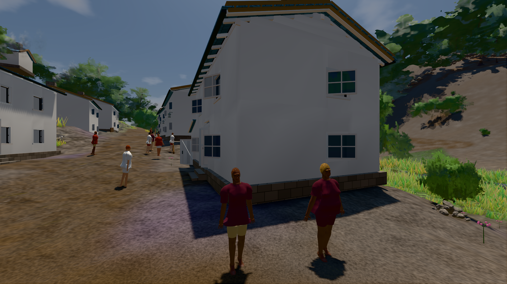

# GPU-PROBE 8ea58de7 — GRÜN

Zweig `w28-ein-schreiber-wand` · Kopf 8ea58de75167d2791414a22af6b2e63e2c4c8e99 · Läufer gtx1050-desktop · 19.11. 23:45 · Wanduhr ab Push 244 s · Lauf https://github.com/MiguellD/AnazhRealm/actions/runs/44631016506

Ruf: `bild:dorf@0.5`

## Läufer gtx1050-desktop — GRÜN

GPU NVIDIA GeForce GTX 1050 · node_modules bleiben (package-lock bd5d6c75)
Schloss /c/Users/User/AppData/Local/Temp/claude/gpu-schloss hält „ci-runner 44631016506/1 probe“
- Hook 2026-11-19 23:42:04 start ci-runner 44631016506/1 probe: wartet auf Schloss von 'hand werkbank stein-kopf (Claude)'
- Hook 2026-11-19 23:42:49 start ci-runner 44631016506/1 probe: Schloss genommen (refs/heads/w28-ein-schreiber-wand 8ea58de75167d2791414a22af6b2e63e2c4c8e99 ws=C:\actions-runner\_work\AnazhRealm\AnazhRealm)

### bild:dorf@0.5 — GRÜN · 154 s · Läufer gtx1050-desktop

Adapter: [linse-gpu] nvidia/pascal

```text
Kamera des Spiels → Blick (5.2 m): -704.22 39.69 -880.02 -703.01 39.69 -874.96
 "abnahme": "ABNAHME GRÜN · beweis · Sicht 0.0 % · Ziel Blickziel im Bild frei 5.2 m · Luma 75.8 σ 30.9 schwarz 0.2 % weiß 0.0 % · Stand 18.546.345 · Bühne summer sunny 0.50 Tiere gehalten · Gerät WebGPU nvidia pascal · Inhalt bauSatz 29.7 % (≥ 2.0 %) Luma 79",
```


