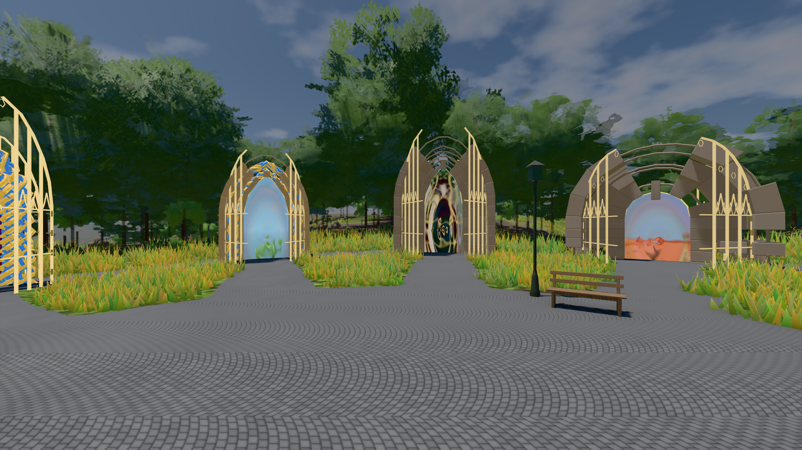
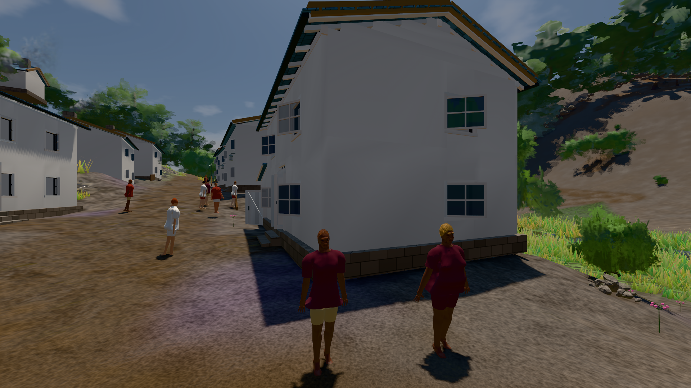

# GPU-PROBE b067531c — GRÜN

Zweig `w28-einheit-sicht` · Kopf b067531cb3820a6fd7d5e8838beec2dd7e5ee03b · Läufer radeon-890m · 20.11. 05:17 · Wanduhr ab Push 376 s · Lauf https://github.com/MiguellD/AnazhRealm/actions/runs/44672719110

Ruf: `gate:verdeckungs-abfrage bild:genesis@0.5 bild:dorf@0.5`

## Läufer radeon-890m — GRÜN

GPU AMD Radeon(TM) 890M Graphics · node_modules bleiben (package-lock 20e3f8f6)
Schloss /c/Users/micha/AppData/Local/Temp/claude/gpu-schloss hält „ci-runner 44672719110/1 probe“
- Hook 2026-11-20 05:12:30 start ci-runner 44672719110/1 probe: verwaistes Schloss 'punkte-radeon-sitzungpid=34888' geloest - Halter pid=34888 lebt nicht
- Hook 2026-11-20 05:12:32 start ci-runner 44672719110/1 probe: Schloss genommen (refs/heads/w28-einheit-sicht b067531cb3820a6fd7d5e8838beec2dd7e5ee03b ws=C:\actions-runner\_work\AnazhRealm\AnazhRealm)

### gate:verdeckungs-abfrage — GRÜN · 68 s · Läufer radeon-890m

Adapter: [linse-gpu] amd/rdna-3

```text
  ✅ Selbsttest „Verdeckt: Wache" → rot: VERDECKT GPU-WACHE 1×: three: Indirect buffer
  ✅ Selbsttest „Phase fehlt" → rot: FREI: Phase fehlt
  ✅ Selbsttest „Selbsttest blind sieht" → rot: SELBSTTEST VAKUÖS: der blinde frühe Zug zeichnete hinter der Wand nicht
  ✅ Selbsttest „Selbsttest ohne Spät heil" → rot: SELBSTTEST VAKUÖS: ohne späten Zug fehlte im ersten Bild kein Haufen
  ✅ Selbsttest „Selbsttest ohne Leser heil" → rot: SELBSTTEST VAKUÖS: ohne Leser-Bruch las jeder Leser den späten Zug
  ✅ Selbsttest „Selbsttest fehlt" → rot: SELBSTTEST fehlt
  ✅ Selbsttest „Abbruch" → rot: ABBRUCH: Renderer stand nicht
✅ SELBSTTEST GRÜN — 20 Fälle: jeder Täter, jede vakuöse Phase und jeder blinde Mutant beim Namen
  [32 s] GRÜN
✅ GRÜN — hinter der Wand 75 Haufen, 0 gezeichnet (5 Bilder mit Pyramide, jedes brach); die Wand fiel: im ersten Bild 75 früh verdeckt, 75 spät gezeichnet, 0 Pop gegen 69 eingeschwungene, das Abbild der Leser trägt 807 von 28800 Texeln des späten Zugs; blind fällt „HAUFEN TROTZ VOLLER VERDECKUNG GEZEICHNET“, ohne späten Zug „POP“, ohne Leser-Bruch „LESER OHNE SPÄTEN ZUG“ — 0 WebGPU-Validierungsfehler, 0 Seitenfehler.
```

### bild:genesis@0.5 — GRÜN · 61 s · Läufer radeon-890m

Adapter: [linse-gpu] amd/rdna-3

```text
Kamera des Spiels → Blick (10.0 m): 0.00 92.40 0.00 -10.00 92.40 0.00
 "abnahme": "ABNAHME GRÜN · beweis · Sicht 0.0 % · Ziel Blickziel im Bild frei 10 m · Luma 98.3 σ 35.9 schwarz 0.0 % weiß 0.0 % · Stand 18.546.346 · Bühne summer sunny 0.50 Tiere gehalten · Gerät WebGPU amd rdna-3 · Inhalt bodenSatz 36.9 % (≥ 15.0 %) Luma 109, portal-membran 2.7 % (≥ 0.3 %) Luma 139",
```



### bild:dorf@0.5 — GRÜN · 85 s · Läufer radeon-890m

Adapter: [linse-gpu] amd/rdna-3

```text
Kamera des Spiels → Blick (5.2 m): -704.22 39.69 -880.02 -703.01 39.69 -874.96
 "abnahme": "ABNAHME GRÜN · beweis · Sicht 0.0 % · Ziel Blickziel im Bild frei 5.2 m · Luma 76.1 σ 30.8 schwarz 0.2 % weiß 0.0 % · Stand 18.546.346 · Bühne summer sunny 0.50 Tiere gehalten · Gerät WebGPU amd rdna-3 · Inhalt bauSatz 29.7 % (≥ 2.0 %) Luma 80",
```


