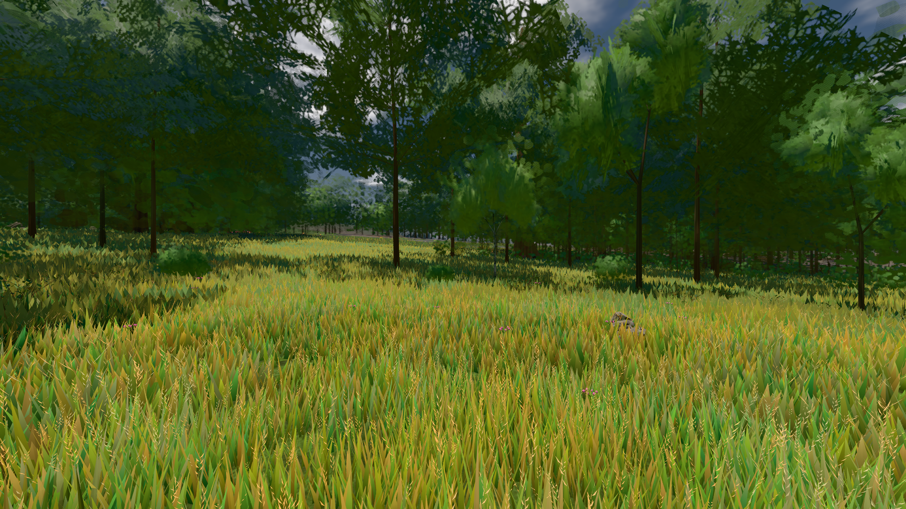

# GPU-PROBE eede46c2 — GRÜN

Zweig `w28-einstellung-kasten` · Kopf eede46c2dc31a6f9a18801d295eecc04c09d893c · Läufer radeon-890m · 12.11. 11:15 · Wanduhr ab Push 430 s · Lauf https://github.com/MiguellD/AnazhRealm/actions/runs/43197688609

Ruf: `bild:wiese@0.5`

## Läufer radeon-890m — GRÜN

GPU AMD Radeon(TM) 890M Graphics · npm ci 34 s (package-lock b254a196)
Schloss /c/Users/micha/AppData/Local/Temp/claude/gpu-schloss hält „ci-runner 43197688609/1 probe“
- Hook 2026-11-12 11:12:46 start ci-runner 43197688609/1 probe: Schloss genommen (refs/heads/w28-einstellung-kasten eede46c2dc31a6f9a18801d295eecc04c09d893c ws=C:\actions-runner\_work\AnazhRealm\AnazhRealm)

### bild:wiese@0.5 — GRÜN · 62 s · Läufer radeon-890m

Adapter: [linse-gpu] amd/rdna-3

```text
Kamera des Spiels → Blick (10.0 m): -280.40 29.71 -1045.60 -289.61 29.71 -1049.50
 "abnahme": "ABNAHME GRÜN · beweis · Sicht 0.0 % · Ziel Blickziel im Bild frei 10 m · Luma 82.2 σ 42.6 schwarz 0.0 % weiß 0.0 % · Stand 18.546.263 · Bühne summer sunny 0.50 Tiere gehalten · Gerät WebGPU amd rdna-3 · Inhalt nahWiese 48.2 % (≥ 15.0 %) h 107° Luma 120",
```


