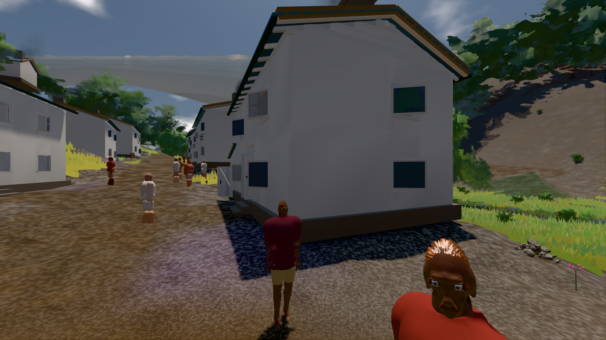

# GPU-PROBE e3c556e2 — GRÜN

Zweig `w28-fenster-leib` · Kopf e3c556e2023e05148a50f81cb395d334c490301c · Läufer gtx1050-desktop · 14.11. 04:53 · Wanduhr ab Push 372 s · Lauf https://github.com/MiguellD/AnazhRealm/actions/runs/43553386151

Ruf: `gate:kamera-leib:echt bild:dorf@0.5`

## Läufer gtx1050-desktop — GRÜN

GPU NVIDIA GeForce GTX 1050 · node_modules bleiben (package-lock 0868fe23)
Schloss /c/Users/User/AppData/Local/Temp/claude/gpu-schloss hält „ci-runner 43553386151/1 probe“
- Hook 2026-11-14 04:47:20 start ci-runner 43553386151/1 probe: Schloss genommen (refs/heads/w28-fenster-leib e3c556e2023e05148a50f81cb395d334c490301c ws=C:\actions-runner\_work\AnazhRealm\AnazhRealm)

### gate:kamera-leib:echt — GRÜN · 167 s · Läufer gtx1050-desktop

Adapter: [linse-gpu] nvidia/pascal

```text
  ✅ K6 Strafe am Prüfplatz — A0 Kopf 0.0 % Leib 1.4 % (2391 px),A1 Kopf 0.0 % Leib 0.7 % (2408 px),A2 Kopf 0.0 % Leib 1.7 % (2513 px),A3 Kopf 1.2 % Leib 0.7 % (2567 px),D0 Kopf 0.0 % Leib 1.9 % (2441 px),D1 Kopf 0.0 % Leib 0.7 % (2441 px),D2 Kopf 1.1 % Leib 1.3 % (2508 px),D3 Kopf 0.0 % Leib 0.8 % (2561 px) · Rückstrahl 0.1 %
✅ GRÜN — die Kamera steckt nie in Laub, Strauch, Fels oder Boden.
```

### bild:dorf@0.5 — GRÜN · 157 s · Läufer gtx1050-desktop

Adapter: [linse-gpu] nvidia/pascal

```text
Kamera des Spiels → Blick (5.2 m): -704.22 39.69 -880.02 -703.03 39.69 -874.96
 "abnahme": "ABNAHME GRÜN · beweis · Sicht 0.0 % · Leib im Vordergrund 2.8 % (Leib bewohner 2.8 %) · Ziel Blickziel im Bild frei 5.2 m · Luma 77 σ 31.8 schwarz 0.4 % weiß 0.0 % · Stand 18.546.277 · Bühne summer sunny 0.50 Tiere gehalten · Gerät WebGPU nvidia pascal · Inhalt bauSatz 29.3 % (≥ 2.0 %) Luma 78",
```


