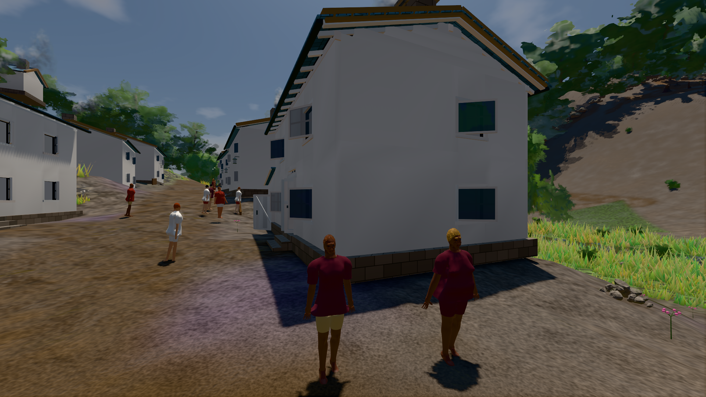

# GPU-PROBE b458b2d4 — GRÜN

Zweig `w28-funktion-welt` · Kopf b458b2d4e033fd16bab693ae790e495e815e83b6 · Läufer gtx1050-desktop · 18.11. 16:48 · Wanduhr ab Push 168 s · Lauf https://github.com/MiguellD/AnazhRealm/actions/runs/44339417412

Ruf: `bild:dorf@0.5`

## Läufer gtx1050-desktop — GRÜN

GPU NVIDIA GeForce GTX 1050 · node_modules bleiben (package-lock 9b0dd62a)
Schloss /c/Users/User/AppData/Local/Temp/claude/gpu-schloss hält „ci-runner 44339417412/1 probe“
- Hook 2026-11-18 16:46:22 start ci-runner 44339417412/1 probe: Schloss genommen (refs/heads/w28-funktion-welt b458b2d4e033fd16bab693ae790e495e815e83b6 ws=C:\actions-runner\_work\AnazhRealm\AnazhRealm)

### bild:dorf@0.5 — GRÜN · 122 s · Läufer gtx1050-desktop

Adapter: [linse-gpu] nvidia/pascal

```text
Kamera des Spiels → Blick (5.2 m): -704.22 39.69 -880.02 -703.03 39.69 -874.96
 "abnahme": "ABNAHME GRÜN · beweis · Sicht 0.0 % · Ziel Blickziel im Bild frei 5.2 m · Luma 77.7 σ 31 schwarz 0.2 % weiß 0.0 % · Stand 18.546.336 · Bühne summer sunny 0.50 Tiere gehalten · Gerät WebGPU nvidia pascal · Inhalt bauSatz 28.7 % (≥ 2.0 %) Luma 79",
```


