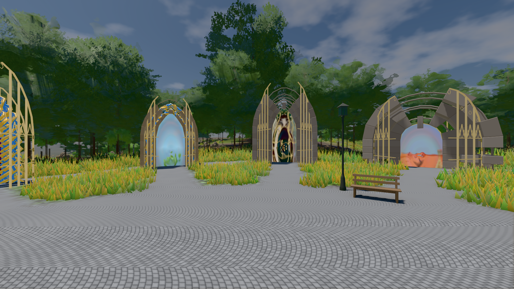
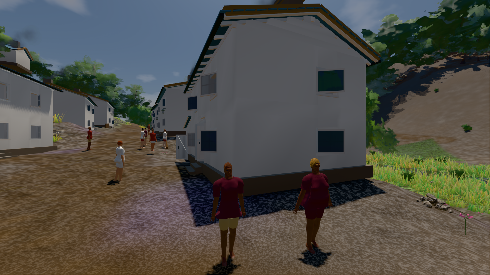

# GPU-PROBE 285780f3 — GRÜN

Zweig `w28-gesicht-grob` · Kopf 285780f380bc6f3563f1844e4737fbd56285c0ea · Läufer omen-gtx1060 · 15.11. 03:36 · Wanduhr ab Push 1577 s · Lauf https://github.com/MiguellD/AnazhRealm/actions/runs/43666474185

Ruf: `bild:genesis@0.5 bild:dorf@0.5 gate:kamera-leib:echt`

## Läufer omen-gtx1060 — GRÜN

GPU NVIDIA GeForce GTX 1060 · node_modules bleiben (package-lock 668076d3)
Schloss /c/Users/micha/AppData/Local/Temp/claude/gpu-schloss hält „ci-runner 43666474185/2 probe“
- Hook 2026-11-15 03:32:00 start ci-runner 43666474185/2 probe: wartet auf Schloss von 'omen-punkte-gtx-sitzung'
- Hook 2026-11-15 03:32:15 start ci-runner 43666474185/2 probe: Schloss genommen (refs/heads/w28-gesicht-grob 285780f380bc6f3563f1844e4737fbd56285c0ea ws=C:\actions-runner\_work\AnazhRealm\AnazhRealm)

### bild:genesis@0.5 — GRÜN · 54 s · Läufer omen-gtx1060

Adapter: [linse-gpu] nvidia/pascal

```text
Kamera des Spiels → Blick (10.0 m): 0.00 92.40 0.00 -10.00 92.40 0.00
 "abnahme": "ABNAHME GRÜN · beweis · Sicht 0.0 % · Ziel Blickziel im Bild frei 10 m · Luma 108 σ 39 schwarz 0.0 % weiß 0.0 % · Stand 18.546.291 · Bühne summer sunny 0.50 Tiere gehalten · Gerät WebGPU nvidia pascal · Inhalt bodenSatz 36.4 % (≥ 15.0 %) Luma 140, portal-membran 2.7 % (≥ 0.3 %) Luma 140",
```



### bild:dorf@0.5 — GRÜN · 79 s · Läufer omen-gtx1060

Adapter: [linse-gpu] nvidia/pascal

```text
Kamera des Spiels → Blick (5.2 m): -704.22 39.69 -880.02 -703.03 39.69 -874.96
 "abnahme": "ABNAHME GRÜN · beweis · Sicht 0.0 % · Ziel Blickziel im Bild frei 5.2 m · Luma 77.8 σ 31 schwarz 0.3 % weiß 0.0 % · Stand 18.546.291 · Bühne summer sunny 0.50 Tiere gehalten · Gerät WebGPU nvidia pascal · Inhalt bauSatz 28.7 % (≥ 2.0 %) Luma 80",
```



### gate:kamera-leib:echt — GRÜN · 79 s · Läufer omen-gtx1060

Adapter: [linse-gpu] nvidia/pascal

```text
  ✅ K6 Strafe am Prüfplatz — A0 Kopf 0.0 % Leib 1.4 % (2449 px),A1 Kopf 0.0 % Leib 1.1 % (2466 px),A2 Kopf 0.0 % Leib 1.6 % (2482 px),A3 Kopf 0.0 % Leib 1.1 % (2513 px),D0 Kopf 0.0 % Leib 2.5 % (2483 px),D1 Kopf 0.0 % Leib 1.0 % (2450 px),D2 Kopf 0.0 % Leib 0.8 % (2496 px),D3 Kopf 0.0 % Leib 1.1 % (2567 px) · Rückstrahl 0.1 %
✅ GRÜN — die Kamera steckt nie in Laub, Strauch, Fels oder Boden.
```
