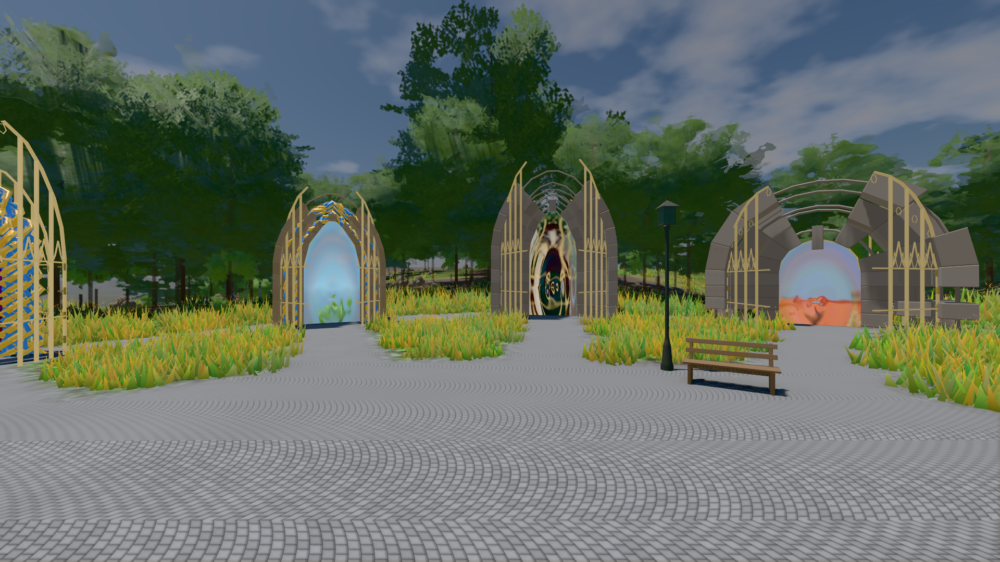
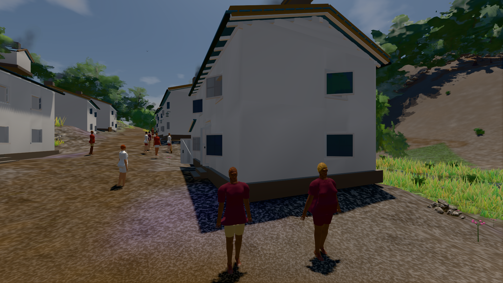

# GPU-PROBE 38727563 — ROT

Zweig `w28-gesicht-grob` · Kopf 38727563ec87cf11f6ff4f6178e9b3040acf6b45 · Läufer omen-gtx1060 · 15.11. 02:27 · Wanduhr ab Push 483 s · Lauf https://github.com/MiguellD/AnazhRealm/actions/runs/43662547519

Ruf: `bild:genesis@0.5 bild:dorf@0.5 gate:kamera-leib:echt`

## Läufer omen-gtx1060 — ROT

GPU NVIDIA GeForce GTX 1060 · npm ci 52 s (package-lock 668076d3)
Schloss /c/Users/micha/AppData/Local/Temp/claude/gpu-schloss hält „ci-runner 43662547519/1 probe“
- Hook 2026-11-15 02:19:57 start ci-runner 43662547519/1 probe: wartet auf Schloss von 'omen-sg-statik'
- Hook 2026-11-15 02:22:13 start ci-runner 43662547519/1 probe: Schloss genommen (refs/heads/w28-gesicht-grob 38727563ec87cf11f6ff4f6178e9b3040acf6b45 ws=C:\actions-runner\_work\AnazhRealm\AnazhRealm)

### bild:genesis@0.5 — GRÜN · 66 s · Läufer omen-gtx1060

Adapter: [linse-gpu] nvidia/pascal

```text
Kamera des Spiels → Blick (10.0 m): 0.00 92.40 0.00 -10.00 92.40 0.00
 "abnahme": "ABNAHME GRÜN · beweis · Sicht 0.0 % · Ziel Blickziel im Bild frei 10 m · Luma 108 σ 39 schwarz 0.0 % weiß 0.0 % · Stand 18.546.291 · Bühne summer sunny 0.50 Tiere gehalten · Gerät WebGPU nvidia pascal · Inhalt bodenSatz 36.4 % (≥ 15.0 %) Luma 140, portal-membran 2.7 % (≥ 0.3 %) Luma 140",
```



### bild:dorf@0.5 — GRÜN · 89 s · Läufer omen-gtx1060

Adapter: [linse-gpu] nvidia/pascal

```text
Kamera des Spiels → Blick (5.2 m): -704.22 39.69 -880.02 -703.03 39.69 -874.96
 "abnahme": "ABNAHME GRÜN · beweis · Sicht 0.0 % · Ziel Blickziel im Bild frei 5.2 m · Luma 77.8 σ 31 schwarz 0.3 % weiß 0.0 % · Stand 18.546.291 · Bühne summer sunny 0.50 Tiere gehalten · Gerät WebGPU nvidia pascal · Inhalt bauSatz 28.7 % (≥ 2.0 %) Luma 80",
```



### gate:kamera-leib:echt — ROT · 78 s · Läufer omen-gtx1060

Adapter: [linse-gpu] nvidia/pascal · ❌ K6 Strafe am Prüfplatz — A0 Kopf 0.0 % Leib 1.3 % (2468 px),A1 Kopf 0.0 % Leib 1.1 % (2456 px),A2 Kopf 0.0 % Leib 1.7 % (2490 px),A3 Kopf 5.8 % Leib 1.1 % (2509 px),D0 Kopf 0.0 % Leib 2.6 % (2489 px),D1 Kopf 0.0 % Leib — keine Station beim Namen

```text
  ❌ K6 Strafe am Prüfplatz — A0 Kopf 0.0 % Leib 1.3 % (2468 px),A1 Kopf 0.0 % Leib 1.1 % (2456 px),A2 Kopf 0.0 % Leib 1.7 % (2490 px),A3 Kopf 5.8 % Leib 1.1 % (2509 px),D0 Kopf 0.0 % Leib 2.6 % (2489 px),D1 Kopf 0.0 % Leib 0.9 % (2453 px),D2 Kopf 0.0 % Leib 0.9 % (2501 px),D3 Kopf 0.7 % Leib 1.3 % (2575 px) · Rückstrahl 0.1 % — Strafe: 1 von 8 Bildern durchsichtig — A3 Kopf 5.8 % Leib 1.1 % (2509 px)
❌ ROT — 1 Verletzung(en): K6 Strafe am Prüfplatz — A0 Kopf 0.0 % Leib 1.3 % (2468 px),A1 Kopf 0.0 % Leib 1.1 % (2456 px),A2 Kopf 0.0 % Leib 1.7 % (2490 px),A3 Kopf 5.8 % Leib 1.1 % (2509 px),D0 Kopf 0.0 % Leib 2.6 % (2489 px),D1 Kopf 0.0 % Leib 0.9 % (2453 px),D2 Kopf 0.0 % Leib 0.9 % (2501 px),D3 Kopf 0.7 % Leib 1.3 % (2575 px) · Rückstrahl 0.1 %
```
