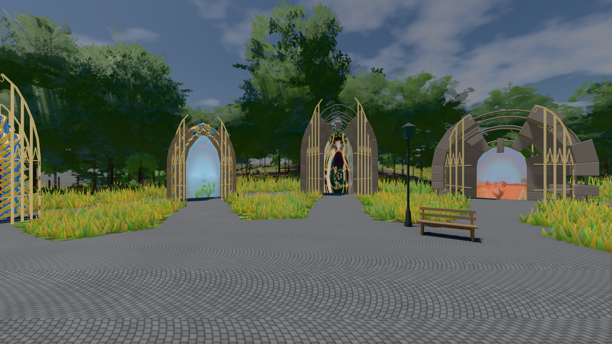

# GPU-PROBE bc619bf0 — GRÜN

Zweig `w28-graben-koerper` · Kopf bc619bf0116e4fb75324838c0de72f3f02026ac3 · Läufer gtx1050-desktop · 19.11. 00:44 · Wanduhr ab Push 148 s · Lauf https://github.com/MiguellD/AnazhRealm/actions/runs/44422946051

Ruf: `bild:genesis@0.5`

## Läufer gtx1050-desktop — GRÜN

GPU NVIDIA GeForce GTX 1050 · npm ci 37 s (package-lock 0e2c503b)
Schloss /c/Users/User/AppData/Local/Temp/claude/gpu-schloss hält „ci-runner 44422946051/1 probe“
- Hook 2026-11-19 00:42:10 start ci-runner 44422946051/1 probe: Schloss genommen (refs/heads/w28-graben-koerper bc619bf0116e4fb75324838c0de72f3f02026ac3 ws=C:\actions-runner\_work\AnazhRealm\AnazhRealm)

### bild:genesis@0.5 — GRÜN · 69 s · Läufer gtx1050-desktop

Adapter: [linse-gpu] nvidia/pascal

```text
Kamera des Spiels → Blick (10.0 m): 0.00 92.40 0.00 -10.00 92.40 0.00
 "abnahme": "ABNAHME GRÜN · beweis · Sicht 0.0 % · Ziel Blickziel im Bild frei 10 m · Luma 95.9 σ 33.2 schwarz 0.0 % weiß 0.0 % · Stand 18.546.339 · Bühne summer sunny 0.50 Tiere gehalten · Gerät WebGPU nvidia pascal · Inhalt bodenSatz 36.9 % (≥ 15.0 %) Luma 109, portal-membran 2.7 % (≥ 0.3 %) Luma 140",
```


