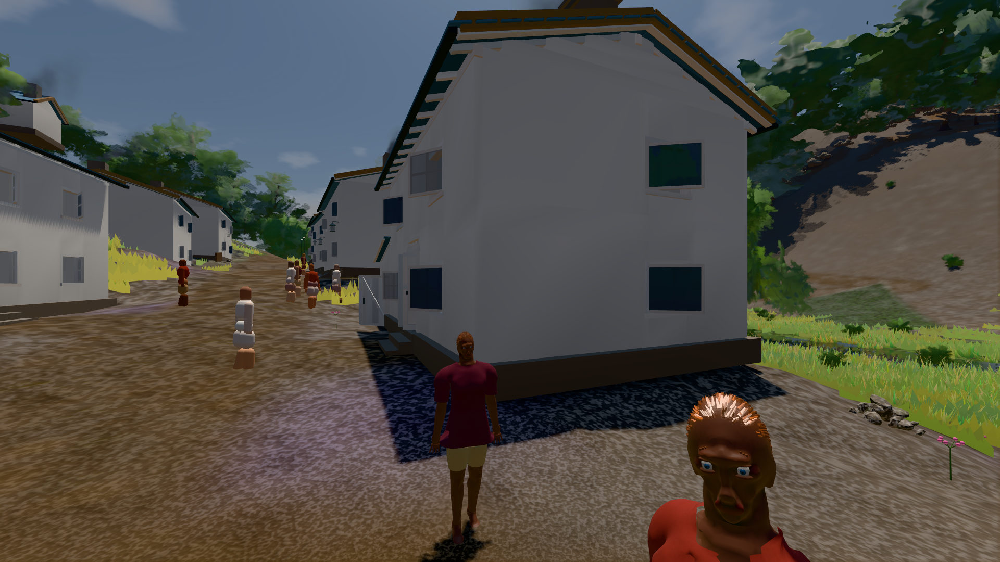

# GPU-PROBE 0c2a21b7 — GRÜN

Zweig `w28-gruendung-flach` · Kopf 0c2a21b7146bda895f50ef304e91c1f62ce9d249 · Läufer omen-gtx1060 · 14.11. 15:11 · Wanduhr ab Push 2392 s · Lauf https://github.com/MiguellD/AnazhRealm/actions/runs/43600238136

Ruf: `bild:dorf@0.5`

## Läufer omen-gtx1060 — GRÜN

GPU NVIDIA GeForce GTX 1060 · node_modules bleiben (package-lock 57539f97)
Schloss /c/Users/micha/AppData/Local/Temp/claude/gpu-schloss hält „ci-runner 43600238136/2 probe“
- Hook 2026-11-14 15:05:15 start ci-runner 43600238136/2 probe: wartet auf Schloss von 'omen-sg-haus-welt'
- Hook 2026-11-14 15:08:57 start ci-runner 43600238136/2 probe: Schloss genommen (refs/heads/w28-gruendung-flach 0c2a21b7146bda895f50ef304e91c1f62ce9d249 ws=C:\actions-runner\_work\AnazhRealm\AnazhRealm)

### bild:dorf@0.5 — GRÜN · 99 s · Läufer omen-gtx1060

Adapter: [linse-gpu] nvidia/pascal

```text
Kamera des Spiels → Blick (5.2 m): -704.22 39.69 -880.02 -703.03 39.69 -874.96
 "abnahme": "ABNAHME GRÜN · beweis · Sicht 0.0 % · Leib im Vordergrund 2.6 % (Leib bewohner 2.6 %) · Ziel Blickziel im Bild frei 5.2 m · Luma 77.1 σ 31.6 schwarz 0.4 % weiß 0.0 % · Stand 18.546.283 · Bühne summer sunny 0.50 Tiere gehalten · Gerät WebGPU nvidia pascal · Inhalt bauSatz 29.0 % (≥ 2.0 %) Luma 79",
```


