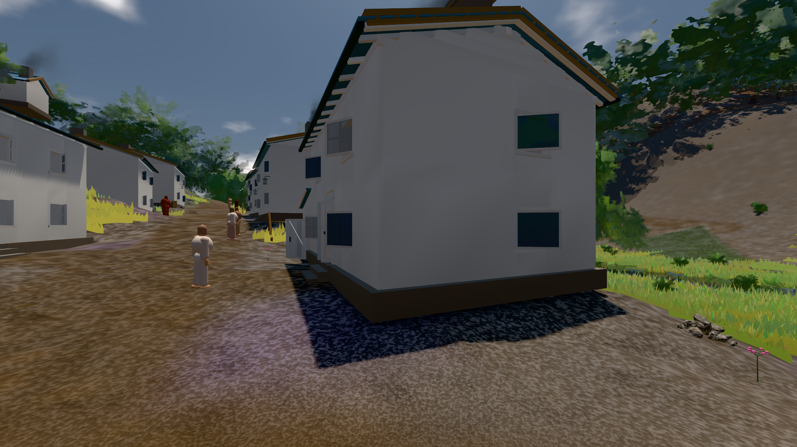

# GPU-PROBE 8f085847 — GRÜN

Zweig `w28-guss-bruch` · Kopf 8f085847c2f9158566f464e0784e11aa9243ef23 · Läufer radeon-890m · 13.11. 12:13 · Wanduhr ab Push 904 s · Lauf https://github.com/MiguellD/AnazhRealm/actions/runs/43413194174

Ruf: `bild:dorf@0.5`

## Läufer radeon-890m — GRÜN

GPU AMD Radeon(TM) 890M Graphics · npm ci 72 s (package-lock 0a5451f9)
Schloss /c/Users/micha/AppData/Local/Temp/claude/gpu-schloss hält „ci-runner 43413194174/1 probe“
- Hook 2026-11-13 12:04:25 start ci-runner 43413194174/1 probe: Schloss genommen (refs/heads/w28-guss-bruch 8f085847c2f9158566f464e0784e11aa9243ef23 ws=C:\actions-runner\_work\AnazhRealm\AnazhRealm)

### bild:dorf@0.5 — GRÜN · 89 s · Läufer radeon-890m

Adapter: [linse-gpu] amd/rdna-3

```text
Kamera des Spiels → Blick (5.2 m): -704.22 39.69 -880.02 -703.03 39.69 -874.96
 "abnahme": "ABNAHME GRÜN · beweis · Sicht 0.0 % · Ziel Blickziel im Bild frei 5.2 m · Luma 79.4 σ 30.7 schwarz 0.4 % weiß 0.0 % · Stand 18.546.270 · Bühne summer sunny 0.50 Tiere gehalten · Gerät WebGPU amd rdna-3 · Inhalt bauSatz 30.1 % (≥ 2.0 %) Luma 78",
```


