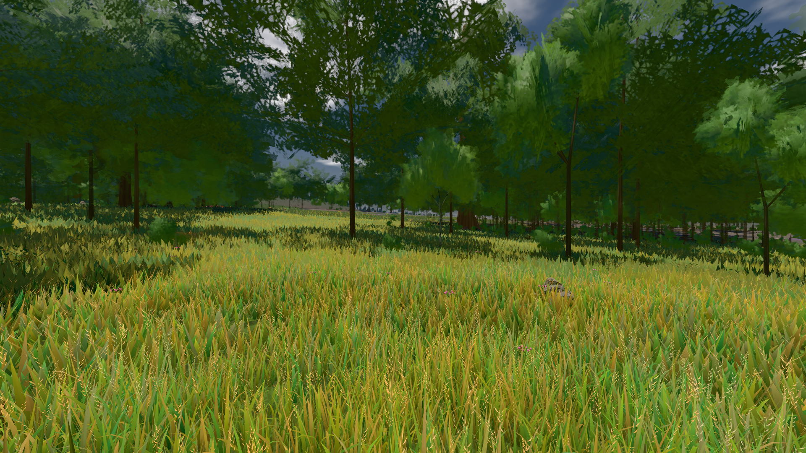

# GPU-PROBE ad773c23 — GRÜN

Zweig `w28-halm-trieb` · Kopf ad773c233639cf73c4e7a0797df1da4588538db8 · Läufer radeon-890m · 12.11. 19:21 · Wanduhr ab Push 283 s · Lauf https://github.com/MiguellD/AnazhRealm/actions/runs/43278154123

Ruf: `bild:wiese@0.5 gate:pop gate:nah-fern`

## Läufer radeon-890m — GRÜN

GPU AMD Radeon(TM) 890M Graphics · node_modules bleiben (package-lock 7bd472a8)
Schloss /c/Users/micha/AppData/Local/Temp/claude/gpu-schloss hält „ci-runner 43278154123/1 probe“
- Hook 2026-11-12 19:17:04 start ci-runner 43278154123/1 probe: wartet auf Schloss von 'punkte-radeon-sitzungpid=59152'
- Hook 2026-11-12 19:17:39 start ci-runner 43278154123/1 probe: Schloss genommen (refs/heads/w28-halm-trieb ad773c233639cf73c4e7a0797df1da4588538db8 ws=C:\actions-runner\_work\AnazhRealm\AnazhRealm)

### bild:wiese@0.5 — GRÜN · 55 s · Läufer radeon-890m

Adapter: [linse-gpu] amd/rdna-3

```text
Kamera des Spiels → Blick (10.0 m): -280.40 29.71 -1045.60 -289.61 29.71 -1049.50
 "abnahme": "ABNAHME GRÜN · beweis · Sicht 0.0 % · Ziel Blickziel im Bild frei 10 m · Luma 83 σ 39.9 schwarz 0.0 % weiß 0.0 % · Stand 18.546.267 · Bühne summer sunny 0.50 Tiere gehalten · Gerät WebGPU amd rdna-3 · Inhalt nahWiese 48.1 % (≥ 15.0 %) h 107° Luma 118",
```



### gate:pop — GRÜN · 86 s · Läufer radeon-890m

Adapter: ungenannt (die Probe nannte keinen Browser-Adapter)

```text
lod.K2#1 GRÜN 0.0381 % Pop-Pixel/s (790 px) · 40*+1@189/41*/45*+2@154/463*/80*/47*+2@192/38*+1@155/36*+1@189 · Laub 216 · dc, Dreiecke 99,426090 · GPU 42.02 ms, CPU 4.52 ms je Bild
BLOCK-TREUE GRÜN 233 Blöcke treu · Selbsttest nennt MeshStandardNodeMaterial · nahWiese:L1:0:0 · instanzFarbe: 1/880 Instanzen fremd
```

### gate:nah-fern — GRÜN · 47 s · Läufer radeon-890m

Adapter: ungenannt (die Probe nannte keinen Browser-Adapter)

```text
✅ SELBSTTEST GRÜN — das Nah-Fern-Urteil nennt die zwei Farben derselben Stelle beim Namen
✅ NAH-FERN GRÜN — EINE Boden-Farbe je Ort
```
