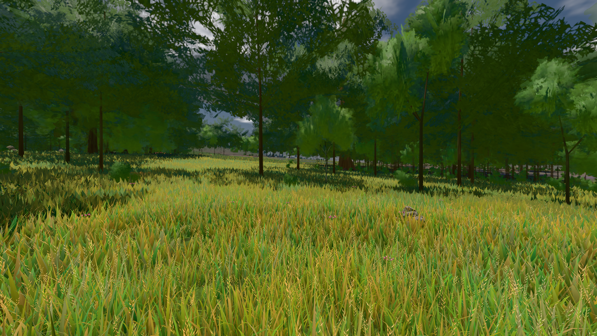

# GPU-PROBE f0b6b1a8 — GRÜN

Zweig `w28-halm-trieb` · Kopf f0b6b1a88b4101cd0700edd8bc8f49d4ca04fbc1 · Läufer gtx1050-desktop · 12.11. 20:11 · Wanduhr ab Push 420 s · Lauf https://github.com/MiguellD/AnazhRealm/actions/runs/43286400917

Ruf: `bild:wiese@0.5 gate:pop gate:nah-fern`

## Läufer gtx1050-desktop — GRÜN

GPU NVIDIA GeForce GTX 1050 · node_modules bleiben (package-lock 7bd472a8)
Schloss /c/Users/User/AppData/Local/Temp/claude/gpu-schloss hält „ci-runner 43286400917/1 probe“
- Hook 2026-11-12 20:04:54 start ci-runner 43286400917/1 probe: Schloss genommen (refs/heads/w28-halm-trieb f0b6b1a88b4101cd0700edd8bc8f49d4ca04fbc1 ws=C:\actions-runner\_work\AnazhRealm\AnazhRealm)

### bild:wiese@0.5 — GRÜN · 93 s · Läufer gtx1050-desktop

Adapter: [linse-gpu] nvidia/pascal

```text
Kamera des Spiels → Blick (10.0 m): -280.40 29.71 -1045.60 -289.61 29.71 -1049.50
 "abnahme": "ABNAHME GRÜN · beweis · Sicht 0.0 % · Ziel Blickziel im Bild frei 10 m · Luma 83.1 σ 39.4 schwarz 0.0 % weiß 0.0 % · Stand 18.546.267 · Bühne summer sunny 0.50 Tiere gehalten · Gerät WebGPU nvidia pascal · Inhalt nahWiese 48.1 % (≥ 15.0 %) h 107° Luma 118",
```



### gate:pop — GRÜN · 127 s · Läufer gtx1050-desktop

Adapter: ungenannt (die Probe nannte keinen Browser-Adapter)

```text
lod.K2#1 GRÜN 0.0306 % Pop-Pixel/s (635 px) · 28*+1@189/31*/386*+1@207/35*+1@154/19*/24*+2@192/67*+1@155/45*+1@189 · Laub 216 · dc, Dreiecke 99,424396 · GPU 43.91 ms, CPU 5.34 ms je Bild
BLOCK-TREUE GRÜN 233 Blöcke treu · Selbsttest nennt MeshStandardNodeMaterial · nahWiese:L1:0:0 · instanzFarbe: 1/893 Instanzen fremd
```

### gate:nah-fern — GRÜN · 89 s · Läufer gtx1050-desktop

Adapter: ungenannt (die Probe nannte keinen Browser-Adapter)

```text
✅ SELBSTTEST GRÜN — das Nah-Fern-Urteil nennt die zwei Farben derselben Stelle beim Namen
✅ NAH-FERN GRÜN — EINE Boden-Farbe je Ort
```
