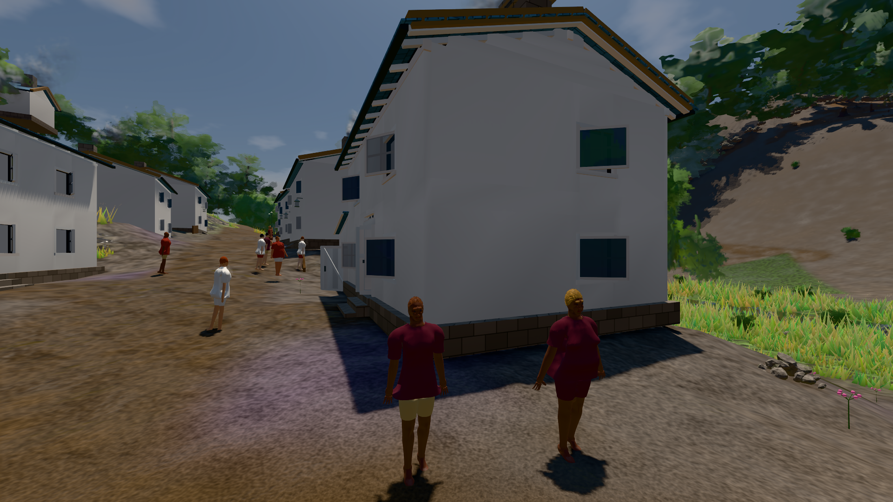

# GPU-PROBE 499b6926 — GRÜN

Zweig `w28-heap-zensus-2` · Kopf 499b6926d7d7f7e90566720495a448847c3afa09 · Läufer radeon-890m · 18.11. 13:54 · Wanduhr ab Push 522 s · Lauf https://github.com/MiguellD/AnazhRealm/actions/runs/44307066310

Ruf: `bild:dorf@0.5`

## Läufer radeon-890m — GRÜN

GPU AMD Radeon(TM) 890M Graphics · npm ci 59 s (package-lock a57f7437)
Schloss /c/Users/micha/AppData/Local/Temp/claude/gpu-schloss hält „ci-runner 44307066310/1 probe“
- Hook 2026-11-18 13:47:03 start ci-runner 44307066310/1 probe: Schloss genommen (refs/heads/w28-heap-zensus-2 499b6926d7d7f7e90566720495a448847c3afa09 ws=C:\actions-runner\_work\AnazhRealm\AnazhRealm)

### bild:dorf@0.5 — GRÜN · 84 s · Läufer radeon-890m

Adapter: [linse-gpu] amd/rdna-3

```text
Kamera des Spiels → Blick (5.2 m): -704.22 39.69 -880.02 -703.03 39.69 -874.96
 "abnahme": "ABNAHME GRÜN · beweis · Sicht 0.0 % · Ziel Blickziel im Bild frei 5.2 m · Luma 77.8 σ 30.9 schwarz 0.2 % weiß 0.0 % · Stand 18.546.335 · Bühne summer sunny 0.50 Tiere gehalten · Gerät WebGPU amd rdna-3 · Inhalt bauSatz 28.7 % (≥ 2.0 %) Luma 80",
```


